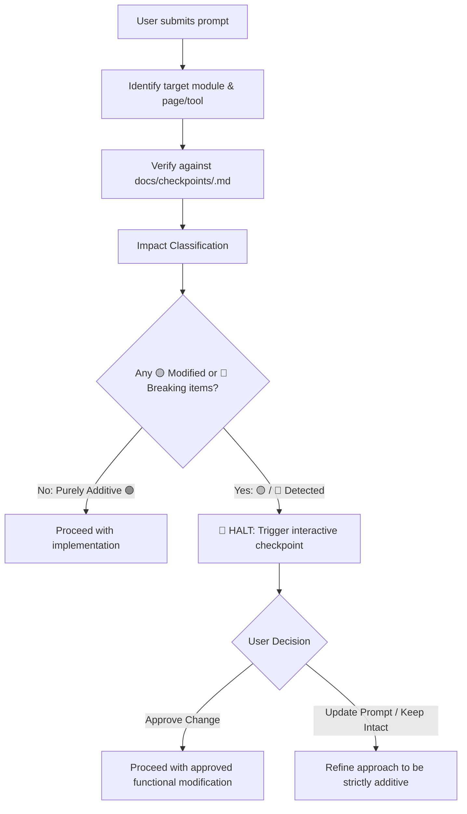

# Portfolio Platform Invariant & Checkpoint Architecture

This directory houses the comprehensive, **page-by-page and view-by-view functional specifications** for every module in the application. These documents serve as living baseline contracts to prevent unwanted regressions and ensure new features are strictly additive.

---

## 📂 Complete Module Catalog & Page Inventories

| Module | Specification Document | Page & View Inventory | Key Logics & Validations Covered |
|---|---|---|---|
| **Dev Tools** | [`dev-tools-module.md`](file:///e:/Code/portfolio/docs/checkpoints/dev-tools-module.md) | **24 Tools** across 5 categories: • Calculators (3 tools) • Formatters (4 tools) • Converters (5 tools) • Generators (7 tools) • Security/Tokens (5 tools) | • 100% client-side privacy guarantee • Percentage & Experience interval math • ReDoS protected regex engine • JWT expiry calculations • Number base real-time conversions |
| **User** | [`user-module.md`](file:///e:/Code/portfolio/docs/checkpoints/user-module.md) | **10 Dedicated Pages**: • Sign In (`/login`) • Profile Hub (`/user`) • No Modules (`/no-modules`) • AI Assistant (`/ai`) • AI Workspace (`/chat`) • File Manager (`/files`) • Diet & Hydration (`/diet-hydration`) • Master Admin (5 tabs) • Telugu Movie Guesser (`/game`) • Barricade Board Game (`/barricade`) | • Destination resolution logic (`0 / 1 / 2+` modules) • Feature flag permissions gating (`user.modules`) • Movie guesser TTS clues & streak multipliers • File storage quotas & preview modal • Calorie/macro math & midnight water resets |
| **Royal Rentals (RR)** | [`rr-module.md`](file:///e:/Code/portfolio/docs/checkpoints/rr-module.md) | **13 Pages & 4 Dialogs**: • Public Vehicle Showcase • Staff Login • Stats Dashboard • Active Bookings • Advance Bookings • Vehicle Inventory • Customer Directory • Activity Audit Logs • Announcements & Home CMS | • Finalize return settlement: 5 scenarios (Case 1 to 4.2) • Extra KM, extra hour & non-intimation fines • Real-time vehicle schedule conflict engine • 4 deposit options (`none`, `bike`, `cash`, `other`) • Inactivity dashboard session auto-lock |
| **Planner** | [`planner-module.md`](file:///e:/Code/portfolio/docs/checkpoints/planner-module.md) | **5 Views & 2 Dialogs**: • Header & Filter Bar • Kanban Board • Compact Task Checklist • Notes Workspace • Collaborative Projects • Task Form Sheet • Reminder Dialog | • Strict priority sort order (`urgent ➔ low`) • Pinned note precedence (`isPinned`) • Kanban drag-and-drop fractional `orderIndex` • Granular collaborative permissions (`IProjectPermissions`) • Instant offline cache & Chrome Extension badge sync |
| **Portfolio** | [`portfolio-module.md`](file:///e:/Code/portfolio/docs/checkpoints/portfolio-module.md) | **8 Cohesive Sections**: • Hero Banner • Professional Summary • Categorized Skills • Career Experience Timeline • Education Credentials • Projects Showcase • Verified Certificates • Awards & Honors | • Zero-auth public access invariant • CDK BreakpointObserver column calculation (1 vs 2 cols) • Dynamic SEO metadata & JSON-LD structured schema • Intersection Observer navigation scrollspy • Light/Dark theme persistence |

---

## 🚦 The Pre-Implementation Gate Protocol

Before executing any code modification, the AI assistant runs the prompt against the relevant module's page-by-page specification:

---

## 📋 Impact Classification Legend
- 🟢 **Additive (Auto-Proceed)**: New tools, new sub-components, new routes, or non-conflicting additions.
- 🟡 **Behavioral Modification (Requires User Gate)**: Changing formulas, modifying default statuses, altering KYC rules, or changing UI order.
- 🔴 **Breaking Change (Requires User Gate)**: Deleting routes, removing features, changing API contracts, or breaking existing test assertions.
