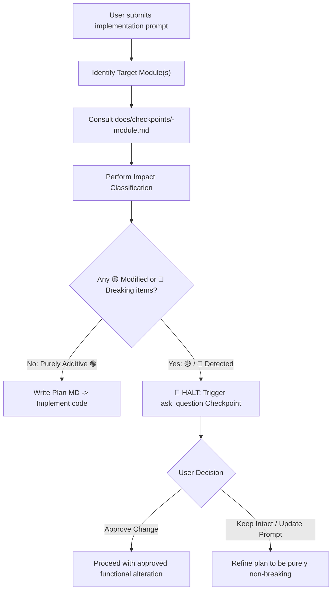

# Portfolio Module Checkpoint System

This directory houses the **Module Checkpoints & Invariant Specifications** designed to guarantee zero unwanted regressions and ensure new features are strictly additive.

---

## 📂 Registered Module Checkpoints

| Module | Specification File | Scope & Invariants |
|---|---|---|
| **User** | [`user-module.md`](file:///e:/Code/portfolio/docs/checkpoints/user-module.md) | Auth guards, module feature permissions, profile workspace, shared games |
| **Royal Rentals (RR)** | [`rr-module.md`](file:///e:/Code/portfolio/docs/checkpoints/rr-module.md) | Fleet management, public showcase, booking workflow, staff dashboard |
| **Portfolio** | [`portfolio-module.md`](file:///e:/Code/portfolio/docs/checkpoints/portfolio-module.md) | Public personal portfolio, section anchors, SEO, responsive UI, theme |
| **Planner** | [`planner-module.md`](file:///e:/Code/portfolio/docs/checkpoints/planner-module.md) | Kanban, Compact task list, markdown notes, projects, reminders, Web & Chrome Extension sync |

---

## 🚦 The Two-Phase Checkpoint Workflow

Whenever an implementation prompt is submitted:

---

## 📋 Impact Classification Legend
- 🟢 **Additive (Auto-Proceed)**: New files, new methods, new routes, non-conflicting UI additions.
- 🟡 **Behavioral Modification (Requires User Checkpoint)**: Changing existing logic, altering UI layout order, modifying shared services.
- 🔴 **Breaking Change (Requires User Checkpoint)**: Altering public APIs, deleting routes, dropping data fields, changing auth requirements.
