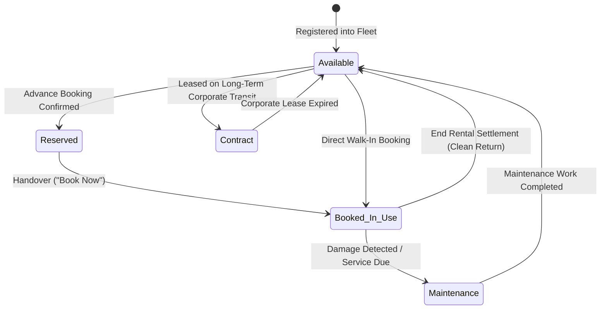
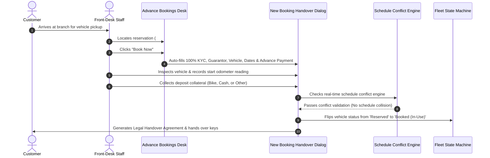
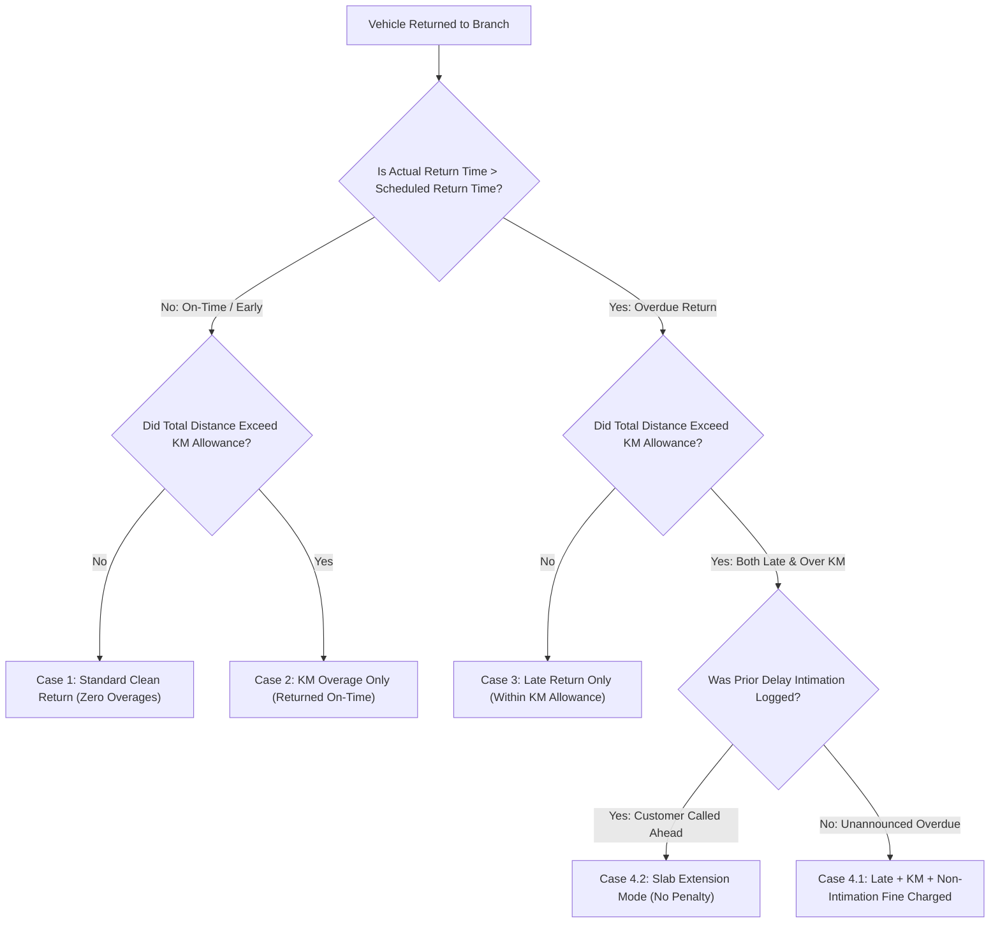

# Comprehensive Business Requirements Specification & Handover Document
## Module: Royal Rentals (RR) Fleet & Booking Operations Platform

**Document Version**: 2.0.0 (Exhaustive Specification)  
**Target Audience**: Business Analyst (BA), Product Owner, Operations Director, Compliance Officer  
**Purpose**: Complete baseline functional specification, mathematical formulas, KYC validation constraints, and business rule sign-off  
**Document Status**: Open for BA Review, Rule Confirmation & Modification  
**Date**: October 2026  

---

## 📋 Instructions for Business Analyst (BA)
> [!IMPORTANT]
> This document details **every single operational screen, mathematical formula, input validation, security constraint, and state machine** implemented in the **Royal Rentals (RR)** platform.
> 
> - **How to Review**: Read through each section. All mathematical formulas, validation regular expressions, and business policies are explicitly stated.
> - **How to Request Changes**: If you wish to change any formula, rate, fee, loyalty discount, fine amount, validation rule, or workflow, enter your modified specification directly in **Section 8: Comprehensive BA Sign-Off & Change Request Matrix**.
> - **Handoff Back to Engineering**: Once you complete your review, return this document (or Section 8). Engineering will automatically update the Angular application code, automated Playwright/Vitest test suites, and checkpoint guardrails to match your exact specifications.

---

## 1. System Overview & User Persona Matrix

Royal Rentals is an end-to-end car rental operations and fleet management platform catering to public self-drive customers, local city transit, long-distance interstate travel, and corporate fleet leases.

### User Personas & Access Boundaries

| Persona | Authentication Required | Accessible Routes / Screens | Primary Responsibilities |
|---|:---:|---|---|
| **Public Customer** | ❌ None | • Public Homepage (`/user/rr` / `/user/rr/home`)<br>• Fleet Browse & Details Modal<br>• Advance Inquiry Dialog | Browsing vehicles, filtering by seating/fuel, viewing pricing slabs, reviewing offers, submitting reservation inquiries. |
| **Desk Staff (`employee`)** | ✅ Staff Auth (`empId` + `dob`) | • Operations Dashboard (`/user/rr/dashboard`)<br>• Active Rentals (`/user/rr/booking/list`)<br>• Advance Desk (`/user/rr/booking/advance`)<br>• Vehicle Inventory (`/user/rr/vehicle/list`)<br>• Customer Directory (`/user/rr/customer/list`) | Creating walk-in rentals, checking out vehicles, logging delay notices, collecting security deposits, performing return check-in settlements, and printing legal agreements. |
| **Branch Admin (`admin`)** | ✅ Admin Auth (`username` + `password`) | **All of the above, PLUS:**<br>• Staff Directory (`/user/rr/employee/list`)<br>• Rental History Archive (`/user/rr/history`)<br>• Activity Audit Logs (`/user/rr/activity-logs`)<br>• Announcements & Ticker (`/user/rr/announcements`)<br>• Homepage CMS Editor (`/user/rr/home-content`) | Fleet pricing adjustments, insurance/pollution tracking, employee account activation, password resets, financial audit review, CMS content updates. |

---

## 2. Global Security & Operational Invariants

### 1. Inactivity Session Lock (`RRInactivityService` & `RRLockScreenComponent`)
- **Timeout Threshold**: Strictly **5 minutes (300,000 ms)** of continuous idle time across staff terminals.
- **Monitored Activity**: Mouse movement, key presses, touch taps, window scrolling, and mouse clicks (throttled at 1,500ms to eliminate CPU overhead).
- **Behavior on Expiry**:
  - Immediately marks `rr_session_is_locked = 'true'` in local/session storage.
  - Overlays `RRLockScreenComponent` on top of the dashboard, concealing customer KYC and billing figures.
  - Form drafts currently being entered by desk agents are **preserved in memory**.
  - Staff must enter their password to unlock. Password is authenticated in-place via `RRApiService.verifyPassword()` and dismisses the lock overlay without reloading the page.
- **Cross-Tab & Desktop Synchronization**: The lock event synchronizes across multiple open browser tabs, the Chrome Extension storage, and desktop wrappers.

### 2. Mandatory Password Policy & Credential Lifecycle Engine
- **Evaluation Engine**: Evaluates `policyState` signal: monitors `passwordAgeDays`, `passwordExpiresInDays`, `mustChangePassword`, `isExpired`, and `isBufferPeriod`.
- **Rotation Cycle**: Passwords expire automatically after **90 days** (`passwordAgeDays >= 90`).
- **15-Day Buffer Period**: When `passwordExpiresInDays <= 15`, staff are greeted with a dismissible warning banner prompting them to rotate credentials ahead of expiration.
- **Mandatory Hard Lockout on Expiry**: Once `isExpired === true`, the system forces an unclosable modal dialog (`passwordPolicyDialog`) requiring the staff member to set a new password ($\ge$ 6 characters) before any further dashboard actions can be executed.
- **Failed Login Lockout Policy**: Tracks `failedLoginAttempts`. After 5 consecutive invalid authentication attempts, the staff account is locked out temporarily (`lockoutUntil`), preventing brute-force dictionary attacks.
- **Administrative Key Reset**: Branch Administrators have authority in `/user/rr/employee/list` to trigger `resetEmployeePasswordKey`, generating a one-time credential initialization token.

### 3. AES-256 Storage Envelopes
- All JWT authentication tokens, staff session profiles, and role structures are encrypted in browser storage using AES-256 (`portfolio_rr_secure_session_v1`) through `createStorageEnvelope` and verified via `verifyStorageEnvelope`.

### 4. Immutable Audit Trail
- Every single operational event (booking creation, modification, vehicle check-in settlement, cancellation, staff login, customer delay intimation) generates a tamper-evident audit record in `RRActivityLogsComponent`.

---

## 3. End-to-End Operational Workflows (State Machines)

### A. Vehicle Status Lifecycle
A vehicle strictly exists in one of the following states:



- **Business Rule**: A vehicle marked as `Booked_In_Use`, `Maintenance`, or `Contract` is strictly excluded from public availability and cannot be selected for new bookings without override authorization.

---

### B. Advance Booking to Active Rental Handover Pipeline



---

## 4. Comprehensive Mathematical Formulas & Pricing Rules

### A. Vehicle Pricing Slabs (`IVehiclePricing`)
Every vehicle defines four discrete duration tiers with built-in kilometer allowances:

| Tier Code | Duration Window | Pricing Model | Base KM Allowance | Surcharge / Overage Rates |
|---|---|---|---|---|
| **`h23`** | Full Day (24 Hours) | Fixed Daily Rent (e.g. ₹2,500 – ₹4,500) | 300 KM / day | `extraKmPrice`: ₹12 – ₹16 / excess km<br>`extraHourPrice`: ₹150 – ₹200 / excess hour |
| **`h11`** | Half Day (12 Hours) | Fixed Half-Day Rent (e.g. ₹1,600 – ₹3,000) | 150 KM | Standard excess KM / hour rates apply |
| **`h3`** | Short Trip (4 Hours) | Fixed 4-Hour Rent (e.g. ₹900 – ₹1,600) | 60 KM | Standard excess KM / hour rates apply |
| **`h1`** | Micro Trip (1 Hour) | Fixed Hourly Rate (e.g. ₹400 – ₹700) | 20 KM | Standard excess KM / hour rates apply |

#### Rental Duration & Base Rent Resolution Rules:
1. **Durations Under 24 Hours**:
   - The system automatically selects the lowest covering tier:
     - Duration $\le$ 1 hour $\rightarrow$ Billed at `h1` tier.
     - Duration 1–4 hours $\rightarrow$ Billed at `h3` tier.
     - Duration 4–12 hours $\rightarrow$ Billed at `h11` tier.
     - Duration 12–24 hours $\rightarrow$ Billed at `h23` tier.
2. **Durations Greater Than 24 Hours**:
   $$\text{Full Days} = \left\lfloor \frac{\text{Total Duration Hours}}{24} \right\rfloor$$
   $$\text{Remaining Hours} = \text{Total Duration Hours} \pmod{24}$$
   $$\text{Base Rent} = (\text{Full Days} \times \text{h23.price}) + \text{Price}(\text{Remaining Hours Tier})$$
   $$\text{Total KM Limit} = (\text{Full Days} \times \text{h23.km}) + \text{KM}(\text{Remaining Hours Tier})$$

---

### B. Discount Calculation Models
The system supports three distinct discount mechanisms:
1. **Flat Rupee Discount (`discountType === 'rupee'`)**:
   $$\text{Final Rental Amount} = \text{Total Rental Amount} - \text{Discount Amount}$$
2. **Percentage Discount (`discountType === 'percentage'`)**:
   $$\text{Discount Value} = \frac{\text{Total Rental Amount} \times \text{Discount Percent}}{100}$$
   $$\text{Final Rental Amount} = \text{Total Rental Amount} - \text{Discount Value}$$
3. **Customer Loyalty Tier Automatic Discounts (`ICustomerMembershipDiscount`)**:
   - `Standard Tier`: **0%** discount.
   - `Silver Tier`: **5%** automatic discount on base rental.
   - `Gold Tier`: **10%** automatic discount on base rental.
   - `Platinum / VIP Tier`: **15%** automatic discount on base rental.
   - *Note: If a customer has an active membership tier, the system auto-applies this discount upon customer lookup.*

---

### C. Security Deposit Policies & Collateral Options
At handover, the desk agent must log one of four mandatory deposit options:

| Deposit Option | Mandatory Required Documentation | Return / Refund Settlement Rule |
|---|---|---|
| **Cash** | Exact positive cash amount (e.g. ₹5,000) | Refunded in cash or adjusted against pending balance / damage deductions upon check-in. |
| **Two-Wheeler (Bike)** | Bike Registration No, Manufacturer, Model, and Registered Owner Name | Physical motorcycle keys and copy of RC book safeguarded at branch; returned at vehicle check-in. |
| **Other Collateral** | Item Name & Estimated Market Value (e.g. Original Passport, Electronics) | Kept in branch safe; returned upon successful check-in. |
| **None** | Authorized exclusively for repeat VIP members or corporate accounts | Zero upfront collateral collected. |

---

### D. Vehicle Return & Settlement Scenarios (`RREndBookingDialogComponent`)

When a vehicle is checked back into the branch, the system evaluates the return state against **5 operational scenarios**:



#### Detailed Calculations per Scenario:

#### Case 1: Standard Clean Return (On-Time / Early, Within KM Allowance)
- **Extra Hours Fee**: ₹0.
- **Extra KM Fee**: ₹0.
- **Non-Intimation Fine**: ₹0.
- Only base rent, cleanliness fee (if dirty), and tolls/challanas apply.

#### Case 2: Kilometer Overage Only (Returned On-Time, KM Limit Exceeded)
$$\text{Actual Distance Driven} = \text{Odometer End} - \text{Odometer Start}$$
$$\text{Extra KM} = \max(0, \text{Actual Distance Driven} - \text{Total Allowed KM})$$
$$\text{Extra KM Fee} = \text{Extra KM} \times \text{vehicle.extraKmPrice}$$
- **Extra Hour Fee**: ₹0.
- **Non-Intimation Fine**: ₹0.

#### Case 3: Late Return Only (Extra Hours Taken, Within KM Allowance)
$$\text{Extra Hours} = \lceil (\text{Actual Return Time} - \text{Scheduled Return Time}) / 1 \text{ hr} \rceil$$
$$\text{Extra Hour Fee} = \text{Extra Hours} \times \text{vehicle.extraHourPrice}$$
- **Extra KM Fee**: ₹0.
- **Non-Intimation Fine**: ₹0.

#### Case 4.1: Unannounced Delay + KM Overage (Both Limits Exceeded Without Notice)
- Applies both `extraHourFee` and `extraKmFee`.
- **Non-Intimation Fine**: Charged automatically (Default: **₹1,000 flat**, configurable, uncapped) because the customer failed to notify the branch in advance.

#### Case 4.2: Extended Rental / Slab Recalculation Mode (Customer Called Ahead)
- If the customer logged an intimation or requested an extension (`recalculateSlabMode === true`):
  - Excess hours are converted into an extended daily/hourly slab.
  - Grants new `slabExtraKmAllowance` and updates `effectiveKmLimit`.
  - Recalculates remaining excess KM fees based on new higher limits.
  - **Non-Intimation Fine is WAIVED (₹0)**.

---

### E. Final Settlement & Balance Pending Math

$$\text{Total Additional Fees} = \text{cleanlinessFee} + \text{extraKmFee} + \text{extraHourFee} + \text{damagesTotal} + \text{challanaTollTotal} + \text{nonIntimationFine}$$

$$\text{Final Total Payable} = \text{Final Base Rent} + \text{Total Additional Fees}$$

$$\text{Balance Pending} = \text{Final Total Payable} - \text{Total Amount Paid to Date}$$

- **If $\text{Balance Pending} > 0$**: Customer owes balance to branch (collected via Cash, UPI, Credit Card, or Net Banking).
- **If $\text{Balance Pending} < 0$**: Branch owes refund to customer (e.g. refunding excess security deposit).

---

## 5. Input Validations, KYC & Integrity Rules

### A. Renter & Guarantor Form Constraints
| Field | Form Control Name | Validation Rule / Regex | Constraint Details |
|---|---|---|---|
| Renter First Name | `renterFirstName` | Mandatory, `/^[A-Za-z ]+$/` | Letters and spaces only. Numbers/symbols rejected. |
| Renter Last Name | `renterSecondName` | Mandatory, `/^[A-Za-z ]+$/` | Letters and spaces only. |
| Renter Father Name | `renterFatherName` | Mandatory, `/^[A-Za-z ]+$/` | Required for legal agreement identification. |
| Renter Aadhaar | `renterAadhar` | Mandatory, `/^[0-9]{12}$/` | Strictly 12 digits. Masked in UI via `RRAadharInputComponent`. |
| Renter Driving License | `renterDL` | Mandatory, `/^[A-Za-z0-9]{16}$/` | Strictly 16 alphanumeric characters. |
| Renter Primary Phone | `renterPhone` | Mandatory, `/^[0-9]{10}$/` | Strictly 10 digits. Used for SMS & booking lookup. |
| Renter Alternate Phone | `renterAltPhone` | Optional, `/^[0-9]{10}$/` | 10 digits if provided. |
| Renter Email | `renterEmail` | Optional, Email Regex | Standard RFC email pattern. |
| Renter Address | `renterAddress` | Mandatory | Full physical address. |
| Guarantor First Name | `guarFirstName` | Mandatory, `/^[A-Za-z ]+$/` | Emergency contact & legal guarantor. |
| Guarantor Phone | `guarPhone` | Mandatory, `/^[0-9]{10}$/` | Strictly 10 digits. |
| Guarantor Address | `guarAddress` | Mandatory | Physical residential address. |

---

### B. Odometer & Chronological Integrity Rules
1. **Odometer End Rule**:
   $$\text{odometerEnd} \ge \text{vehicleOdometerStart}$$
   - *System blocks submission if ending mileage is lower than pickup mileage.*
2. **Chronological Return Rule**:
   $$\text{returnDateTimeActual} \ge \text{pickupDateTime}$$
   - *System blocks return submission if actual return timestamp precedes pickup timestamp.*
3. **Cleanliness Fee Rule**:
   - Must be explicitly selected as `'none'` (₹0), `'500'`, `'1000'`, or `'custom'` ($\ge 0$). Form submission is blocked if unaddressed.
4. **Dynamic Damages Rule**:
   - Each damage entry requires a non-empty text description and a numeric amount $\ge 0$.
5. **Bidirectional Schedule Conflict Engine (`ScheduleConflict`)**:
   - Hard blocks confirmation if requested `[pickupDateTime, returnDateTime]` overlaps with another active rental, advance reservation, or maintenance window.

---

### C. Booking Cancellation & Refund Protocols
When a booking is cancelled via `RRModifyBookingDialogComponent`:
1. **Mandatory Audit Reason**: Operator must enter a descriptive `deletionReason` (minimum 3 characters).
2. **Refund Settlement Channels**: Operator must select one of 5 supported refund channels:
   - `'Original method'`
   - `'Cash'`
   - `'UPI Transfer'`
   - `'Bank Transfer'`
   - `'Used for another Booking'` (Store credit)
3. **Button State Gate**: The confirm "Delete" action button is strictly **disabled** until both reason and refund mode are selected.
4. **Immediate Fleet Release**: Immediately resets vehicle status back to `'Available'`.

---

## 6. Page-by-Page Screen Catalog & Navigation Map

```
┌─────────────────────────────────────────────────────────────┐
│                       PUBLIC SCREENS                        │
├──────────────────────────────┬──────────────────────────────┤
│ /user/rr (or /user/rr/home)  │ Public Fleet Showcase & CMS  │
│ /user/rr/login               │ Staff & Admin Login Portal   │
└──────────────────────────────┴──────────────────────────────┘
                               │
                        (Authenticated)
                               │
┌──────────────────────────────▼──────────────────────────────┐
│                    DESK STAFF WORKSPACE                     │
├──────────────────────────────┬──────────────────────────────┤
│ /user/rr/dashboard           │ Fleet KPI Metrics & Dues     │
│ /user/rr/booking/list        │ Active Rentals Management    │
│ /user/rr/booking/advance     │ Advance Reservations Desk    │
│ /user/rr/vehicle/list        │ Fleet Inventory & Slabs      │
│ /user/rr/customer/list       │ Customer KYC & Loyalty Tiers │
└──────────────────────────────┴──────────────────────────────┘
                               │
                   (Role === 'admin' Only)
                               │
┌──────────────────────────────▼──────────────────────────────┐
│                  OPERATIONS ADMIN WORKSPACE                 │
├──────────────────────────────┬──────────────────────────────┤
│ /user/rr/employee/list       │ Staff Accounts & Credentials │
│ /user/rr/history             │ Completed Rentals & Invoices │
│ /user/rr/activity-logs       │ System Activity Audit Trail  │
│ /user/rr/announcements       │ Homepage Ticker & Offers     │
│ /user/rr/home-content        │ Homepage CMS Banners & Copy  │
└──────────────────────────────┴──────────────────────────────┘
```

---

## 7. Legal Handover Agreement & Tax Invoice Specifications

The Royal Rentals platform produces two separate statutory documents via `RRInvoicePdfService`:

### 7.1 Document A: Legal Rental Handover Agreement (`generateAgreementPdfDoc`)
- **Statutory Purpose**: Physical legal contract signed at the branch during vehicle handover.
- **Paper Dimensions**: Formatted strictly for Indian Legal paper size **`[216, 356]` mm**.
- **Header**: `RAM & RAM'S CAR RENTALS - AGREEMENT`.
- **Structural Sections**:
  1. **Renter Details Table**: Renter full name, father's name, primary phone, alternate phone, masked Aadhaar (`XXXX XXXX 1234`), driving license number, physical address, security deposit collateral, and payment mode.
  2. **Vehicle Details Table**: Registration number, manufacturer, vehicle name, model, pickup date & time, return date & time, starting odometer reading (formatted as `XXXXX kms`), and total rental amount.
  3. **Guarantor Details Table**: Guarantor full name, father's name, masked Aadhaar, and verified physical residential address.
  4. **Travel Clause**: Legal destination declaration (`For my need I hired your above-mentioned Vehicle... to travel from [travelFrom] to [travelTo]`).
  5. **Sole Responsibility & Indemnity Paragraph**: Unambiguous clause declaring renter's personal liability for accidents, traffic offenses, vehicle damage, and indemnification of the vehicle owner.
  6. **7 Verbatim Statutory Terms & Conditions**:
     - *Term 1*: "No Insurance is claimed or paid, in case of any damage to vehicle I (Renter) bear the complete amount."
     - *Term 2*: "I (Renter) is/am responsible for Half Clutch Failure."
     - *Term 3*: "I (Renter) agree to any action on my Safety Deposit in case of any damages."
     - *Term 4*: "I (Renter) agree that I am responsible for any Criminal / Legal Police Charges / Cases during rental period."
     - *Term 5*: "I (Renter) agree to pay rent everyday if any damage to the vehicle untill the completion of the repair/damage."
     - *Term 6*: "I (Renter) agree that Half-day booking must be done before 9AM and should be returned by 9PM same-day."
     - *Term 7*: "I (Renter) is/am solely responsible to check/know which type of fuel to be filled in the vehicle at the time of Pre-agreement documentation, in case of any Engine failure due to wrong fuel filled in the vehicle, I (Renter) will take the complete responsibility of the damage occured to the vehicle."
  7. **Notice of Surcharges & Extra Fees**:
     - Extension Fee: Extra ₹1,000/- per day + Base Rent Amount.
     - Late Fee: ₹`extraHourPrice`/- per excess hour.
     - Extra Kilometer Fee: ₹`extraKmPrice`/- per excess kilometer.
     - Cleanliness Fee: ₹500 to ₹1,000 depending on dirt level.
  8. **4 Final Legal Consent Declarations**: Explicit agreement to collateral seizure, legal action consent, and voluntary signature.
  9. **Three Physical Signature Blocks**:
     - `Signature of Renter`
     - `Signature of Guarantor`
     - `Authorised Signatory (for Ram's Cars / Royal Rentals)`

---

### 7.2 Document B: Final Tax Invoice (`generateInvoicePdfDoc`)
- **Statutory Purpose**: Official commercial billing statement generated and downloaded automatically upon vehicle return settlement.
- **Paper Dimensions**: Formatted strictly for standard **A4 (`[210, 297]` mm)**.
- **Invoice Numbering**: Standardized as `INV-<BookingID>` (e.g. `INV-RRB042`).
- **Dynamic Header & Color-Coded Status Pills**:
  - If `pendingAmount <= 0`: Renders emerald badge `PAID IN FULL`.
  - If `pendingAmount > 0`: Renders rose badge `PENDING BALANCE: ₹<pendingAmount>`.
- **Bill-To & Vehicle Inspection Summary**:
  - Customer profile, contact information, masked KYC.
  - Vehicle specifications, pickup timestamp, actual return timestamp.
  - Mileage tracking table: Starting Odometer, Ending Odometer, Actual Distance Driven, Allowed Kilometer Limit.
- **Multi-Line Item Charge Breakdown Table**:
  - Base Duration Rental charges.
  - Extra Kilometer charges (`extraKms` $\times$ `extraKmPrice`).
  - Late Return Extra Hour charges (`extraHours` $\times$ `extraHourPrice`).
  - Cleanliness fee (Light ₹500, Heavy ₹1,000, Custom).
  - Traffic Challan & Fastag Toll deductions.
  - Non-Intimation Penalty Fine (if charged).
  - Itemized Damage Repairs (individual descriptions and confirmed costs).
  - Discount Deductions (Rupee flat or Loyalty Percentage).
  - Total Gross Payable, Advance Amount Paid, and Net Balance Due / Refund Owed.
- **Authorized Corporate Signature**: Includes company digital stamp and authorized signatory line.

---

### 7.3 Customer Delay & Schedule Intimation Bridge (`recordCustomerIntimation`)
The platform allows desk agents to record formal customer communications from `/user/rr/booking/list` via `openIntimationModal`. The system supports **6 distinct intimation categories**:

| Intimation Category | Operational Context | System Settlement Impact |
|---|---|---|
| **`delay`** | Customer calls ahead notifying delay in returning vehicle. | **Waives the ₹1,000 Non-Intimation Fine** during return settlement in `RREndBookingDialogComponent`. |
| **`extension`** | Customer requests multi-day or multi-hour rental extension. | Activates `recalculateSlabMode` to convert extra hours into extended daily/hourly pricing slabs. |
| **`route_change`** | Customer alters route (e.g. city transit changed to outstation/interstate). | Notifies fleet desk for interstate permit verification and Fastag toll tracking. |
| **`early_return`** | Customer checking vehicle back into branch ahead of schedule. | Alerts inspection crew for early vehicle intake and turnaround. |
| **`emergency`** | Customer reports accident, mechanical breakdown, or medical emergency. | Logs emergency incident; dispatches recovery vehicle and freezes odometer timeline. |
| **`other`** | General operator notes or special customer instructions. | Permanent audit log attached to booking record. |

- **Validation Constraint**: Operator must enter descriptive notes ($\ge 3$ characters); optional `expectedReturnDateTime`.

---

### 7.4 Corporate & Branch Operational Metadata
The platform incorporates default corporate identity data for legal documents, invoices, and the public homepage CMS:
- **Corporate Entity**: RoadReady Rentals Automotives / Ram & Ram's Car Rentals.
- **Head Office Address**: Cinema Road, Suryanarayana Puram, Kakinada, Andhra Pradesh 533001.
- **24/7 Operations Helpdesk**: `+91 9494873336`, `+91 9494893336`.
- **WhatsApp Support Desk**: `+91 9494873336`.
- **Official Email**: `support@roadready.com` / `info@rams-cars.com`.
- **5 Core Service Lines**: Self Drive Cars, Local Sight Seeing, Outstation Pickups, Package Tours, Corporate Fleet Transits.
- **Fleet Statistics**: 10+ Years Experience, 50+ Vehicles, 15,000+ Bookings, 100% Safe Rides.

## 8. Concrete Worked Financial Settlement Examples

To assist the Business Analyst in verifying calculation correctness, the following 5 worked examples demonstrate exact calculations performed by `RREndBookingDialogComponent`:

```
Vehicle Baseline: Hyundai Creta (Reg: AP09-BX-4455)
Pricing Slabs:
  - 24-Hour (h23): ₹3,000 (includes 300 KM)
  - 12-Hour (h11): ₹1,800 (includes 150 KM)
  - 4-Hour (h3):   ₹1,000 (includes 60 KM)
  - 1-Hour (h1):   ₹400   (includes 20 KM)
  - extraKmPrice:  ₹14/km
  - extraHourPrice: ₹150/hr
Original Booking: 24 Hours | Scheduled Rent: ₹3,000 | Advance Paid: ₹1,500 | Deposit: ₹5,000 Cash
```

---

### Example 1: Case 1 — Clean Return (On-Time & Within KM)
- **Start Odometer**: 42,000 km | **End Odometer**: 42,220 km (Driven: 220 km $\le$ 300 km allowed)
- **Scheduled Return**: 18:00 | **Actual Return**: 17:45 (Returned early)
- **Cleanliness**: Selected `'none'` (₹0) | **Damages**: ₹0 | **Challanas**: ₹0
- **Calculations**:
  - `extraKms = 0`, `extraKmFee = ₹0`
  - `extraHours = 0`, `extraHourFee = ₹0`
  - `totalAdditionalFees = ₹0`
  - `finalTotalPayable = ₹3,000`
  - `balancePending = ₹3,000 - ₹1,500 (paid) = ₹1,500`
- **Settlement**: Customer pays ₹1,500 rental balance. The ₹5,000 cash deposit is refunded 100% in cash.

---

### Example 2: Case 2 — Kilometer Overage Only (Returned On-Time)
- **Start Odometer**: 42,000 km | **End Odometer**: 42,390 km (Driven: 390 km)
- **Allowed KM**: 300 km $\rightarrow$ **Extra KM**: $390 - 300 = 90\text{ km}$
- **Scheduled Return**: 18:00 | **Actual Return**: 18:00 (On-time)
- **Cleanliness**: Selected `'500'` (Light dirt) | **Damages**: ₹0 | **Toll**: ₹120
- **Calculations**:
  - `extraKmFee = 90 km × ₹14 = ₹1,260`
  - `extraHourFee = ₹0`
  - `totalAdditionalFees = ₹500 (clean) + ₹1,260 (km) + ₹120 (toll) = ₹1,880`
  - `finalTotalPayable = ₹3,000 + ₹1,880 = ₹4,880`
  - `balancePending = ₹4,880 - ₹1,500 (paid) = ₹3,380`
- **Settlement**: Customer pays ₹3,380 due balance. Full ₹5,000 deposit returned upon payment.

---

### Example 3: Case 3 — Late Return Only (Within KM Allowance)
- **Start Odometer**: 42,000 km | **End Odometer**: 42,250 km (Driven: 250 km $\le$ 300 km)
- **Scheduled Return**: 18:00 | **Actual Return**: 21:15 (Overdue by 3h 15m $\rightarrow$ 4 Extra Hours)
- **Cleanliness**: Selected `'none'` (₹0) | **Damages**: ₹0 | **Challana**: ₹0
- **Calculations**:
  - `extraKms = 0`, `extraKmFee = ₹0`
  - `extraHours = 4 hours`, `extraHourFee = 4 × ₹150 = ₹600`
  - `totalAdditionalFees = ₹600`
  - `finalTotalPayable = ₹3,000 + ₹600 = ₹3,600`
  - `balancePending = ₹3,600 - ₹1,500 = ₹2,100`
- **Settlement**: Customer pays ₹2,100 balance. Cash deposit returned.

---

### Example 4: Case 4.1 — Unannounced Delay + KM Overage (Both Limits Exceeded Without Notice)
- **Start Odometer**: 42,000 km | **End Odometer**: 42,360 km (Driven: 360 km $\rightarrow$ 60 Extra KM)
- **Scheduled Return**: 18:00 | **Actual Return**: 20:30 (Overdue by 2h 30m $\rightarrow$ 3 Extra Hours)
- **Intimation Status**: No intimation logged by customer.
- **Cleanliness**: Selected `'1000'` (Interior heavy stain) | **Damages**: Scratch on rear door ₹2,500
- **Calculations**:
  - `extraKmFee = 60 km × ₹14 = ₹840`
  - `extraHourFee = 3 hours × ₹150 = ₹450`
  - `nonIntimationFine = ₹1,000` (Applied automatically)
  - `damagesTotal = ₹2,500`
  - `cleanlinessFee = ₹1,000`
  - `totalAdditionalFees = ₹1,000 + ₹840 + ₹450 + ₹2,500 + ₹1,000 = ₹5,790`
  - `finalTotalPayable = ₹3,000 + ₹5,790 = ₹8,790`
  - `balancePending = ₹8,790 - ₹1,500 (paid) = ₹7,290`
- **Deposit Adjustment Settlement**:
  - The ₹5,000 cash deposit is held and offset against the ₹7,290 balance.
  - Net amount collected from customer: $₹7,290 - ₹5,000 = ₹2,290$.

---

### Example 5: Case 4.2 — Extended Rental / Slab Recalculation Mode (Customer Called Ahead)
- **Start Odometer**: 42,000 km | **End Odometer**: 42,520 km (Driven: 520 km)
- **Original Booking**: 24 Hours (300 km allowance)
- **Scheduled Return**: 18:00 | **Actual Return**: Next day 06:00 (12 hours delay)
- **Intimation Status**: Customer called 4 hours prior; desk agent logged delay intimation in system.
- **Operator Action**: Enabled `recalculateSlabMode = true`.
- **Slab Recalculation Math**:
  - Raw hours exceeded: 12 hours.
  - Added slab for 12 hours (`h11`): Added rent = ₹1,800; Added KM allowance = 150 km.
  - `newEffectiveKmLimit = 300 km (base) + 150 km (slab allowance) = 450 km`.
  - `extraKms = 520 km - 450 km = 70 km` (Down from 220 km without extension!).
  - `extraKmFee = 70 km × ₹14 = ₹980`.
  - `extraHourFee = ₹0` (Absorbed into base slab extension rent).
  - `nonIntimationFine = ₹0` (Waived due to customer intimation).
  - `finalRentAmount = ₹3,000 (original) + ₹1,800 (added slab) = ₹4,800`.
  - `totalAdditionalFees = ₹980 (extra km)`.
  - `finalTotalPayable = ₹4,800 + ₹980 = ₹5,780`.
  - `balancePending = ₹5,780 - ₹1,500 = ₹4,280`.
- **Customer Savings**: Recalculation saved customer $₹1,000\text{ (fine)} + ₹1,800\text{ (hourly overage)} - ₹1,800\text{ (slab)} = ₹1,000+$ savings on overage fees.

---

## 9. Operational Incident & Edge-Case Playbook

| Incident / Edge-Case | Root Cause / Trigger | Automated System Behavior & Constraints | Required Desk Agent Action |
|---|---|---|---|
| **Broken / Tampered Odometer** | Customer returns vehicle with disconnected or lower odometer reading than start. | System hard blocks return submission via rule `odometerEnd >= vehicleOdometerStart`. Cannot finalize. | Inspect engine ECU diagnostic mileage or GPS telemetry distance; enter verified GPS total or escalate to Admin for manual odometer override. |
| **Customer Abandons Vehicle** | Vehicle parked at third-party location or police station. | Vehicle status remains `'Booked_In_Use'`. Inactivity and timer continue accruing daily rental. | Log customer intimation of type `'delay'` with abandonment notes. Branch Admin dispatches recovery driver; recovery towing fee added as custom damage item. |
| **Mid-Trip Mechanical Breakdown** | Engine overheating or tire blowout not caused by renter negligence. | Original booking active. Replacement vehicle required without double-charging. | Open `RRModifyBookingDialogComponent`, swap vehicle registration to new available vehicle. Prior odometer and duration preserve automatically. |
| **Customer Contests Damages** | Customer disputes minor dent or bumper scratch. | Damage items can be toggled `confirmed = false` or adjusted in real time before checkout. | Review check-out photo carousel in vehicle profile; compare with check-in condition. If unresolved, Admin enters agreed compromise amount. |
| **Customer Defaults on Balance Payment** | Customer cannot pay full balance pending at return. | Operator unchecks `settleNow`. System sets `endedAt`, status `'completed'`, but preserves non-zero `pendingAmount`. | System flags customer profile with outstanding debt; prevents new bookings until prior dues cleared. |
| **Unclaimed Deposit Collateral** | Customer leaves two-wheeler collateral and does not return within 30 days. | Booking marked `'completed'` with deposit notes preserved. | System flags overdue collateral in customer profile. Legal notice dispatched after 30 days per Indian Contract Act. |

---

## 10. System Audit Event Catalog & Tamper-Evident Trail

Every critical operation performed on the platform writes an immutable audit record to `RRActivityLogsComponent` with actor metadata:

| Event Identifier (`action`) | Triggering Screen / Action | Captures Actor Metadata | Captured Audit Payload Details |
|---|---|:---:|---|
| `'logged in'` | `/user/rr/login` (Staff or Admin) | Operator Name, ID, Role, IP | Login timestamp, method (Employee ID vs Admin username). |
| `'started booking'` | New Booking Dialog (`RRNewBookingDialogComponent`) | Operator Name, ID, Role | Booking ID, Vehicle Reg No, Customer Name, Scheduled Dates, Start Odometer, Payment Mode. |
| `'ended booking'` | End Booking Dialog (`RREndBookingDialogComponent`) | Operator Name, ID, Role | Booking ID, Vehicle Reg No, Actual Return Time, End Odometer, Additional Fees, Damages, Final Settlement Amount. |
| `'modified booking'` | Modify Booking Dialog (`RRModifyBookingDialogComponent`) | Operator Name, ID, Role | Booking ID, Vehicle Reg No, Modified Dates, Adjusted Odometer, Updated Financials. |
| `'deleted booking'` | Modify Booking Dialog ("Delete Booking") | Operator Name, ID, Role | Booking ID, Vehicle Reg No, Mandatory Deletion Reason, Refund Amount, Refund Mode. |
| `'recorded intimation'` | Delay Intimation Modal (`openIntimationModal`) | Operator Name, ID, Role | Booking ID, Intimation Type (`'delay'`), Staff Notes, Expected New Return Timestamp. |
| `'vehicle status changed'` | Fleet Inventory (`RRVehicleListComponent`) | Operator Name, ID, Role | Vehicle Reg No, Old Status, New Status (`Available`, `Maintenance`, `Contract`), Availability Date. |
| `'employee key reset'` | Staff Directory (`RREmployeeListComponent`) | Admin Name, ID | Target Employee ID, Reset Timestamp, Password Key regenerated. |

---

## 11. Comprehensive 30-Point BA Sign-Off & Change Request Matrix

> [!TIP]
> **BA Action Item**: Review each rule reference (`BR-01` to `BR-30`). Mark your decision as **Approved** or **Modified**. For any rule you modify, enter your revised logic, new fees, or custom parameters in the right-hand column.

| Rule ID | Operational Subsystem | Current Implemented Rule & Formulas | BA Decision (`Approved` / `Modified`) | BA Modified Specification / New Requirement |
|:---:|---|---|:---:|---|
| **BR-01** | **Pricing Duration Tiers** | 4 standard slabs: `24h (h23)`, `12h (h11)`, `4h (h3)`, `1h (h1)`. | `[Pending]` | *Confirm 4 tiers or specify alternative duration slabs...* |
| **BR-02** | **KM Allowance Defaults** | 300 KM for 24h, 150 KM for 12h, 60 KM for 4h, 20 KM for 1h. | `[Pending]` | *Confirm KM limits or adjust allowances...* |
| **BR-03** | **Overage Rates** | Excess KM: ₹12–₹16/km; Excess Hour: ₹150–₹200/hr. | `[Pending]` | *Confirm overage rates or specify new rate card...* |
| **BR-04** | **Loyalty Tiers** | `Standard: 0%`, `Silver: 5%`, `Gold: 10%`, `Platinum/VIP: 15%`. | `[Pending]` | *Confirm discount percentages or adjust tiers...* |
| **BR-05** | **Discount Types** | Supports both flat Rupee discount and Percentage discount. | `[Pending]` | *Confirm discount calculation models...* |
| **BR-06** | **Non-Intimation Fine** | Flat ₹1,000 fine if returned overdue + excess KM without notice. | `[Pending]` | *Confirm ₹1,000 fine or specify new penalty formula...* |
| **BR-07** | **Delay Intimation Notice** | Customer phone call logged by staff waives non-intimation fine. | `[Pending]` | *Confirm delay intimation waiver policy...* |
| **BR-08** | **Cleanliness Fee Slabs** | None (₹0), Light (₹500), Heavy (₹1,000), or Custom ($\ge 0$). | `[Pending]` | *Confirm cleaning fee tiers...* |
| **BR-09** | **Deposit Options** | Cash, Two-Wheeler (Bike), Other Collateral, or None (VIP only). | `[Pending]` | *Confirm deposit collateral options...* |
| **BR-10** | **Odometer Constraint** | Ending odometer must be $\ge$ Starting odometer. | `[Pending]` | *Confirm odometer validation constraint...* |
| **BR-11** | **Return Date Constraint** | Actual return date-time must be $\ge$ Pickup date-time. | `[Pending]` | *Confirm chronological return constraint...* |
| **BR-12** | **Renter KYC Regex** | 12-digit Aadhaar, 16-character DL, 10-digit Phone, letters-only Name. | `[Pending]` | *Confirm KYC regex formats...* |
| **BR-13** | **Guarantor Policy** | Mandatory emergency guarantor name, phone, and address. | `[Pending]` | *Confirm guarantor requirements...* |
| **BR-14** | **Cancellation Modes** | 5 modes: Original method, Cash, UPI, Bank Transfer, Store Credit. | `[Pending]` | *Confirm refund payout channels...* |
| **BR-15** | **Inactivity Lockout** | 5 minutes idle time locks screen; requires password to unlock. | `[Pending]` | *Confirm 5-minute timeout or specify alternative...* |
| **BR-16** | **Password Rotation** | Mandatory prompt if password expired; requires $\ge 6$ chars. | `[Pending]` | *Confirm password rotation policy...* |
| **BR-17** | **Staff RBAC Boundaries** | Desk staff restricted from Staff Admin, History, CMS, Audit Logs. | `[Pending]` | *Confirm role permission matrix...* |
| **BR-18** | **Agreement Format** | Legal paper size `[216, 356]` mm with 3 physical signature blocks. | `[Pending]` | *Confirm legal agreement layout & signature blocks...* |
| **BR-19** | **Damage Deductions** | Dynamic itemized damage list with description & non-negative cost. | `[Pending]` | *Confirm damage assessment and deduction protocol...* |
| **BR-20** | **Challan & Toll Billing** | Traffic fines and tolls entered at check-in added to final bill. | `[Pending]` | *Confirm toll/challan recovery workflow...* |
| **BR-21** | **Immediate Settlement** | Toggle `settleNow`: if unchecked, balance stays as customer debt. | `[Pending]` | *Confirm post-rental debt ledger policy...* |
| **BR-22** | **Customer Autocomplete** | Suggests registered active members; auto-applies tier discount. | `[Pending]` | *Confirm regular customer directory lookup logic...* |
| **BR-23** | **Masked KYC Storage** | In member mode, accepts masked Aadhaar (`XXXX-XXXX-1234`) and DL. | `[Pending]` | *Confirm privacy masking rules for repeat customers...* |
| **BR-24** | **Max Discount Ceiling** | Tier discounts capped at optional `maxDiscountAmount` ceiling. | `[Pending]` | *Confirm discount ceiling / capping policy...* |
| **BR-25** | **Schedule Conflict Check** | 3-way conflict scan: reservations, active bookings, maintenance. | `[Pending]` | *Confirm hard-blocking schedule overlap engine...* |
| **BR-26** | **Handover Pipeline** | Advance "Book Now" pre-fills 100% KYC and credits advance deposit. | `[Pending]` | *Confirm advance-to-active handover conversion...* |
| **BR-27** | **Vehicle Drag & Ordering** | CDK drag-and-drop fleet reordering persists to backend. | `[Pending]` | *Confirm fleet display priority ordering...* |
| **BR-28** | **Compliance Expiry Alerts**| Warning badges for Insurance & Pollution (PUC) expiring soon. | `[Pending]` | *Confirm statutory compliance alert thresholds...* |
| **BR-29** | **Public Catalog Filters** | Vehicles with `allowBooking === false` or `maintenance` hidden. | `[Pending]` | *Confirm public showcase exclusion rules...* |
| **BR-30** | **Automated Invoicing** | Automatically compiles and downloads customer tax invoice PDF. | `[Pending]` | *Confirm automated tax invoice download on check-in...* |
| **BR-31** | **Half-Clutch Liability** | Renter solely responsible for clutch plate burnout / failure. | `[Pending]` | *Confirm clutch damage liability clause...* |
| **BR-32** | **Wrong Fuel Engine Damage**| Renter bears 100% engine repair costs if incorrect fuel filled. | `[Pending]` | *Confirm wrong fuel liability clause...* |
| **BR-33** | **Downtime Compensation** | Renter pays daily rent during vehicle garage repair downtime. | `[Pending]` | *Confirm commercial downtime compensation clause...* |
| **BR-34** | **Half-Day Window** | Half-day rentals must be booked before 9AM & returned by 9PM. | `[Pending]` | *Confirm half-day rental schedule boundaries...* |
| **BR-35** | **6 Intimation Categories** | Supports `delay`, `extension`, `route_change`, `early_return`, `emergency`, `other`. | `[Pending]` | *Confirm customer intimation categories & workflows...* |
| **BR-36** | **Staff Brute-Force Lock** | Temporary account lockout after 5 consecutive failed login attempts. | `[Pending]` | *Confirm employee security lockout policy...* |

---

## 12. Formal Sign-Off & Change Request Authorization

### Sign-Off Authorization Block

- **Lead Business Analyst Name**: ____________________________________________________  
- **Title / Department**: ____________________________________________________  
- **Signature**: ____________________________________________________  
- **Review Completion Date**: ________________________ (DD/MM/YYYY)  
- **Executive Decision**:  
  - [ ] **APPROVED AS BASELINE**: All 36 business rules (`BR-01` to `BR-36`) approved without modifications.  
  - [ ] **APPROVED WITH MODIFICATIONS**: Approved subject to engineering applying the changes specified in Section 11 above.  

---

### Executive Change Request & Notes Summary

*(If changes were marked above, summarize high-level operational priorities and rollout target dates below)*

```
[BA CHANGE REQUEST SUMMARY]
1. Priority Modifications: 
   ____________________________________________________________________________________________________
   ____________________________________________________________________________________________________

2. Operational Justification:
   ____________________________________________________________________________________________________
   ____________________________________________________________________________________________________

3. Target Effective Date for Rule Changes: ________________________
```
