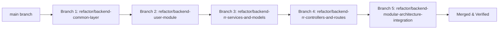

# Implementation Plan: Backend Modularization (`user` & `rr` Domains, Common Infrastructure)

## 1. Overview & Architectural Goals

The current backend application (`apps/portfolio-core`) hosts both the **User / Portfolio Platform** features and the **RoadReady Rentals (RR)** enterprise fleet management system. Currently, the architecture suffers from structural fragmentation and file-level bloat:
1. **Scattered User Features**: User domain controllers, services, models, and routes (`auth`, `admin`, `diet-hydration`, `planner`, `chat`, `game`, `movie`, `files`) are placed directly at the top level in `src/controllers/`, `src/routes/`, `src/services/`, and `src/models/`.
2. **Monolithic RR Route File**: The RoadReady rental system contains a 3,247-line `rr.routes.ts` file containing raw database queries, business calculations, authentication policies, validation routines, and route handlers in a single monolithic file.
3. **Muddled Boundaries**: RR-specific customer membership logic (`customer.controller.ts`, `customer.routes.ts`, `billing.service.ts`, `regular-customer.model.ts`) is mixed into top-level user directories rather than encapsulated inside the RR domain.
4. **Missing 4-Tier Feature Layering**: Both modules lack consistent feature encapsulation where each sub-feature possesses its own dedicated **Route**, **Controller**, **Service**, and **Model** files.

### Core Objectives:
- **Common Isolation**: Relocate all cross-cutting infrastructure (database connections, rate limiters, security configuration, encryption, regex utilities, express typings, and shared cloud storage) into `src/common/`.
- **Modular Domain Encapsulation**: Group all domain-specific logic into `src/modules/user/` and `src/modules/rr/`.
- **Complete Decoupling of `rr.routes.ts`**: Extract all MongoDB data-access routines and business calculations into dedicated domain services and models, moving request handling to controllers and keeping route files strictly for endpoint mapping and middleware wiring.
- **Enforce the 4-File Feature Standard**: For every feature model across `user` and `rr`, establish:
  - `*.routes.ts` (Express router, middleware attachment, route mapping)
  - `*.controller.ts` (HTTP request parsing, DTO validation, status code response handling)
  - `*.service.ts` (Pure business logic, database transactions, calculations, audit logging)
  - `*.model.ts` (Mongoose schema / MongoDB interfaces / data models)
- **100% Backward Compatibility**: Preserve all existing REST endpoints, status codes, and JSON response contracts without breaking frontend applications (`apps/portfolio`, `apps/portfolio-rr`, browser extensions, or mobile builds).

---

## 2. Directory Structure: Current vs. Proposed

### Current Structure
```text
apps/portfolio-core/src/
├── app/
│   └── rr/
│       ├── r2-storage.controller.ts
│       ├── rr-public.routes.ts
│       ├── rr.middleware.ts
│       ├── rr.routes.ts              <-- [CRITICAL: 3,247 lines monolithic file]
│       ├── rr.service.ts             <-- [477 lines, mixed responsibilities]
│       ├── services/
│       │   ├── rr-notification-scheduler.service.ts
│       │   └── rr-whatsapp.service.ts
│       └── utils/
│           └── template-interpolator.ts
├── config/
│   ├── mongodb.ts
│   ├── mongoose.ts
│   └── security.ts
├── controllers/
│   ├── admin.controller.ts
│   ├── auth.controller.ts
│   ├── chat-history.controller.ts
│   ├── chat.controller.ts
│   ├── customer.controller.ts       <-- [RR feature misplaced in root]
│   ├── diet-stats.controller.ts
│   ├── diet.controller.ts
│   ├── files.controller.ts
│   ├── game.controller.ts
│   ├── gemini-chat.controller.ts
│   ├── hydration.controller.ts
│   ├── kyc.controller.ts
│   ├── movie.controller.ts
│   ├── planner-projects.controller.ts
│   └── planner.controller.ts
├── middlewares/
│   ├── admin.middleware.ts
│   ├── auth.middleware.ts
│   ├── kyc-auth.middleware.ts
│   ├── rate-limit.middleware.ts
│   └── rbac.middleware.ts
├── models/
│   ├── chat-history.model.ts
│   ├── diet-log.model.ts
│   ├── file.model.ts
│   ├── hydration-log.model.ts
│   ├── movie.model.ts
│   ├── note.model.ts
│   ├── planner-notification.model.ts
│   ├── planner-project.model.ts
│   ├── regular-customer.model.ts    <-- [RR feature misplaced in root]
│   ├── todo.model.ts
│   └── user-diet-config.model.ts
├── routes/
│   ├── admin.routes.ts
│   ├── auth.routes.ts
│   ├── chat.routes.ts
│   ├── customer.routes.ts          <-- [RR feature misplaced in root]
│   ├── diet-hydration.routes.ts
│   ├── files.routes.ts
│   ├── game.routes.ts
│   ├── kyc.routes.ts
│   ├── movie.routes.ts
│   └── planner.routes.ts
├── services/
│   ├── admin.service.ts
│   ├── auth.service.ts
│   ├── billing.service.ts          <-- [RR feature misplaced in root]
│   ├── chat-history.service.ts
│   ├── diet-analytics.service.ts
│   ├── diet-storage.service.ts
│   ├── diet.service.ts
│   ├── game.service.ts
│   ├── gemini.service.ts
│   ├── hydration.service.ts
│   ├── kyc-verification.service.ts
│   ├── movie.service.ts
│   ├── planner-project.service.ts
│   ├── planner-sse.service.ts
│   └── r2.service.ts
├── types/
│   └── express.ts
├── utils/
│   ├── DB/mongodb.ts
│   ├── security/kyc-crypto.util.ts
│   └── security/regex.util.ts
└── main.ts
```

### Proposed Modular Architecture
```text
apps/portfolio-core/src/
├── common/                               # Cross-cutting infrastructure
│   ├── config/
│   │   ├── mongodb.ts
│   │   ├── mongoose.ts
│   │   └── security.ts
│   ├── middlewares/
│   │   ├── error-handler.middleware.ts
│   │   ├── kyc-auth.middleware.ts
│   │   └── rate-limit.middleware.ts
│   ├── services/
│   │   ├── kyc-verification.service.ts
│   │   └── r2-storage.service.ts
│   ├── types/
│   │   └── express.ts
│   └── utils/
│       ├── db/mongodb.ts
│       ├── security/kyc-crypto.util.ts
│       └── security/regex.util.ts
│
├── modules/
│   ├── user/                             # USER DOMAIN
│   │   ├── user.routes.ts                # Master User aggregator router
│   │   ├── auth/
│   │   │   ├── auth.routes.ts
│   │   │   ├── auth.controller.ts
│   │   │   ├── auth.service.ts
│   │   │   ├── auth.middleware.ts
│   │   │   └── auth.model.ts
│   │   ├── admin/
│   │   │   ├── admin.routes.ts
│   │   │   ├── admin.controller.ts
│   │   │   ├── admin.service.ts
│   │   │   ├── admin.middleware.ts
│   │   │   └── rbac.middleware.ts
│   │   ├── diet-hydration/
│   │   │   ├── diet-hydration.routes.ts
│   │   │   ├── diet.controller.ts
│   │   │   ├── hydration.controller.ts
│   │   │   ├── diet.service.ts
│   │   │   ├── hydration.service.ts
│   │   │   ├── diet-analytics.service.ts
│   │   │   ├── diet-log.model.ts
│   │   │   ├── hydration-log.model.ts
│   │   │   └── user-diet-config.model.ts
│   │   ├── planner/
│   │   │   ├── planner.routes.ts
│   │   │   ├── planner.controller.ts
│   │   │   ├── planner-projects.controller.ts
│   │   │   ├── planner-project.service.ts
│   │   │   ├── planner-sse.service.ts
│   │   │   ├── planner-project.model.ts
│   │   │   ├── planner-notification.model.ts
│   │   │   ├── todo.model.ts
│   │   │   └── note.model.ts
│   │   ├── chat/
│   │   │   ├── chat.routes.ts
│   │   │   ├── chat.controller.ts
│   │   │   ├── chat-history.service.ts
│   │   │   ├── gemini.service.ts
│   │   │   └── chat-history.model.ts
│   │   ├── game/
│   │   │   ├── game.routes.ts
│   │   │   ├── game.controller.ts
│   │   │   └── game.service.ts
│   │   ├── movie/
│   │   │   ├── movie.routes.ts
│   │   │   ├── movie.controller.ts
│   │   │   ├── movie.service.ts
│   │   │   └── movie.model.ts
│   │   ├── files/
│   │   │   ├── files.routes.ts
│   │   │   ├── files.controller.ts
│   │   │   ├── files.service.ts
│   │   │   └── file.model.ts
│   │   └── kyc/
│   │       ├── kyc.routes.ts
│   │       └── kyc.controller.ts
│   │
│   └── rr/                               # ROADREADY RENTALS (RR) DOMAIN
│       ├── rr.routes.ts                  # Master RR aggregator router (/api/rr)
│       ├── rr.middleware.ts              # authenticateRRToken, requireAdmin, requireManagerOrAdmin
│       ├── auth/
│       │   ├── rr-auth.routes.ts
│       │   ├── rr-auth.controller.ts
│       │   ├── rr-auth.service.ts
│       │   └── rr-auth.policy.ts         # Inactivity rules, password policies, lockouts
│       ├── employees/
│       │   ├── rr-employee.routes.ts
│       │   ├── rr-employee.controller.ts
│       │   ├── rr-employee.service.ts
│       │   └── rr-employee.model.ts
│       ├── vehicles/
│       │   ├── rr-vehicle.routes.ts
│       │   ├── rr-vehicle.controller.ts
│       │   ├── rr-vehicle.service.ts
│       │   └── rr-vehicle.model.ts
│       ├── bookings/
│       │   ├── rr-booking.routes.ts
│       │   ├── rr-booking.controller.ts
│       │   ├── rr-booking.service.ts
│       │   └── rr-booking.model.ts
│       ├── customers/
│       │   ├── rr-customer.routes.ts     # Moved from top-level customer.routes.ts
│       │   ├── rr-customer.controller.ts # Moved from top-level customer.controller.ts
│       │   ├── rr-customer.service.ts    # Merged with billing.service.ts
│       │   └── rr-customer.model.ts      # Moved from regular-customer.model.ts
│       ├── announcements/
│       │   ├── rr-announcement.routes.ts
│       │   ├── rr-announcement.controller.ts
│       │   ├── rr-announcement.service.ts
│       │   └── rr-announcement.model.ts
│       ├── home-content/
│       │   ├── rr-home-content.routes.ts
│       │   ├── rr-home-content.controller.ts
│       │   ├── rr-home-content.service.ts
│       │   └── rr-home-content.model.ts
│       ├── feedback/
│       │   ├── rr-feedback.routes.ts
│       │   ├── rr-feedback.controller.ts
│       │   ├── rr-feedback.service.ts
│       │   └── rr-feedback.model.ts
│       ├── whatsapp/
│       │   ├── rr-whatsapp.routes.ts
│       │   ├── rr-whatsapp.controller.ts
│       │   ├── rr-whatsapp.service.ts
│       │   ├── rr-notification-scheduler.service.ts
│       │   └── rr-template-interpolator.util.ts
│       ├── reports/
│       │   ├── rr-report.routes.ts
│       │   ├── rr-report.controller.ts
│       │   └── rr-report.service.ts
│       ├── logs/
│       │   ├── rr-log.routes.ts
│       │   ├── rr-log.controller.ts
│       │   ├── rr-log.service.ts
│       │   └── rr-log.model.ts
│       ├── public/
│       │   ├── rr-public.routes.ts
│       │   └── rr-public.controller.ts
│       └── storage/
│           ├── rr-storage.routes.ts
│           └── rr-storage.controller.ts
│
└── main.ts                               # Clean, lightweight entry point (< 100 lines)
```

---

## 3. Phased Task Breakdown & Multi-Branch Strategy

To minimize risk, prevent merge collisions, and allow step-by-step verification, the refactoring is broken down into **5 distinct branches and sequential tasks**.



---

### Branch 1: `refactor/backend-common-layer`
**Objective**: Extract all cross-cutting configurations, common utilities, shared middlewares, and cross-domain services into `src/common/` without altering application behavior.

- **Branch Name**: `refactor/backend-common-layer`
- **Primary Commit Message**:
  ```text
  refactor(backend): extract common config, middlewares, utils, and shared services

  - Create src/common/ structure for config, middlewares, utils, types, and services
  - Move mongodb, mongoose, and security configs to src/common/config
  - Move rate-limit and shared kyc-auth middlewares to src/common/middlewares
  - Move db connection and crypto/regex utilities to src/common/utils
  - Move generic R2 and KYC verification services to src/common/services
  - Update path references and ensure TypeScript build passes cleanly
  ```

#### Sub-Tasks:
- [ ] **Task 1.1: Directory Scaffold & Config Relocation**
  - Create `apps/portfolio-core/src/common/{config,middlewares,utils,services,types}`.
  - Move `src/config/*` to `src/common/config/`.
  - Move `src/utils/*` to `src/common/utils/`.
  - Move `src/types/*` to `src/common/types/`.
- [ ] **Task 1.2: Shared Middlewares & Cross-Domain Services Relocation**
  - Move `rate-limit.middleware.ts` and `kyc-auth.middleware.ts` to `src/common/middlewares/`.
  - Move `kyc-verification.service.ts` and `r2.service.ts` to `src/common/services/`.
- [ ] **Task 1.3: Reference Updates & Verification**
  - Update relative import paths across existing controllers and services.
  - Run `cmd /c "npx nx build portfolio-core"` to verify zero compiler errors.

---

### Branch 2: `refactor/backend-user-module`
**Objective**: Consolidate all user and platform portfolio features (`auth`, `admin`, `diet-hydration`, `planner`, `chat`, `game`, `movie`, `files`, `kyc`) under `src/modules/user/`, strictly establishing route, controller, service, and model files per feature.

- **Branch Name**: `refactor/backend-user-module`
- **Primary Commit Message**:
  ```text
  refactor(backend): modularize user features into dedicated routes, controllers, services, and models

  - Scaffold src/modules/user feature folders: auth, admin, diet-hydration, planner, chat, game, movie, files, kyc
  - Relocate and group corresponding routes, controllers, services, and models into respective feature folders
  - Standardize 4-tier layer pattern (route, controller, service, model) per feature
  - Create master user.routes.ts aggregator router
  - Update main.ts user route bindings and verify compilation
  ```

#### Sub-Tasks:
- [ ] **Task 2.1: Scaffold User Feature Folders**
  - Create feature folders: `src/modules/user/{auth,admin,diet-hydration,planner,chat,game,movie,files,kyc}`.
- [ ] **Task 2.2: Migrate & Standardize User Features**
  - **Auth**: Move `auth.routes.ts`, `auth.controller.ts`, `auth.service.ts`, `auth.middleware.ts` into `src/modules/user/auth/`.
  - **Admin**: Move `admin.routes.ts`, `admin.controller.ts`, `admin.service.ts`, `admin.middleware.ts`, `rbac.middleware.ts` into `src/modules/user/admin/`.
  - **Diet & Hydration**: Move `diet-hydration.routes.ts`, `diet.controller.ts`, `diet-stats.controller.ts`, `hydration.controller.ts`, `diet.service.ts`, `diet-analytics.service.ts`, `diet-storage.service.ts`, `hydration.service.ts`, and models (`diet-log.model.ts`, `hydration-log.model.ts`, `user-diet-config.model.ts`) into `src/modules/user/diet-hydration/`.
  - **Planner**: Move `planner.routes.ts`, `planner.controller.ts`, `planner-projects.controller.ts`, `planner-project.service.ts`, `planner-sse.service.ts`, and models (`planner-project.model.ts`, `planner-notification.model.ts`, `todo.model.ts`, `note.model.ts`) into `src/modules/user/planner/`.
  - **Chat**: Move `chat.routes.ts`, `chat.controller.ts`, `chat-history.controller.ts`, `gemini-chat.controller.ts`, `chat-history.service.ts`, `gemini.service.ts`, `chat-history.model.ts` into `src/modules/user/chat/`.
  - **Game & Movie**: Move `game.*` into `src/modules/user/game/` and `movie.*` into `src/modules/user/movie/`.
  - **Files**: Move `files.routes.ts`, `files.controller.ts`, `file.model.ts` into `src/modules/user/files/`.
  - **KYC**: Move user-facing `kyc.routes.ts` and `kyc.controller.ts` into `src/modules/user/kyc/`.
- [ ] **Task 2.3: Create Master `user.routes.ts` Aggregator**
  - Build `src/modules/user/user.routes.ts` that mounts sub-routers:
    - `/auth` ➔ `authRouter`
    - `/admin` ➔ `adminRouter`
    - `/diet-hydration` ➔ `dietHydrationRouter`
    - `/planner` ➔ `plannerRouter`
    - `/chat` ➔ `chatRouter`
    - `/game` ➔ `gameRouter`
    - `/movies` ➔ `movieRouter`
    - `/files` ➔ `filesRouter`
    - `/kyc` ➔ `kycRouter`
- [ ] **Task 2.4: Verification**
  - Run `cmd /c "npx nx build portfolio-core"` to verify zero typecheck errors.

---

### Branch 3: `refactor/backend-rr-services-and-models`
**Objective**: Extract all business logic, calculations, database access routines, and data models out of `rr.routes.ts` and `rr.service.ts` into dedicated domain services and models inside `src/modules/rr/`.

- **Branch Name**: `refactor/backend-rr-services-and-models`
- **Primary Commit Message**:
  ```text
  refactor(backend): decompose rr monolithic operations into dedicated domain services and models

  - Create dedicated RR domain models for employee, vehicle, booking, customer, announcement, home-content, feedback, and log
  - Extract database queries and business calculations from rr.routes.ts into domain services
  - Build rr-auth.service with password policy, lockout, and inactivity rules
  - Build rr-employee.service for staff CRUD and activation lifecycle
  - Build rr-vehicle.service for fleet inventory, status transitions, and availability
  - Build rr-booking.service for booking reservations, pricing calculations, conflicts, and auto-close sweep
  - Relocate customer membership and billing calculations into rr-customer.service and rr-customer.model
  - Build domain services for announcements, home content, feedback, reports, and logs
  ```

#### Sub-Tasks:
- [ ] **Task 3.1: Define Dedicated RR Models**
  - Scaffold `src/modules/rr/{auth,employees,vehicles,bookings,customers,announcements,home-content,feedback,reports,logs,whatsapp,public,storage}`.
  - Create model files with typed interfaces and Mongoose/MongoDB collection contracts:
    - `employees/rr-employee.model.ts`
    - `vehicles/rr-vehicle.model.ts`
    - `bookings/rr-booking.model.ts`
    - `customers/rr-customer.model.ts` (relocate from `regular-customer.model.ts`)
    - `announcements/rr-announcement.model.ts`
    - `home-content/rr-home-content.model.ts`
    - `feedback/rr-feedback.model.ts`
    - `logs/rr-log.model.ts`
    - `whatsapp/rr-whatsapp.model.ts`
- [ ] **Task 3.2: Extract Core RR Domain Services**
  - **Auth & Employee**:
    - `rr-auth.service.ts`: Handle login verification, bcrypt hashing, JWT issuance, password age calculation (45-day cycle), 60-day inactivity checks, and lockout policies.
    - `rr-employee.service.ts`: Staff list retrieval, employee registration, activation/deactivation, password reset, and profile updates.
  - **Vehicles**:
    - `rr-vehicle.service.ts`: Vehicle CRUD, plate filtering, autocomplete queries, date-based availability calculations, and pricing slab lookups.
  - **Bookings**:
    - `rr-booking.service.ts`: Booking creation, date overlap and conflict prevention, advance booking validation, early/late return recalculation, customer intimation, and automated 2-hour idle advance booking cancellation sweep (`autoCloseIdleAdvanceBookings`).
  - **Customers & Memberships**:
    - `rr-customer.service.ts`: Relocate `BillingService` and customer lookup logic here (`findCustomer`, `calculateMembershipDiscount`, customer search, and KYC masking).
  - **Announcements & Home Content**:
    - `rr-announcement.service.ts`: CRUD for announcements, category tagging, active toggling, and priority ordering.
    - `rr-home-content.service.ts`: Homepage hero, statistics, testimonials, feature lists, and default content fallback.
  - **Feedback**:
    - `rr-feedback.service.ts`: Feedback submission, screenshot attachment handling, issue type categorization, status workflow (pending -> reviewed -> resolved), and admin deletion.
  - **Reports & Logs**:
    - `rr-report.service.ts`: Day/month/custom range status report aggregations, KPI telemetry, download audit logging.
    - `rr-log.service.ts`: Activity audit logging (`logActivity`) and log history queries.
- [ ] **Task 3.3: Database Seeding Decoupling**
  - Create `src/modules/rr/common/rr-seed.service.ts` to cleanly house default employee creation, default vehicle fleet creation, default ticker setup, and initial customer backfill.
- [ ] **Task 3.4: Verification**
  - Ensure services compile cleanly with proper TypeScript types.

---

### Branch 4: `refactor/backend-rr-controllers-and-routes`
**Objective**: Disassemble the 3,247-line `rr.routes.ts` into isolated controllers and route files for each feature, and wire them together in a clean, declarative master `rr.routes.ts`.

- **Branch Name**: `refactor/backend-rr-controllers-and-routes`
- **Primary Commit Message**:
  ```text
  refactor(backend): dismantle monolithic rr.routes.ts into discrete feature controllers and routers

  - Create isolated controllers handling HTTP requests and responses for all RR features
  - Create dedicated route files mapping REST endpoints and RBAC middlewares per feature
  - Relocate customer routes and controller into src/modules/rr/customers
  - Re-implement rr-public.routes with dedicated rr-public.controller
  - Compose master rr.routes.ts orchestrator mounting all sub-feature routers
  - Safely remove legacy 3,247-line monolithic rr.routes.ts
  ```

#### Sub-Tasks:
- [ ] **Task 4.1: Implement Discrete RR Controllers**
  - `auth/rr-auth.controller.ts`: `login`, `changePassword`, `logout`, `getPermissions`.
  - `employees/rr-employee.controller.ts`: `getEmployees`, `createEmployee`, `activateEmployee`, `resetPassword`, `updateEmployee`, `deleteEmployee`.
  - `vehicles/rr-vehicle.controller.ts`: `getVehicles`, `getVehicleById`, `createVehicle`, `updateVehicle`, `deleteVehicle`, `getVehicleAvailability`, `autocompleteVehicles`.
  - `bookings/rr-booking.controller.ts`: `getBookings`, `createBooking`, `updateBooking`, `deleteBooking`, `closeAdvanceBooking`, `autoCloseIdle`, `sendCustomerIntimation`.
  - `customers/rr-customer.controller.ts`: `getCustomers`, `getCustomerById`, `createCustomer`, `updateCustomer`, `deleteCustomer`, `autocompleteCustomers`.
  - `announcements/rr-announcement.controller.ts`: `getAnnouncements`, `createAnnouncement`, `updateAnnouncement`, `toggleAnnouncement`, `deleteAnnouncement`, `updateTicker`.
  - `home-content/rr-home-content.controller.ts`: `getHomeContent`, `updateHomeContent`, `resetHomeContent`.
  - `feedback/rr-feedback.controller.ts`: `submitFeedback`, `getMyFeedback`, `getFeedbackStats`, `getAllFeedback`, `updateFeedbackStatus`, `deleteFeedback`.
  - `reports/rr-report.controller.ts`: `getStatusReports`, `logReportDownload`.
  - `logs/rr-log.controller.ts`: `getLogs`.
  - `whatsapp/rr-whatsapp.controller.ts`: `getConfig`, `updateConfig`, `testMessage`, `previewMessage`, `sendMessage`, `runSchedulerSweep`.
  - `public/rr-public.controller.ts`: Public homepage, public announcements, public fleet, public invoice lookup.
  - `storage/rr-storage.controller.ts`: Vehicle and feedback screenshot R2 uploads.
- [ ] **Task 4.2: Implement Discrete Route Files**
  - Create `*.routes.ts` in each feature folder, applying `authenticateRRToken`, `requireAdmin`, and `requireManagerOrAdmin` middlewares.
- [ ] **Task 4.3: Assemble Streamlined Master `rr.routes.ts`**
  - Mount feature sub-routers:
    ```typescript
    rrRouter.use('/auth', rrAuthRouter);
    rrRouter.use('/employees', rrEmployeeRouter);
    rrRouter.use('/vehicles', rrVehicleRouter);
    rrRouter.use('/bookings', rrBookingRouter);
    rrRouter.use('/customers', rrCustomerRouter);
    rrRouter.use('/announcements', rrAnnouncementRouter);
    rrRouter.use('/home-content', rrHomeContentRouter);
    rrRouter.use('/feedback', rrFeedbackRouter);
    rrRouter.use('/reports', rrReportRouter);
    rrRouter.use('/logs', rrLogRouter);
    rrRouter.use('/whatsapp', rrWhatsAppRouter);
    rrRouter.use('/public', rrPublicRouter);
    ```
- [ ] **Task 4.4: Decommission Legacy Monolith**
  - Replace the 3,247-line `rr.routes.ts` with the clean modular router.

---

### Branch 5: `refactor/backend-modular-architecture-integration`
**Objective**: Clean up `main.ts`, remove legacy top-level files, verify backward compatibility, and execute monorepo builds and test suites.

- **Branch Name**: `refactor/backend-modular-architecture-integration`
- **Primary Commit Message**:
  ```text
  refactor(backend): wire user and rr root routers in main.ts, remove legacy files, and verify end-to-end

  - Update main.ts to import clean modular routers from src/modules/user and src/modules/rr
  - Remove obsolete controllers, routes, models, and services from legacy root locations
  - Verify complete TypeScript compilation of portfolio-core and all dependent projects
  - Validate end-to-end API compatibility for both User and RR platform interfaces
  - Update apps/portfolio-core documentation with modular architecture guide
  ```

#### Sub-Tasks:
- [ ] **Task 5.1: Clean `main.ts` Refactoring**
  - Rewire `main.ts` to mount:
    ```typescript
    // Common middlewares (Helmet, CORS, MongoSanitize, Global Rate Limiting)
    app.use('/api', apiRateLimiter);

    // Modular Domain Routers
    app.use('/api', userRouter); // Handles /api/auth, /api/user/*, /api/movies, etc.
    app.use('/api/rr', rrRouter); // Handles all /api/rr/* routes

    // Shared KYC endpoints (compatible with both platform and RR callers)
    app.use('/api/kyc', kycRouter);
    app.use('/api/rr/kyc', kycRouter);
    ```
- [ ] **Task 5.2: Legacy File Cleanup**
  - Remove vacated directories: `src/controllers/`, `src/routes/`, `src/models/`, `src/services/` that have been migrated into `src/modules/` or `src/common/`.
- [ ] **Task 5.3: End-to-End Build & Validation**
  - Run full TypeScript typecheck: `cmd /c "npx nx build portfolio-core"`.
  - Verify web frontend builds (`portfolio` and `portfolio-rr`).
  - Run Playwright test suite to confirm zero regressions.
- [ ] **Task 5.4: Documentation**
  - Add architecture documentation in `apps/portfolio-core/README.md`.

---

## 4. Comprehensive Feature & Route Mapping Matrix

| Route Endpoint | Method | Domain | Target Sub-Directory | Target Route File | Target Controller File | Target Service File | Target Model File |
| :--- | :--- | :--- | :--- | :--- | :--- | :--- | :--- |
| `/api/auth/*` | POST, GET, PATCH | User | `src/modules/user/auth` | `auth.routes.ts` | `auth.controller.ts` | `auth.service.ts` | `auth.model.ts` |
| `/api/admin/*` | GET, PATCH, DELETE | User | `src/modules/user/admin` | `admin.routes.ts` | `admin.controller.ts` | `admin.service.ts` | Interface in shared-types |
| `/api/user/diet-hydration/*` | GET, POST, PUT, DELETE | User | `src/modules/user/diet-hydration` | `diet-hydration.routes.ts` | `diet.controller.ts`, `hydration.controller.ts` | `diet.service.ts`, `hydration.service.ts` | `diet-log.model.ts`, `hydration-log.model.ts` |
| `/api/user/planner/*`, `/api/planner/*` | GET, POST, PUT, DELETE | User | `src/modules/user/planner` | `planner.routes.ts` | `planner.controller.ts`, `planner-projects.controller.ts` | `planner-project.service.ts`, `planner-sse.service.ts` | `planner-project.model.ts`, `todo.model.ts` |
| `/api/chat/*` | GET, POST | User | `src/modules/user/chat` | `chat.routes.ts` | `chat.controller.ts`, `gemini-chat.controller.ts` | `chat-history.service.ts`, `gemini.service.ts` | `chat-history.model.ts` |
| `/api/game/*`, `/api/user/game/*` | GET, POST | User | `src/modules/user/game` | `game.routes.ts` | `game.controller.ts` | `game.service.ts` | State interfaces |
| `/api/movies/*` | GET, POST, PUT, DELETE | User | `src/modules/user/movie` | `movie.routes.ts` | `movie.controller.ts` | `movie.service.ts` | `movie.model.ts` |
| `/api/files/*` | GET, POST, DELETE | User | `src/modules/user/files` | `files.routes.ts` | `files.controller.ts` | `files.service.ts` | `file.model.ts` |
| `/api/kyc/*` | GET, POST | Common / Shared | `src/modules/user/kyc` (mounted at `/api/kyc` and `/api/rr/kyc`) | `kyc.routes.ts` | `kyc.controller.ts` | `src/common/services/kyc-verification.service.ts` | Shared KYC types |
| `/api/rr/auth/*` | POST, GET | RR | `src/modules/rr/auth` | `rr-auth.routes.ts` | `rr-auth.controller.ts` | `rr-auth.service.ts` | `rr-employee.model.ts` |
| `/api/rr/employees/*` | GET, POST, PUT, DELETE | RR | `src/modules/rr/employees` | `rr-employee.routes.ts` | `rr-employee.controller.ts` | `rr-employee.service.ts` | `rr-employee.model.ts` |
| `/api/rr/vehicles/*` | GET, POST, PUT, DELETE | RR | `src/modules/rr/vehicles` | `rr-vehicle.routes.ts` | `rr-vehicle.controller.ts` | `rr-vehicle.service.ts` | `rr-vehicle.model.ts` |
| `/api/rr/bookings/*` | GET, POST, PUT, DELETE | RR | `src/modules/rr/bookings` | `rr-booking.routes.ts` | `rr-booking.controller.ts` | `rr-booking.service.ts` | `rr-booking.model.ts` |
| `/api/rr/customers/*` | GET, POST, PUT, DELETE | RR | `src/modules/rr/customers` | `rr-customer.routes.ts` | `rr-customer.controller.ts` | `rr-customer.service.ts` | `rr-customer.model.ts` |
| `/api/rr/announcements/*` | GET, POST, PUT, PATCH, DELETE | RR | `src/modules/rr/announcements` | `rr-announcement.routes.ts` | `rr-announcement.controller.ts` | `rr-announcement.service.ts` | `rr-announcement.model.ts` |
| `/api/rr/home-content/*` | GET, PUT, POST | RR | `src/modules/rr/home-content` | `rr-home-content.routes.ts` | `rr-home-content.controller.ts` | `rr-home-content.service.ts` | `rr-home-content.model.ts` |
| `/api/rr/feedback/*` | GET, POST, PATCH, DELETE | RR | `src/modules/rr/feedback` | `rr-feedback.routes.ts` | `rr-feedback.controller.ts` | `rr-feedback.service.ts` | `rr-feedback.model.ts` |
| `/api/rr/whatsapp/*` | GET, POST, PUT | RR | `src/modules/rr/whatsapp` | `rr-whatsapp.routes.ts` | `rr-whatsapp.controller.ts` | `rr-whatsapp.service.ts` | `rr-whatsapp.model.ts` |
| `/api/rr/reports/*` | GET, POST | RR | `src/modules/rr/reports` | `rr-report.routes.ts` | `rr-report.controller.ts` | `rr-report.service.ts` | Aggregation interfaces |
| `/api/rr/logs/*` | GET | RR | `src/modules/rr/logs` | `rr-log.routes.ts` | `rr-log.controller.ts` | `rr-log.service.ts` | `rr-log.model.ts` |
| `/api/rr/public/*` | GET | RR | `src/modules/rr/public` | `rr-public.routes.ts` | `rr-public.controller.ts` | Respective domain services | Public DTOs |
| `/api/rr/storage/*` | POST | RR | `src/modules/rr/storage` | `rr-storage.routes.ts` | `rr-storage.controller.ts` | `src/common/services/r2-storage.service.ts` | Storage response DTOs |

---

## 5. Verification & Quality Gates

Each branch will undergo strict quality gates before advancing to the next:
1. **Compilation Check**:
   ```bash
   cmd /c "npx nx build portfolio-core"
   ```
   Must pass with zero TypeScript diagnostics or missing module errors.
2. **Dependent Frontends Check**:
   ```bash
   cmd /c "npx nx build portfolio --configuration development"
   cmd /c "npx nx build portfolio-rr --configuration development"
   ```
3. **Route & Schema Integrity**:
   Verify that all endpoint signatures, HTTP verb methods, query parameter parsers, and status responses match existing production behavior exactly.
4. **Git Hygiene**:
   Clean commits with the specified branch names and conventional commit messages.
