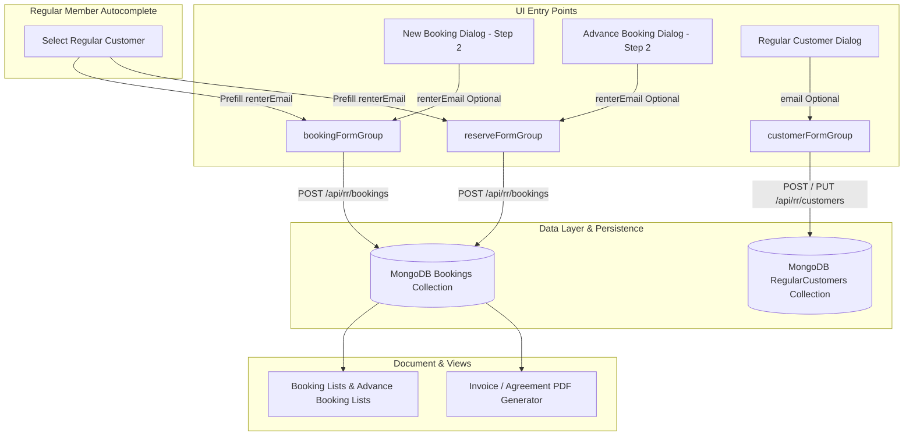

# Implementation Plan: Optional Customer Email Input across New Booking, Advance Booking, and Regular Customers

## 1. Overview & Objectives

In the vehicle rental and booking module (`rr`), customer contact information is gathered during booking workflows and customer membership onboarding. Currently, the Renter Person Details (Step 2) section in **New Booking** and **Advance Booking** collects physical contact and KYC details (phone, alternate phone, Aadhaar, driving license, address) but lacks a customer **Email** input. Meanwhile, in **Regular Customers**, the email field was previously mandatory.

### Key Requirements:
1. **New Booking Dialog (`new-booking-dialog`)**:
   - Add an optional customer **Email** input to **Renter Person Details (Step 2)**.
   - Automatically prefill the email when selecting an existing Regular Customer from directory autocomplete.
   - Include client-side format validation (optional, but if filled, must conform to standard email syntax).
   - Persist `renterEmail` to the booking document.

2. **Advance Booking Dialog (`reserve-booking-dialog`)**:
   - Add an optional customer **Email** input to **Renter Person Details (Step 2)**.
   - Prefill the email when selecting an existing Regular Customer or editing an existing reservation.
   - Persist `renterEmail` to the reserved booking record.

3. **Regular Customers (`customer-list` & backend API)**:
   - Make the Email input **optional** for customer membership onboarding and editing, allowing staff to register customers who do not possess or choose not to provide an email address.
   - Update MongoDB schema (`regular-customer.model.ts`) to make `email` non-required with a `sparse: true` unique index to avoid duplicate key conflicts on omitted or blank emails.
   - Update `CustomerController` backend validation and duplicate check logic to only validate and check for duplicate emails when an email is actually supplied.

4. **Agreements & Dashboard Visibility**:
   - Display customer email on active booking and advance booking table cards when present.
   - Include customer email in the generated rental agreement PDF (`rr-invoice-pdf.service.ts`).

---

## 2. Git Information

- **Branch Name**: `feat/rr-customer-email-input`
- **Commit Message**:
  ```text
  feat(rr): add optional email input for customer in new booking, advance booking, and regular customers

  - Add optional renterEmail control and input field in New Booking Dialog (Step 2)
  - Add optional renterEmail control and input field in Advance Booking Dialog (Step 2)
  - Auto-prefill email in booking forms when selecting an existing regular member
  - Make email optional in Regular Customer registration modal and backend validation
  - Configure sparse index in regular customer schema to allow omitted emails
  - Include customer email in booking lists and generated PDF rental agreements
  ```

---

## 3. Architecture & Data Flow



---

## 4. Detailed Component Changes

### 4.1. Shared Types (`libs/shared-types/src/lib/`)
1. **`rr.ts`**:
   - Add `renterEmail?: string;` to `IBooking`.
2. **`regular-customer.ts`**:
   - Update `IRegularCustomer`: change `email: string;` to `email?: string;`.
   - Update `IRegularCustomerMasked`: change `email: string;` to `email?: string;`.
   - Update `ICreateCustomerDTO`: change `email: string;` to `email?: string;`.
   - Update `IUpdateCustomerDTO`: ensure `email?: string;` is optional.

---

### 4.2. Backend (`apps/portfolio-core/`)

#### A. `apps/portfolio-core/src/models/regular-customer.model.ts`
- Update `email` schema definition:
  - `required: false` (remove `required: [true, ...]`).
  - Add `sparse: true` to the index definition to ensure multiple records with `null`/omitted emails do not trigger MongoDB duplicate key errors (`E11000`).
  - Provide a custom validator or conditional regex match that only triggers if a non-empty string is provided.
  - In pre-save / pre-validate middleware, normalize empty string `""` to `undefined` or delete `email` so `sparse: true` functions as intended.

#### B. `apps/portfolio-core/src/controllers/customer.controller.ts`
- **`createCustomer`**:
  - Make email validation optional:
    ```ts
    if (body.email && body.email.trim()) {
      if (!/^[a-zA-Z0-9._%+-]+@[a-zA-Z0-9.-]+\.[a-zA-Z]{2,}$/.test(body.email.trim())) {
        errors.push('Please provide a valid email address');
      }
    }
    ```
  - Duplicate check: Only query `{ email: body.email.trim().toLowerCase() }` if `body.email?.trim()` is provided.
- **`updateCustomer`**:
  - Apply the same conditional email regex and duplicate checks only when `body.email` is provided and non-empty.

#### C. `apps/portfolio-core/src/app/rr/rr.routes.ts`
- In `GET /bookings` search query filters, add `{ renterEmail: { $regex: sRegex } }` so staff can locate bookings by customer email.

---

### 4.3. Frontend Booking Creation Dialogs (`apps/portfolio/src/app/modules/rr/shared/dialogs/`)

#### A. New Booking Dialog (`new-booking-dialog`)
1. **`new-booking-dialog.component.ts`**:
   - Add `renterEmail` to `bookingFormGroup`:
     ```ts
     renterEmail: ['', [Validators.pattern(/^[a-zA-Z0-9._%+-]+@[a-zA-Z0-9.-]+\.[a-zA-Z]{2,}$/)]],
     ```
   - In `selectRegularCustomer(item)`:
     ```ts
     this.bookingFormGroup.patchValue({
       ...
       renterEmail: fullCustomer.email || '',
     });
     ```
   - In `clearSelectedRegularCustomer()` / resetting methods: clear `renterEmail`.
2. **`new-booking-dialog.component.html`**:
   - In **Renter Person Details (Step 2)** grid, add the Customer Email input:
     ```html
     <div>
       <label hlmLabel class="text-xs text-muted-foreground block mb-1">Email Address (Optional)</label>
       <input
         hlmInput
         type="email"
         formControlName="renterEmail"
         placeholder="customer@example.com"
         class="w-full text-sm"
       />
       @if (bookingFormGroup.get('renterEmail')?.invalid && bookingFormGroup.get('renterEmail')?.touched) {
         <span class="text-xs text-destructive">Please enter a valid email address.</span>
       }
     </div>
     ```

#### B. Advance Booking Dialog (`reserve-booking-dialog`)
1. **`reserve-booking-dialog.component.ts`**:
   - Add `renterEmail` to `reserveFormGroup`:
     ```ts
     renterEmail: ['', [Validators.pattern(/^[a-zA-Z0-9._%+-]+@[a-zA-Z0-9.-]+\.[a-zA-Z]{2,}$/)]],
     ```
   - In `selectRegularCustomer(item)`: patch `renterEmail: fullCustomer.email || ''`.
   - In `populateForm(resv)` (when modifying/viewing a reservation): patch `renterEmail: resv.renterEmail || ''`.
2. **`reserve-booking-dialog.component.html`**:
   - In **Renter Person Details (Step 2)**, add the Customer Email input with optional placeholder and validation messaging.

---

### 4.4. Frontend Regular Customers Management (`apps/portfolio/src/app/modules/rr/components/dashboard/components/customer-list/`)

1. **`customer-list.component.ts`**:
   - Update `initForm()`:
     - Remove `Validators.required` from `email`.
     - Keep the email pattern validator only:
       ```ts
       email: ['', [Validators.pattern(/^[a-zA-Z0-9._%+-]+@[a-zA-Z0-9.-]+\.[a-zA-Z]{2,}$/)]],
       ```
2. **`customer-list.component.html`**:
   - In the Customer Modal, update the label:
     - Change `<label hlmLabel ...>Email Address *</label>` to `<label hlmLabel ...>Email Address (Optional)</label>`.
     - Update validation error message to show only if invalid pattern (not required).
   - In the table display:
     - If `c.email` exists, render email icon and email string; otherwise render a subtle placeholder (`—` or `None`).

---

### 4.5. Rental Agreements & Dashboard Visibility

1. **`rr-invoice-pdf.service.ts`**:
   - In `generateAgreementPdf` and `generateSettlementReceiptPdf`, include `renterEmail` in the agreement renter summary table if present (or show "N/A" if not provided).
2. **`booking-list.component.html` & `advance-booking-list.component.html`**:
   - Display `b.renterEmail` alongside `b.renterPhone` in the customer info cell when present.

---

## 5. Verification & Testing Checklist

1. **New Booking Flow**:
   - [ ] Open New Booking modal, proceed to Step 2. Verify Email input is present with label "Email Address (Optional)".
   - [ ] Verify form is valid without filling email.
   - [ ] Enter an invalid email (e.g. `test@invalid`). Verify validation error displays on blur.
   - [ ] Enter a valid email (e.g. `customer@domain.com`). Verify booking submission succeeds and email is persisted in the booking record.
   - [ ] Search & select an existing Regular Customer with an email. Verify email is automatically populated into the field.
2. **Advance Booking Flow**:
   - [ ] Open Advance Booking dialog, navigate to Step 2. Verify Email input is present.
   - [ ] Verify reservation creates successfully with or without email.
   - [ ] Verify email prefill works with regular customer autocomplete.
3. **Regular Customer Flow**:
   - [ ] Create a new Regular Member without an email. Verify submission succeeds without validation errors.
   - [ ] Create another Regular Member without an email. Verify no MongoDB duplicate key error occurs (sparse index check).
   - [ ] Create a Regular Member with a valid email. Verify email is saved and displayed in table.
4. **Agreements & Invoices**:
   - [ ] Download or view PDF agreement for a booking with email; verify email displays correctly.
   - [ ] Download or view PDF agreement for a booking without email; verify layout remains clean without breaking.
