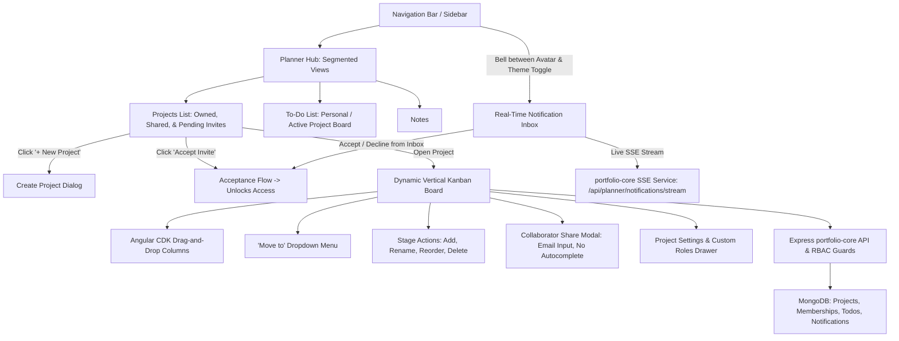

# Implementation Plan: GitHub Projects-Style Collaborative Planner with Dynamic Kanban & Custom RBAC

## 1. Overview & Objectives
Transform the **User Module - Planner - To-Do List** into a collaborative, GitHub Projects-style workflow platform. Users can create, view, and manage projects from a dedicated **Projects List**, invite collaborators strictly via manual email entry with **no autocomplete**, assign **fixed system roles** or create **custom roles** with tailored permissions, transition tasks across **dynamic vertical workflow stages** via drag-and-drop or a "Move to" menu, receive alerts via a **real-time notification icon situated between the user avatar and theme toggle**, and enforce that **invited users can only access a project after explicitly accepting the invitation**.

### Git Details
- **Branch Name**: `feat/user-planner-github-projects-rbac`
- **Commit Message**:
  ```text
  feat(planner): implement collaborative github projects with custom rbac, dynamic kanban stages, and real-time notifications

  - Add dedicated Projects list view with project creation and acceptance workflow
  - Enforce fixed system roles alongside admin-defined custom roles with granular permissions
  - Add invite-by-email collaborator modal without autocomplete and require acceptance before project access
  - Add real-time notification bell positioned between user avatar and theme toggle in navigation
  - Replace static 3-column board with dynamic vertical workflow stages supporting CDK drag-drop and 'Move to' menu
  - Implement SSE real-time stream for project activity, card transitions, and invitation alerts
  ```

---

## 2. Architecture & Flow Diagram



---

## 3. Core Functional Requirements & Specifications

### 3.1 Dedicated Projects List View
In addition to the Personal To-Do List and Notes, a dedicated **Projects** view will be added to the Planner:
- **Navigation**:
  - Segmented tab in Planner toolbar: `[To-do List] | [Notes] | [Projects]`.
  - Also displays an active project indicator when viewing an individual project board, with a `"← Back to Projects"` breadcrumb.
- **Sectioned Layout in Projects View**:
  1. **My Projects**: Projects created and owned by the current user.
  2. **Collaborative Projects**: Projects where the user is an active, accepted member.
  3. **Pending Invitations**: Projects to which the user has been invited but has not yet accepted/declined. Displays prominent **[Accept]** and **[Decline]** buttons with role preview.
- **Project Card Metadata**:
  - Project Title & Description.
  - Role pill (e.g. `Admin`, `Member`, or custom role name).
  - Member avatars and count.
  - Dynamic stages breakdown badge (e.g., `4 Stages • 12 Tasks`).
  - Actions: **Open Board**, **Settings** (for Admins), **Leave Project** (for Members), **Archive/Delete** (for Owners).
- **"+ New Project" Action**:
  - Modal with Title, Description, and initial stages template (defaulting to standard vertical columns: `Backlog`, `In Progress`, `In Review`, `Done`).

---

### 3.2 Fixed Roles vs. Custom Roles (RBAC)

#### A. Fixed System Roles (Immutable)
These 5 roles are standardized system presets. They **cannot** be renamed, edited, or deleted by any user:
| Fixed Role | Project Settings | Manage Stages | Invite Members | Create / Edit Cards | Move Cards | Delete Cards | Read Only |
|---|:---:|:---:|:---:|:---:|:---:|:---:|:---:|
| **Admin** | ✅ | ✅ | ✅ | ✅ | ✅ | ✅ | ❌ |
| **Write / Member** | ❌ | ❌ | ❌ | ✅ | ✅ | Own cards | ❌ |
| **Reviewer** | ❌ | ❌ | ❌ | Review comments | Review stages | ❌ | ❌ |
| **Triage** | ❌ | ❌ | Assign only | Tag / prioritize | ✅ | ❌ | ❌ |
| **Read-Only / Viewer** | ❌ | ❌ | ❌ | ❌ | ❌ | ❌ | ✅ |

#### B. Custom Roles (User-Definable by Project Admins)
Project Admins can define project-scoped custom roles with tailored capability flags:
```typescript
export interface IProjectCustomRole {
  id: string;
  name: string;
  description?: string;
  isCustom: true;
  permissions: {
    canManageProject: boolean;
    canManageStages: boolean;
    canManageRoles: boolean;
    canInviteMembers: boolean;
    canCreateCards: boolean;
    canEditCards: boolean;
    canDeleteCards: boolean;
    canMoveCards: boolean;
    canComment: boolean;
  };
}
```
- Admins can create new custom roles, modify their permission matrices, and delete unused custom roles.

---

### 3.3 Collaborator Invitation by Email (Strictly No Autocomplete)

- **Share / Invite Collaborator Dialog**:
  - Explicit email input field: `<input type="email" autocomplete="off" placeholder="collaborator@example.com" />`.
  - **No autocomplete dropdown, no auto-suggest list, no user search query typeahead**. The user must enter the exact recipient email.
  - Role dropdown: lists the 5 Fixed System Roles plus any active Custom Roles defined in the project.
  - "Send Invite" button.
- **Backend Validation**:
  - Validates email format.
  - Looks up recipient user by email. If recipient already belongs to the project (pending or accepted), return conflict error.
  - Creates a member record with `status: 'pending'`.
  - Dispatches an invite notification to the recipient and pushes a real-time event via SSE.

---

### 3.4 Project Access Gating (Acceptance Required)

- **Membership Status Lifecycle**:
  - `status: 'pending'` — User has been invited; **ZERO access** granted to project data, board, or tasks.
  - `status: 'accepted'` — User explicitly clicked "Accept"; full role permissions unlocked.
  - `status: 'declined'` — User declined the invite; record archived/deleted.
- **Access Enforcement**:
  - **Backend Guard**: All endpoints accessing project details, stages, or cards (`GET /api/planner/projects/:id`, `GET /api/planner/projects/:id/todos`, etc.) check:
    ```typescript
    if (project.ownerId.toString() !== req.userId) {
      const member = project.members.find(m => m.userId.toString() === req.userId);
      if (!member || member.status !== 'accepted') {
        return res.status(403).json({
          error: 'Forbidden',
          message: 'Project access requires an accepted invitation.'
        });
      }
    }
    ```
  - **Frontend Handling**:
    - If a user navigates directly to a project URL without having accepted, they are presented with an Invitation Banner:
      > *"You've been invited to join this project as **[Role Name]**. Accept the invitation to view the board."*
      > Buttons: **[Accept Invitation]** and **[Decline]**.
    - Acceptance can be performed from either the **Notification Inbox** or the **Projects List**.
    - Upon accepting, the user is immediately transitioned into the active project board without page refresh.

---

### 3.5 Real-Time Notification Icon (Positioned Between User Avatar & Toggle Theme)

- **Exact Header / Sidebar Layout Positioning**:
  - In `apps/portfolio/src/app/shared/components/sidebar/sidebar.component.html`:
    1. **Mobile Header** (Screens < 1024px):
       ```html
       <div class="flex items-center gap-2">
         <!-- 1. Theme toggle -->
         <button hlmBtn variant="ghost" (click)="toggleTheme()">...</button>

         <!-- 2. Notification icon (PLACED IN BETWEEN) -->
         <div class="relative">
           <button
             hlmBtn
             variant="ghost"
             size="icon"
             class="relative text-muted-foreground hover:text-foreground hover:bg-muted h-8 w-8 rounded-full"
             (click)="toggleNotificationInbox()"
             aria-label="View notifications"
           >
             <ng-icon name="lucideBell" class="size-4.5" />
             @if (unreadNotificationCount() > 0) {
               <span class="absolute top-1 right-1 flex h-2 w-2">
                 <span class="animate-ping absolute inline-flex h-full w-full rounded-full bg-red-400 opacity-75"></span>
                 <span class="relative inline-flex rounded-full h-2 w-2 bg-red-500"></span>
               </span>
             }
           </button>
         </div>

         <!-- 3. User avatar dropdown -->
         @if (isLoggedIn()) {
           <hlm-avatar ...>...</hlm-avatar>
         }
       </div>
       ```
    2. **Desktop Sidebar Footer**:
       ```html
       <div class="footer-actions flex flex-col items-center gap-3 w-full">
         <!-- 1. Theme toggle -->
         <button hlmBtn variant="ghost" (click)="toggleTheme()">...</button>

         <!-- 2. Notification icon (PLACED IN BETWEEN) -->
         <div class="relative">
           <button
             hlmBtn
             variant="ghost"
             size="icon"
             class="footer-btn text-muted-foreground hover:text-foreground hover:bg-muted size-9 rounded-full relative"
             (click)="toggleNotificationInbox()"
             [hlmTooltip]="'Notifications (' + unreadNotificationCount() + ')'"
             tooltipPosition="right"
           >
             <ng-icon name="lucideBell" class="size-5" />
             @if (unreadNotificationCount() > 0) {
               <span class="absolute top-1.5 right-1.5 flex h-2 w-2">
                 <span class="animate-ping absolute inline-flex h-full w-full rounded-full bg-red-400 opacity-75"></span>
                 <span class="relative inline-flex rounded-full h-2 w-2 bg-red-500"></span>
               </span>
             }
           </button>
         </div>

         <!-- 3. User account avatar -->
         @if (isLoggedIn()) {
           <hlm-avatar ...>...</hlm-avatar>
         }
       </div>
       ```
- **Notification Inbox Popover / Slide-over**:
  - Displays unread counter and list of real-time alerts.
  - Interactive Project Invitation notifications have inline **[Accept]** and **[Decline]** buttons.
  - Real-time updates delivered through SSE stream (`/api/planner/notifications/stream`).

---

### 3.6 Dynamic Board Layout & Flexible Stage Transitions

- **Dynamic Vertical Workflow Columns**:
  - Board renders strictly vertical columns driven by `project.stages` array ordered by `stage.order`.
  - Project Admins can:
    - **Add Stage**: Define stage name and color tag.
    - **Rename & Style Stage**: Modify title or color pill.
    - **Reorder Stages**: Drag column headers or use move left/right controls.
    - **Delete Stage**: Safeguard modal prompts to migrate any remaining cards in that column to a selected target column before removal.
- **Stage Transitions**:
  - **Drag-and-Drop**: Built using `@angular/cdk/drag-drop` (`cdkDropListGroup`, `cdkDropList`, and `cdkDrag`), enabling smooth multi-column dragging.
  - **"Move to" Menu**: Dropdown button on each card listing all active stages for immediate one-click transitions (especially convenient for mobile and keyboard navigation).
  - Transition permissions checked against user's role (`canMoveCards`).

---

## 4. Database Models & Shared Types

### 4.1 `IPlannerProject` (`libs/shared-types` & `apps/portfolio-core/src/models/planner-project.model.ts`)
```typescript
export type FixedProjectRole = 'admin' | 'member' | 'reviewer' | 'triage' | 'viewer';
export type MemberStatus = 'pending' | 'accepted' | 'declined';

export interface IProjectMember {
  userId: string; // ObjectId string
  email: string;
  role: FixedProjectRole | string; // fixed or customRoleId
  status: MemberStatus;
  invitedBy: string;
  joinedAt?: string;
  createdAt: string;
}

export interface IProjectStage {
  id: string;
  name: string;
  color?: string;
  order: number;
  isDefault?: boolean;
}

export interface IProjectCustomRole {
  id: string;
  name: string;
  description?: string;
  isCustom: true;
  permissions: {
    canManageProject: boolean;
    canManageStages: boolean;
    canManageRoles: boolean;
    canInviteMembers: boolean;
    canCreateCards: boolean;
    canEditCards: boolean;
    canDeleteCards: boolean;
    canMoveCards: boolean;
    canComment: boolean;
  };
}

export interface IPlannerProject {
  id: string;
  title: string;
  description?: string;
  ownerId: string;
  members: IProjectMember[];
  customRoles: IProjectCustomRole[];
  stages: IProjectStage[];
  archived: boolean;
  createdAt: string;
  updatedAt: string;
}
```

### 4.2 Todo Item Additions (`libs/shared-types` & `todo.model.ts`)
- `projectId?: string` (references active project; `undefined` indicates private personal todo)
- `stageId?: string` (references dynamic stage in the project)
- `assigneeIds?: string[]` (collaborators assigned to task)

### 4.3 Notification Schema (`planner-notification.model.ts`)
- `userId`: recipient
- `projectId`: project reference
- `actorId`: triggering user
- `type`: `'project_invite' | 'card_moved' | 'card_assigned' | 'stage_changed' | 'mention'`
- `title`, `message`, `data` (contains `projectId`, `todoId`, `stageId`)
- `isRead`: boolean

---

## 5. API Endpoints (`apps/portfolio-core/src/routes/planner.routes.ts`)

### 5.1 Projects & Collaborators
- `GET /api/planner/projects` — List user's projects (owned, accepted, and pending invites).
- `POST /api/planner/projects` — Create project with initial default stages.
- `GET /api/planner/projects/:id` — Get project details (strictly guarded: requires owner or accepted member).
- `PUT /api/planner/projects/:id` — Update project metadata (Admin only).
- `DELETE /api/planner/projects/:id` — Archive/delete project (Owner only).
- `POST /api/planner/projects/:id/members` — Invite collaborator by email (`{ email, role }`, no autocomplete).
- `POST /api/planner/projects/:id/accept` — Accept invitation (unlocks access).
- `POST /api/planner/projects/:id/decline` — Decline invitation.
- `PATCH /api/planner/projects/:id/members/:userId` — Update member role (Admin only).
- `DELETE /api/planner/projects/:id/members/:userId` — Remove collaborator or leave project.

### 5.2 Dynamic Stages & Custom Roles
- `POST /api/planner/projects/:id/stages` — Add vertical stage column (Admin only).
- `PATCH /api/planner/projects/:id/stages/:stageId` — Rename/recolor stage (Admin only).
- `PUT /api/planner/projects/:id/stages/reorder` — Reorder stages array (Admin only).
- `DELETE /api/planner/projects/:id/stages/:stageId` — Delete stage with target fallback migration.
- `POST /api/planner/projects/:id/roles` — Create custom role (Admin only).
- `PATCH /api/planner/projects/:id/roles/:roleId` — Update custom role permissions.
- `DELETE /api/planner/projects/:id/roles/:roleId` — Delete custom role.

### 5.3 Card Stage Movement & Notifications
- `PATCH /api/planner/todos/:id/stage` — Transition card to new stage with permissions check and live broadcast.
- `GET /api/planner/notifications` — Get user notifications.
- `PATCH /api/planner/notifications/:id/read` — Mark notification read.
- `GET /api/planner/notifications/stream` — SSE real-time stream endpoint.

---

## 6. Implementation Steps

1. **Shared Types**: Add project, stage, membership, fixed/custom roles, and notification types in `libs/shared-types/src/lib/planner.ts`.
2. **Backend Database Models & Middleware**:
   - Create `planner-project.model.ts` and `planner-notification.model.ts`.
   - Update `todo.model.ts` with `projectId`, `stageId`, and `assigneeIds`.
   - Implement RBAC access guard middleware enforcing accepted membership.
3. **Backend Controllers & Routes**:
   - Implement project CRUD, invite-by-email (without autocomplete), accept/decline handlers, dynamic stages, and SSE notification broadcaster.
4. **Navigation Notification Bell**:
   - Update `sidebar.component.html` and `sidebar.component.ts` to insert the real-time notification bell directly between the user avatar and theme toggle in both desktop footer and mobile top header.
   - Build `NotificationInboxComponent` popover with accept/decline action triggers.
5. **Frontend Projects List View**:
   - Create `ProjectsListComponent` inside planner components displaying "My Projects", "Collaborative Projects", and "Pending Invitations".
   - Add "+ New Project" creation modal.
6. **Frontend Dynamic Kanban Board**:
   - Refactor `KanbanBoardComponent` to dynamically render vertical columns from `project.stages`.
   - Wire `@angular/cdk/drag-drop` and card "Move to" menu.
   - Add stage management controls (Add, Rename, Reorder, Delete with migration).
7. **Collaborator & RBAC Modals**:
   - Build Invite Modal with manual email input (no autocomplete) and role selector.
   - Build Custom Roles editor modal for Project Admins.
8. **End-to-End Validation**:
   - Verify invite flow: pending user is blocked from project until accepting via inbox or projects list.
   - Verify fixed roles immutability and custom role creation.
   - Verify stage reordering and card drag-and-drop transitions.
