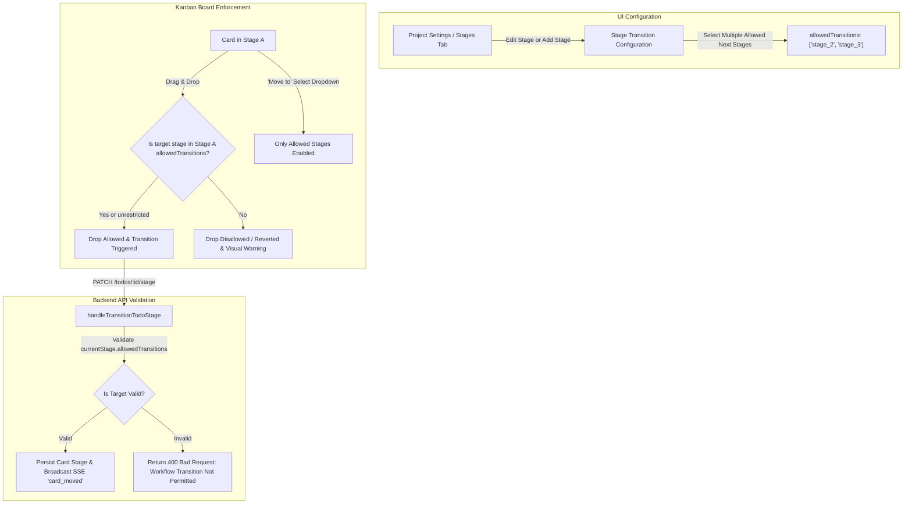

# Implementation Plan: Project Edit & Configurable Workflow Stage Transitions

## 1. Overview & Objectives

This plan addresses two core workflow management capabilities for the **GitHub Projects-style Planner**:
1. **Project Editing**: After creating a project, users with appropriate permissions (Owner or Admins with `canManageProject`) can edit project details (**Title** and **Description**) from both the **Projects List** and the **Active Project Board / Settings Dialog**.
2. **Dynamic Workflow Stages & Transition Matrix**: Keep the default workflow stages (`Backlog`, `In Progress`, `In Review`, `Done`), allow adding custom stages, and introduce an interface where users can configure for each stage which **next stage(s)** cards can be moved to (supporting multiple target stages, e.g. branching workflows: `In Progress` -> `In Review` or `Blocked`). Transitions are enforced both on the Kanban board (CDK Drag-and-Drop and "Move to" menu) and validated server-side by the REST API.

---

## 2. Git Information

- **Branch Name**: `feat/planner-project-edit-and-workflow-transitions`
- **Commit Message**:
  ```text
  feat(planner): add project edit option and configurable workflow stage transitions

  - Add project edit modal and action buttons in Projects list, active board header, and Settings dialog
  - Extend project stage schema with allowedTransitions (multi-target workflow stage routing)
  - Provide stage configuration interface with multi-select checkboxes for next allowed stages
  - Enforce stage transition rules in Kanban CDK drag-drop and card 'Move to' dropdown
  - Add backend validation in transitionTodoStage API to reject unauthorized workflow transitions
  ```

---

## 3. Workflow Architecture & Transition Matrix Flow



---

## 4. User Experience & Interface Specifications

### 4.1. Project Edit Option
- **Entry Points**:
  1. **Projects List View (`app-planner-projects-list`)**:
     - On project cards owned or managed by the user, add an **Edit Project** button (pencil icon) in the card action bar next to the delete button.
  2. **Active Project Header (`planner.component`)**:
     - Beside the project title and badges, add an **Edit** button (pencil icon) for instant editing.
  3. **Project Settings Dialog (`app-planner-project-settings-dialog`)**:
     - Introduce a new **"General"** tab (Tab list: `General` | `Collaborators` | `Stages` | `Roles`).
     - Allows modifying Project Title (required, max 200 chars) and Description (optional, max 2000 chars) with Save/Cancel controls.
- **Permissions Guard**:
  - Enabled only for Project Owners and users with `canManageProject` permission.

### 4.2. Workflow Stages & Multi-Target Transition Interface
- **Default Behavior**:
  - Newly created projects continue to initialize with standard default stages: `Backlog`, `In Progress`, `In Review`, `Done`.
  - Default stages start with flexible transitions (or logical presets: `Backlog` -> `In Progress`, `In Progress` -> `In Review` / `Backlog`, `In Review` -> `Done` / `In Progress`, `Done` -> `In Progress`).
  - Users can choose **"Any stage allowed"** (unrestricted) or restrict to specific target stages.
- **Stage Addition ("Add Stage" Form)**:
  - Input for **Stage Name**.
  - Color picker for **Stage Accent**.
  - Multi-select interface for **"Next Allowed Stages"**:
    - Toggle: `[x] Allow moving to any stage (Unrestricted)` OR checkboxes for each existing project stage.
    - Multiple stages can be checked (e.g. `In QA` can move to `Ready for Deploy` OR `Bug Found / In Progress`).
- **Stage Editing ("Edit Stage" Dialog / Inline Editor)**:
  - Clicking the Edit icon on an existing stage row opens an editor modal or drawer:
    - Edit Name, Color, and update **Next Allowed Stages** via interactive checkbox pills.
    - Visual indicators showing which stages are currently configured as valid destinations.
- **Kanban Board UX**:
  - **Drag-and-Drop (Angular CDK)**:
    - When dragging a card from Stage A, columns not in `allowedTransitions` are visually dimmed with a subtle "not-allowed" state.
    - `cdkDropListEnterPredicate` prevents dropping into illegal columns, giving instant tactile feedback.
  - **"Move to" Menu on Card**:
    - Disallowed stages are disabled in the `<select>` dropdown (with a `(Not allowed)` badge) or filtered to show only permitted target stages.
    - If a user tries to transition illegally, a clear error toast appears explaining the workflow restriction.

---

## 5. Technical Implementation Details

### 5.1. Data Models & Shared Types (`libs/shared-types`)
- In `libs/shared-types/src/lib/planner.ts`:
  ```typescript
  export interface IProjectStage {
    id: string;
    name: string;
    color?: string;
    order: number;
    isDefault?: boolean;
    allowedTransitions?: string[]; // Array of target stage IDs. If empty or undefined, any transition is permitted.
  }

  export interface ICreateStageDto {
    name: string;
    color?: string;
    allowedTransitions?: string[];
  }

  export interface IUpdateStageDto {
    name?: string;
    color?: string;
    allowedTransitions?: string[];
  }
  ```

### 5.2. Backend Implementation (`apps/portfolio-core`)
1. **Mongoose Schema (`models/planner-project.model.ts`)**:
   - Update `ProjectStageSchema`:
     ```typescript
     allowedTransitions: { type: [String], default: [] }
     ```
2. **Stage Service & Controller (`controllers/planner-projects.controller.ts`)**:
   - `handleAddStage`:
     - Accept `allowedTransitions` in request body.
     - Validate that all IDs in `allowedTransitions` (if specified) exist in `project.stages`.
   - `handleUpdateStage`:
     - Support updating `name`, `color`, and `allowedTransitions`.
   - `handleDeleteStage`:
     - When deleting a stage, remove its ID from `allowedTransitions` of all remaining stages in the project.
   - `handleTransitionTodoStage`:
     - Retrieve card's current stage (`currentStage = project.stages.find(s => s.id === todo.stageId)`).
     - If `currentStage?.allowedTransitions && currentStage.allowedTransitions.length > 0`:
       - Check if `targetStageId` is in `currentStage.allowedTransitions`.
       - If not allowed, respond with `400 Bad Request`: `Invalid stage transition. Tasks in "${currentStage.name}" cannot be moved to "${targetStage.name}".`
3. **Project Update Endpoint**:
   - Verify `PUT /api/planner/projects/:id` (`handleUpdateProject`) works seamlessly with Title and Description updates and broadcasts SSE `project_updated`.

### 5.3. Frontend Services & State (`apps/portfolio`)
1. **`PlannerApiService`**:
   - Ensure `updateProject(id, dto)` and `updateStage(projectId, stageId, dto)` pass `allowedTransitions`.
2. **`PlannerStateService`**:
   - Add `updateProject(projectId: string, dto: IUpdateProjectDto): Observable<IPlannerProject> | Promise<IPlannerProject>`:
     - Optimistically updates `myProjects`, `collaborativeProjects`, and `selectedProject`.
     - Calls API and syncs state.
   - Update `addStage` and `updateStage` methods to accept `allowedTransitions?: string[]`.
3. **`ProjectSettingsDialogComponent`**:
   - Add **General** tab for editing project details (Title, Description).
   - In **Stages** tab:
     - Add Edit Stage modal / inline form with checkboxes for multi-select next stages.
     - Add next stages multi-select to the Add Stage form.
     - Display badges next to each stage showing: `Can move to: [Stage B, Stage C]`.
4. **`KanbanBoardComponent`**:
   - Add transition validation helper `isTransitionAllowed(sourceStageId: string, targetStageId: string): boolean`.
   - Connect CDK `cdkDropListEnterPredicate` to block invalid target columns during drag.
   - Restrict or label options in the "Move to" select dropdown.

---

## 6. Step-by-Step Execution Plan

| Step | Phase | Task Description | Files Impacted |
|:---:|---|---|---|
| **1** | **Shared Types** | Extend `IProjectStage`, `ICreateStageDto`, `IUpdateStageDto` with `allowedTransitions?: string[]`. | `libs/shared-types/src/lib/planner.ts` |
| **2** | **Backend Models & Logic** | Update Mongoose schema, controller methods (`handleAddStage`, `handleUpdateStage`, `handleDeleteStage`, `handleTransitionTodoStage`) with transition validation. | `apps/portfolio-core/src/models/planner-project.model.ts`, `apps/portfolio-core/src/controllers/planner-projects.controller.ts` |
| **3** | **Frontend API & State** | Add `updateProject` in `PlannerStateService`; update `addStage` and `updateStage` signatures to support `allowedTransitions`. | `apps/portfolio/src/app/modules/user/components/planner/services/planner-state.service.ts`, `apps/portfolio/src/app/modules/user/components/planner/services/planner-api.service.ts` |
| **4** | **Project Settings UI** | Add General tab (edit title/desc) and Stages transition matrix configuration (multi-select next stages for new & existing stages). | `apps/portfolio/src/app/modules/user/components/planner/components/project-settings-dialog/project-settings-dialog.component.*` |
| **5** | **Projects List & Board Header** | Add Edit Project trigger buttons on project cards in `projects-list` and next to project title in `planner.component`. | `apps/portfolio/src/app/modules/user/components/planner/components/projects-list/projects-list.component.*`, `apps/portfolio/src/app/modules/user/components/planner/planner.component.*` |
| **6** | **Kanban Board Drag & Drop** | Implement `cdkDropListEnterPredicate` and filter/disable invalid stages in card "Move to" menu. | `apps/portfolio/src/app/modules/user/components/planner/components/kanban-board/kanban-board.component.*` |
| **7** | **Verification & Testing** | Run unit tests, lint checks, verify transitions and project edits in browser. | Test suites & manual dev testing |

---

## 7. Verification Checklist

- [ ] Project owner / admin can edit Project Title & Description from Projects List and Active Board.
- [ ] Non-authorized members cannot see/use edit project controls.
- [ ] Users can add new workflow stages and configure their allowed next stages.
- [ ] Users can edit existing default and custom stages to modify next allowed transitions (multi-selection).
- [ ] Drag-and-drop restricts dragging cards to disallowed target columns.
- [ ] "Move to" dropdown on card only enables allowed next stages.
- [ ] Direct API requests to transition a card to an invalid stage are rejected with HTTP 400.
- [ ] Deleting a stage cleans up references in other stages' `allowedTransitions`.
- [ ] Existing dev servers compile without TypeScript or lint errors.
