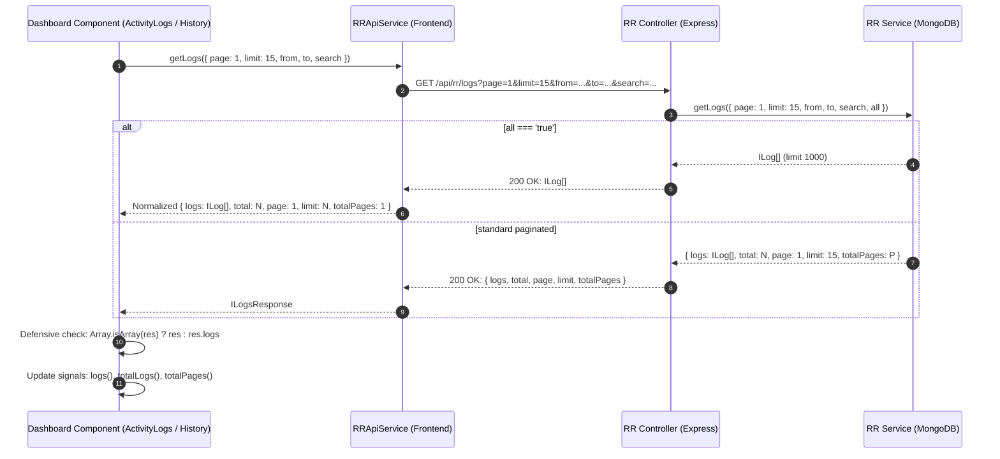

# Implementation Plan: RR API Response Contracts, Pagination & Activity Logs Fix

## 1. Overview & Root Cause Analysis

### 1.1 Context
In recent backend refactoring commits (`7a6344e` and `99fc1ba`), the monolithic `rr.routes.ts` file was decomposed into modular feature controllers and services under `apps/portfolio-core/src/modules/rr/`. During this transformation, several endpoint response contracts and query parameter handlings were altered or truncated.

Specifically:
- At [activity-logs.component.ts:L236](file:///e:/Code/portfolio/apps/portfolio/src/app/modules/rr/components/dashboard/components/activity-logs/activity-logs.component.ts#L236-L244):
  ```typescript
  const res = await this.rrApi.getLogs({
    from: fromIso || undefined,
    to: toIso || undefined,
    page: this.currentPage(),
    limit: this.pageSize(),
    search: combinedSearch || undefined,
  });

  this.logs.set(res?.logs || []);
  this.totalLogs.set(res?.total || 0);
  this.totalPages.set(res?.totalPages || 1);
  ```
- **The Failure**:
  - `apps/portfolio-core/src/modules/rr/logs/rr-log.controller.ts` calls `RRLogService.getLogs(limit)` and executes `res.json(logs)`.
  - `RRLogService.getLogs()` returns a flat array of `ILog[]` (limited to 100 items).
  - Because `res` is an array:
    - `res?.logs` is `undefined` (falling back to `[]`).
    - `res?.total` is `undefined` (falling back to `0`).
    - `res?.totalPages` is `undefined` (falling back to `1`).
  - Furthermore, `RRLogController` and `RRLogService` completely dropped `from`, `to`, `page`, `limit`, `search`, and `all` query parameters, breaking date filtering, search filtering, and pagination navigation.

---

## 2. Comprehensive Audit of Affected Endpoints & Components

A systematic comparison between the legacy `rr.routes.ts`, all controllers in `apps/portfolio-core`, and all HTTP calls across `apps/portfolio` revealed the following discrepancies:

| Endpoint | Affected Controller & Service | Expected Contract by Frontend | Current Backend Implementation | Impact |
| :--- | :--- | :--- | :--- | :--- |
| **`GET /api/rr/logs`** | `RRLogController.getLogs`<br>`RRLogService.getLogs` | `ILogsResponse` `{ logs: ILog[], total: number, page: number, limit: number, totalPages: number }` (or `ILog[]` if `all=true`) | Returns raw `ILog[]` array directly. Ignores `from`, `to`, `search`, `page`, `limit`, `all`. | `activity-logs.component.ts` gets `undefined` for `logs`, `total`, `totalPages`. `stats-view.component.ts` recent logs are empty. |
| **`GET /api/rr/bookings`** | `RRBookingController.getBookings`<br>`RRBookingService.getBookings` | Supports unpaginated `IBooking[]` and paginated `IBookingsResponse` `{ bookings: IBooking[], total: number, page: number, limit: number, totalPages: number }` | Controller drops `from`, `to`, `paginate`, `all`, `includeDeleted`, `history`. Omitted `req.userId` and `req.userRole`. | History view date filtering is ignored. `paginate=true` without `page`/`limit` falls back to array. Role scoping for non-admin staff fails. |
| **`GET /api/rr/employees`** | `RREmployeeController.getEmployees` | `IEmployee[]` | Hardcodes `RREmployeeService.getEmployees(false)`. | `req.query['includeDeleted'] === 'true'` is ignored when requesting deactivated employees. |
| **`POST /api/rr/employees/:id/reset-password`** | `RREmployeeController.resetPassword`<br>`RREmployeeService.resetPassword` | `{ success: boolean, message: string, temporaryPassword: string }` | Returns `{ message: string, temporaryPassword: string }` without `success: true`. | Inconsistent contract with `RRApiService.resetEmployeePassword` interface. |
| **`DELETE /api/rr/bookings/:id`** | `RRBookingController.deleteBooking` | `{ message: string }` | Only passes `req.body`. | Ignores `req.query` fallback for `deletionReason`, `reasonForDeletion`, and `returnAmount` when body is empty. |
| **`GET /api/rr/feedback` & `GET /api/rr/feedback/my`** | `RRFeedbackController.getFeedbacks`<br>`RRFeedbackController.getMyFeedback` | `{ success: boolean, total: number, data: IRRFeedback[] }`<br>`{ success: boolean, data: IRRFeedback[] }` | Returns wrapped object. Frontend service returns `res.data`. | If an array or alternative payload format is returned, `res.data` evaluates to `undefined`. Defensive normalization needed in `RRApiService` and `feedback-admin.component.ts`. |
| **`GET /api/rr/customers`** | `RRCustomerController.getCustomers` | `ICustomerListResponse` | Returns `{ customers, total, page, limit, totalPages }`. | `new-booking-dialog.component.ts:L379` directly reads `list.customers.find(...)`. Needs defensive guard. |
| **`GET /api/rr/reports/status`** | `RRReportController.getStatusReport` | `IRRStatusReportResponse` | Returns `{ bookings, summary, page, limit, totalPages, totalCount }`. | `status-reports.component.ts` directly reads `res.bookings`. Needs defensive guard. |
| **Frontend Consumption** | `activity-logs.component.ts`<br>`stats-view.component.ts`<br>`history.component.ts`<br>`booking-list.component.ts`<br>`advance-booking-list.component.ts`<br>`status-reports.component.ts`<br>`feedback-admin.component.ts`<br>`new-booking-dialog.component.ts` | Resilient UI components | Components assume rigid object or array types without defensive checks. | If backend returns array or wrapped object unexpectedly, signals crash or UI displays empty state. |

---

## 3. Git Information, Branch Strategy & Commit Schedule (from 02-12-2026)

All tasks are related to resolving API response contracts, pagination parameter forwarding, and defensive consumption across backend and frontend. They will be managed in **one dedicated branch** (`fix/rr-api-contracts-pagination-and-activity-logs`), with commits dated from **02-12-2026** (`2026-12-02`):

| Task # | Scope / Focus Area | Proposed Commit Timestamp | Proposed Commit Message |
| :--- | :--- | :--- | :--- |
| **Task 1** | **Backend Core (Logs & Bookings)**<br>Restore pagination, date filtering, regex search, and response contracts in `RRLogController`, `RRLogService`, and `RRBookingController`. | `2026-12-02 10:00:00 +0530` | `fix(rr-core): restore pagination, date filtering, and response contract for activity logs and bookings` |
| **Task 2** | **Backend Core (Employees & Bookings Deletion)**<br>Support `includeDeleted` in `RREmployeeController`, return `success: true` in `resetPassword`, and support query fallback in `deleteBooking`. | `2026-12-02 11:30:00 +0530` | `fix(rr-core): support includeDeleted in employee list and preserve success contract in reset-password` |
| **Task 3** | **Frontend Service Client Resilience**<br>Add defensive response normalization in `RRApiService` for `getLogs`, `getBookingsPaginated`, `getMyFeedbacks`, and `getFeedbacks`. | `2026-12-02 13:00:00 +0530` | `fix(rr): add defensive unwrap and fallback handling in rr-api service for paginated endpoints` |
| **Task 4** | **Frontend UI Components Defensive Signals**<br>Add array/object guard checks in `activity-logs`, `stats-view`, `history`, `booking-list`, `advance-booking-list`, `status-reports`, `feedback-admin`, and `new-booking-dialog`. | `2026-12-02 14:30:00 +0530` | `fix(rr): resolve activity logs, history, and dashboard components crash on array response` |

---

## 4. Architecture & Data Flow Diagrams

### 4.1 Paginated Logs & Bookings Request-Response Flow



### 4.2 Frontend Defensive Normalization Flow

```mermaid
flowchart TD
    A[Incoming API Response 'res'] --> B{Is 'res' an Array?}
    B -->|Yes: Raw Array| C[Extract list = res]
    C --> D[Compute total = res.length]
    D --> E[Compute totalPages = Math.ceil total / pageSize]
    B -->|No: Wrapped Object| F[Extract list = res.logs || res.bookings || []]
    F --> G[Extract total = res.total || list.length]
    G --> H[Extract totalPages = res.totalPages || 1]
    E --> I[Update Angular Signals]
    H --> I[Update Angular Signals]
```

---

## 5. Detailed Task Breakdown & Implementation Steps

### Task 1: Restore Pagination, Date Filtering & Response Contract for Logs & Bookings
- **Files to Modify**:
  - [rr-log.service.ts](file:///e:/Code/portfolio/apps/portfolio-core/src/modules/rr/logs/rr-log.service.ts)
  - [rr-log.controller.ts](file:///e:/Code/portfolio/apps/portfolio-core/src/modules/rr/logs/rr-log.controller.ts)
  - [rr-booking.controller.ts](file:///e:/Code/portfolio/apps/portfolio-core/src/modules/rr/bookings/rr-booking.controller.ts)
- **Detailed Changes**:
  1. **`RRLogService.getLogs(options)`**:
     - Accept options: `{ from?: string, to?: string, page?: number | string, limit?: number | string, search?: string, all?: string | boolean }`.
     - Build Mongo `Filter<ILog>`:
       - If `from` or `to` present: query `timestamp` with `$gte` and `$lte`.
       - If `search` present: use `safeRegex` across `action`, `performedBy`, `role`, and `details`.
     - If `all === 'true'`: return `ILog[]` (max 1000 items).
     - Otherwise: calculate `pageNum`, `limitNum` (1 to 100, default 15), `skip = (pageNum - 1) * limitNum`.
     - Execute `Promise.all([find(...).skip(...).limit(...), countDocuments(...)])`.
     - Return `{ logs, total, page: pageNum, limit: limitNum, totalPages: Math.ceil(total / limitNum) || 1 }`.
  2. **`RRLogController.getLogs(req, res)`**:
     - Parse `from`, `to`, `page`, `limit`, `search`, `all` from `req.query`.
     - Pass options to `RRLogService.getLogs(...)` and return `res.json(result)`.
  3. **`RRBookingController.getBookings(req, res)`**:
     - Forward `from`, `to`, `paginate`, `all`, `includeDeleted`, `history` from `req.query` to `RRBookingService.getBookings`.
     - Forward `req.userId` and `req.userRole` into `RRBookingService.getBookings(queryOptions, req.userId, req.userRole)`.

### Task 2: Fix Employee Query & Booking Deletion Controller Contracts
- **Files to Modify**:
  - [rr-employee.controller.ts](file:///e:/Code/portfolio/apps/portfolio-core/src/modules/rr/employees/rr-employee.controller.ts)
  - [rr-booking.controller.ts](file:///e:/Code/portfolio/apps/portfolio-core/src/modules/rr/bookings/rr-booking.controller.ts)
- **Detailed Changes**:
  1. **`RREmployeeController.getEmployees`**:
     - Read `const includeDeleted = req.query['includeDeleted'] === 'true'`.
     - Pass `includeDeleted` to `RREmployeeService.getEmployees(includeDeleted)`.
  2. **`RREmployeeController.resetPassword`**:
     - Return `{ success: true, message: result.message, temporaryPassword: result.temporaryPassword }` to align with the frontend contract.
  3. **`RRBookingController.deleteBooking`**:
     - Merge `req.body` with query parameters (`deletionReason: req.body?.deletionReason || req.query['deletionReason'] || req.query['reasonForDeletion']`, `returnAmount: req.body?.returnAmount ?? req.query['returnAmount']`).

### Task 3: Enhance Frontend API Services with Defensive Normalization
- **Files to Modify**:
  - [rr-api.service.ts](file:///e:/Code/portfolio/apps/portfolio/src/app/modules/rr/services/rr-api.service.ts)
  - [rr-customer-api.service.ts](file:///e:/Code/portfolio/apps/portfolio/src/app/modules/rr/services/rr-customer-api.service.ts)
- **Detailed Changes**:
  1. **`getLogs(params)`**:
     - If the response is a raw array (`Array.isArray(res)`), wrap it into `ILogsResponse` `{ logs: res, total: res.length, page: params?.page || 1, limit: params?.limit || 15, totalPages: Math.ceil(res.length / (params?.limit || 15)) || 1 }`.
     - If already an object with `res.logs`, return as is.
  2. **`getBookingsPaginated(params)`**:
     - If the response is an array (`Array.isArray(res)`), wrap it into `IBookingsResponse` `{ bookings: res, total: res.length, page: params?.page || 1, limit: params?.limit || 10, totalPages: Math.ceil(res.length / (params?.limit || 10)) || 1 }`.
  3. **`getMyFeedbacks()` & `getFeedbacks()`**:
     - Defensively check if `Array.isArray(res)` vs `{ success, data }` and return safe array.

### Task 4: Make Frontend UI Components Resilient to Response Shape Variations
- **Files to Modify**:
  - [activity-logs.component.ts](file:///e:/Code/portfolio/apps/portfolio/src/app/modules/rr/components/dashboard/components/activity-logs/activity-logs.component.ts)
  - [stats-view.component.ts](file:///e:/Code/portfolio/apps/portfolio/src/app/modules/rr/components/dashboard/components/stats-view/stats-view.component.ts)
  - [history.component.ts](file:///e:/Code/portfolio/apps/portfolio/src/app/modules/rr/components/dashboard/components/history/history.component.ts)
  - [booking-list.component.ts](file:///e:/Code/portfolio/apps/portfolio/src/app/modules/rr/components/dashboard/components/booking-list/booking-list.component.ts)
  - [advance-booking-list.component.ts](file:///e:/Code/portfolio/apps/portfolio/src/app/modules/rr/components/dashboard/components/advance-booking-list/advance-booking-list.component.ts)
  - [status-reports.component.ts](file:///e:/Code/portfolio/apps/portfolio/src/app/modules/rr/components/dashboard/components/status-reports/status-reports.component.ts)
  - [feedback-admin.component.ts](file:///e:/Code/portfolio/apps/portfolio/src/app/modules/rr/components/dashboard/components/feedback-admin/feedback-admin.component.ts)
  - [new-booking-dialog.component.ts](file:///e:/Code/portfolio/apps/portfolio/src/app/modules/rr/shared/dialogs/new-booking-dialog/new-booking-dialog.component.ts)
- **Detailed Changes**:
  1. **`activity-logs.component.ts`**:
     ```typescript
     const list = Array.isArray(res) ? res : (res?.logs || []);
     const total = Array.isArray(res) ? res.length : (res?.total ?? list.length);
     const totalPages = Array.isArray(res)
       ? Math.ceil(res.length / this.pageSize()) || 1
       : (res?.totalPages ?? 1);

     this.logs.set(list);
     this.totalLogs.set(total);
     this.totalPages.set(totalPages);
     ```
  2. **`stats-view.component.ts`**:
     ```typescript
     const list = Array.isArray(res) ? res : (res?.logs || []);
     this.recentLogs.set(list);
     ```
  3. **`history.component.ts`**:
     ```typescript
     const list = Array.isArray(res) ? res : (res?.bookings || []);
     const total = Array.isArray(res) ? res.length : (res?.total ?? list.length);
     const totalPages = Array.isArray(res)
       ? Math.ceil(res.length / this.pageSize()) || 1
       : (res?.totalPages ?? 1);

     this.bookings.set(list);
     this.totalRecords.set(total);
     this.totalPages.set(totalPages);
     ```
  4. **`booking-list.component.ts` & `advance-booking-list.component.ts`**:
     ```typescript
     this.bookings.set(Array.isArray(data) ? data : ((data as any)?.bookings || []));
     ```
  5. **`status-reports.component.ts`**:
     ```typescript
     const bookingList = Array.isArray(res) ? res : (res?.bookings || []);
     this.bookings.set(bookingList);
     this.totalCount.set(Array.isArray(res) ? res.length : (res?.totalCount ?? bookingList.length));
     this.totalPages.set(Array.isArray(res) ? Math.ceil(res.length / this.pageSize()) || 1 : (res?.totalPages ?? 1));
     ```
  6. **`feedback-admin.component.ts`**:
     ```typescript
     const list = Array.isArray(feedbacksRes) ? feedbacksRes : (feedbacksRes?.data || []);
     this.feedbacks.set(list);
     ```
  7. **`new-booking-dialog.component.ts`**:
     ```typescript
     const customerList = Array.isArray(list) ? list : (list?.customers || []);
     const matched = customerList.find((c) => c.phone === phone);
     ```

---

## 6. Verification & Validation Plan

### 6.1 Automated Verification
1. **Compilation Check**:
   - `npx nx build portfolio-core`
   - `npx nx build portfolio`
2. **Linting Check**:
   - `npx nx lint portfolio-core`
   - `npx nx lint portfolio`
3. **Unit & Component Tests**:
   - Run affected component unit tests:
     - `npx nx test portfolio --testFile=activity-logs.component.spec.ts`
     - `npx nx test portfolio --testFile=history.component.spec.ts`
     - `npx nx test portfolio --testFile=rr-api.service.spec.ts`

### 6.2 Manual & API Contract Verification
1. Call `GET /api/rr/logs?page=1&limit=5`:
   - Verify response has `{ logs: [...], total: N, page: 1, limit: 5, totalPages: P }`.
2. Call `GET /api/rr/logs?all=true`:
   - Verify response is array `ILog[]`.
3. Call `GET /api/rr/bookings?paginate=true&page=1&limit=10`:
   - Verify response has `{ bookings: [...], total: N, page: 1, limit: 10, totalPages: P }`.
4. Call `GET /api/rr/employees?includeDeleted=true`:
   - Verify deactivated/deleted employees are returned.
5. In UI:
   - Navigate to `/user/rr/dashboard/logs`. Verify activity logs render, total logs count is correct, and pagination buttons navigate between pages.
   - Navigate to `/user/rr/dashboard/stats`. Verify recent logs card displays latest 5 entries.
   - Navigate to `/user/rr/dashboard/history`. Verify date range filtering and pagination work properly.
