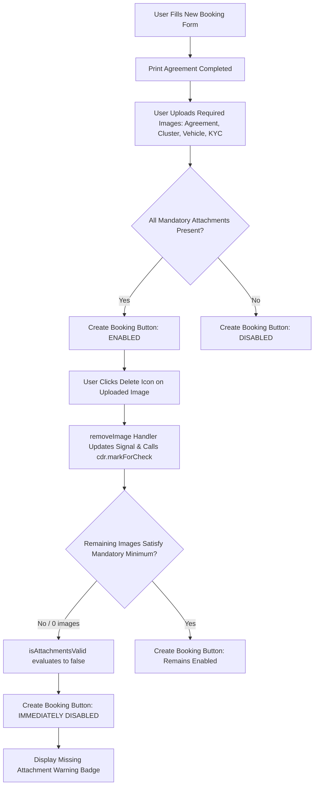
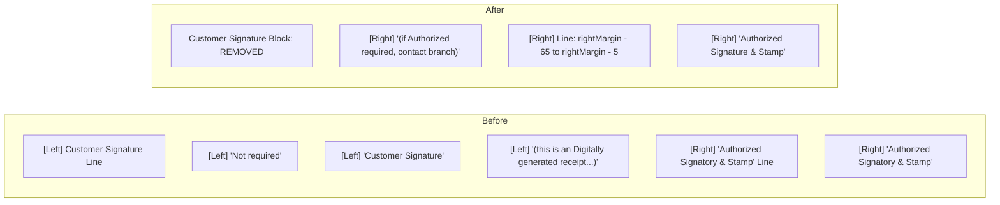

# Implementation Plan: RR Booking, Invoice & Dashboard Refinements

## 1. Overview & Objectives

This implementation plan divides the requested enhancements into **3 modular tasks and branches** (combining related Dashboard tasks into one branch), with commits starting from **03-12-2026** (`2026-12-03`):

1. **New Booking**: Disable the **"Create Booking"** button when an uploaded image is deleted or when mandatory attachments requirements are not met.
2. **Invoice PDF**: Remove the customer signature area and move the text `"(if Authorized required, contact branch)"` directly to the top of the **"Authorized Signatory & Stamp"** signature block.
3. **Dashboard (In Service & Templates)**:
   - **In Service**: Keep the hover overlay update button and the red/rose status banner update button on vehicle cards in "In Service" (maintenance), while removing all redundant update buttons (touch-screen duplicate buttons and external buttons below cards).
   - **Templates**: Add a multi-select control directly above `"Available Dynamic Placeholders (Click to insert):"` in the WhatsApp Templates editor to assign which Dashboard cards the template should be displayed on (defaulting to empty `[]`).

---

## 2. Git Information, Branch Strategy & Commit Schedule (from 03-12-2026)

Related tasks are grouped into their respective branches. Each branch builds cleanly on the previous task.

| Branch Name | Scope / Related Tasks | Commit Timestamp | Primary Commit Message |
| :--- | :--- | :--- | :--- |
| `fix/rr-new-booking-disable-create-on-image-delete` | **Task 1: New Booking**<br>Disable Create Booking button when uploaded image is deleted | `2026-12-03 10:00:00 +0530` | `fix(rr): disable create booking button when uploaded image is deleted or mandatory attachments missing` |
| `feat/rr-invoice-pdf-signature-layout-refinement` | **Task 2: Invoice PDF**<br>Remove customer signature & reposition authorization notice above authorized signature | `2026-12-03 11:30:00 +0530` | `feat(rr): remove customer signature and position authorization notice above authorized signature in invoice pdf` |
| `feat/rr-dashboard-in-service-and-template-card-targets` | **Task 3: Dashboard**<br>1. Streamline in-service buttons (keep hover + red button, remove remain)<br>2. Add multi-select dashboard cards target above template placeholders | `2026-12-03 14:00:00 +0530`<br><br>`2026-12-03 15:30:00 +0530` | `feat(rr): streamline in-service vehicle actions by keeping hover and red status update buttons and removing duplicate buttons`<br><br>`feat(rr): add dashboard cards multi-select assignment to whatsapp templates configuration` |

---

## 3. Architecture & Interaction Diagrams

### 3.1 New Booking Button Disable on Image Deletion



### 3.2 Invoice PDF Signatures Layout Transformation



---

## 4. Detailed Task Breakdown & Implementation Details

---

### Task 1: New Booking - Disable Create Booking Button on Image Deletion

- **Branch Name**: `fix/rr-new-booking-disable-create-on-image-delete`
- **Commit Date**: `2026-12-03 10:00:00 +0530`
- **Commit Message**:
  ```text
  fix(rr): disable create booking button when uploaded image is deleted or mandatory attachments missing

  - Ensure all image removal handlers in new-booking-dialog trigger change detection and update validation signals
  - Guarantee that deleting an uploaded image immediately disables Create Booking when mandatory requirements are unmet
  - Inject ChangeDetectorRef and call markForCheck in removeSignedAgreement, removeInstrumentCluster, removeVehicleImage, removeCustomerId, and removeDepositImage
  - Update missing attachments feedback badge to immediately reflect missing items upon deletion
  ```
- **Files Touched**:
  - `apps/portfolio/src/app/modules/rr/shared/dialogs/new-booking-dialog/new-booking-dialog.component.ts`
  - `apps/portfolio/src/app/modules/rr/shared/dialogs/new-booking-dialog/new-booking-dialog.component.html`

- **Technical Fix**:
  1. Inject `ChangeDetectorRef` in `NewBookingDialogComponent`.
  2. In all removal methods:
     - `removeSignedAgreement()`: set `signedAgreementUrl` to `null` and call `this.cdr.markForCheck()`.
     - `removeInstrumentCluster(idx)`: filter array and call `this.cdr.markForCheck()`.
     - `removeVehicleImage(idx)`: filter array and call `this.cdr.markForCheck()`.
     - `removeCustomerId(idx)`: filter array and call `this.cdr.markForCheck()`.
     - `removeGuaranteeId(idx)`: filter array and call `this.cdr.markForCheck()`.
     - `removeDepositImage(idx)`: filter array and call `this.cdr.markForCheck()`.
  3. Ensure that when any image is removed, if the mandatory requirements are no longer met (signed agreement is null, or cluster < 1, or vehicleImages < 1, or customerIds < 1, or deposit < 1 if deposit is required), `isAttachmentsValid` evaluates to `false` and immediately forces the Create Booking button to be disabled.

---

### Task 2: Invoice PDF - Remove Customer Signature & Move Text Above Authorized Signature

- **Branch Name**: `feat/rr-invoice-pdf-signature-layout-refinement`
- **Commit Date**: `2026-12-03 11:30:00 +0530`
- **Commit Message**:
  ```text
  feat(rr): remove customer signature and position authorization notice above authorized signature in invoice pdf

  - Remove customer signature line, 'Not required' note, and 'Customer Signature' label from invoice PDF
  - Move '(if Authorized required, contact branch)' text to the right side directly above Authorized Signature & Stamp
  - Adjust vertical coordinates and typography for balanced invoice footer alignment
  - Update signature note info banner in rr-pdf-viewer-dialog to match the revised layout
  ```
- **Files Touched**:
  - `apps/portfolio/src/app/modules/rr/services/rr-invoice-pdf.service.ts`
  - `apps/portfolio/src/app/modules/rr/shared/dialogs/pdf-viewer-dialog/rr-pdf-viewer-dialog.component.ts`

- **Technical Fix**:
  1. In `rr-invoice-pdf.service.ts` (lines 959–994):
     - Remove customer signature line (`doc.line(leftMargin + 5, sigY, leftMargin + 65, sigY)`), `"Not required"`, and `"Customer Signature"`.
     - Reposition notice text:
       ```typescript
       // Signatures Section
       const sigY = y + 14;

       // Notice on top of Authorized Signature & Stamp
       doc.setFont('Helvetica', 'normal');
       doc.setFontSize(6.5);
       doc.setTextColor(100, 116, 139);
       doc.text(
         '(if Authorized required, contact branch)',
         rightMargin - 35,
         sigY - 2,
         { align: 'center' }
       );

       // Authorized Signatory Separator Line
       doc.setDrawColor(203, 213, 225); // slate-300
       doc.line(rightMargin - 65, sigY + 1.5, rightMargin - 5, sigY + 1.5);

       // Authorized Signatory Label
       doc.setFont('Helvetica', 'bold');
       doc.setFontSize(8);
       doc.setTextColor(100, 116, 139);
       doc.text('Authorized Signature & Stamp', rightMargin - 35, sigY + 5.5, {
         align: 'center',
       });
       ```
  2. In `rr-pdf-viewer-dialog.component.ts` (lines 305–311):
     - Update the note banner to reflect the change:
       ```html
       <div>
         <span class="font-semibold text-foreground">Signature Note:</span>
         <span> "(if Authorized required, contact branch)" positioned above Authorized Signature & Stamp.</span>
       </div>
       ```

---

### Task 3: Dashboard - In-Service Buttons Streamlining & Templates Cards Multi-Select

- **Branch Name**: `feat/rr-dashboard-in-service-and-template-card-targets`
- **Files Touched**:
  - `apps/portfolio/src/app/modules/rr/shared/components/vehicle-card/vehicle-card.component.html`
  - `apps/portfolio/src/app/modules/rr/components/dashboard/components/stats-view/stats-view.component.html`
  - `libs/shared-types/src/lib/rr.ts`
  - `apps/portfolio/src/app/modules/rr/components/dashboard/components/whatsapp-templates/whatsapp-templates.component.html`
  - `apps/portfolio/src/app/modules/rr/components/dashboard/components/whatsapp-templates/whatsapp-templates.component.ts`

#### Part 3A: In-Service Buttons Streamlining
- **Commit Date**: `2026-12-03 14:00:00 +0530`
- **Commit Message**:
  ```text
  feat(rr): streamline in-service vehicle actions by keeping hover and red status update buttons and removing duplicate buttons

  - Retain desktop hover overlay 'Update Date' button on in-service vehicle cards
  - Retain 'Update' button inside red/rose 'Next Available by:' badge banner
  - Remove duplicate touch-screen fallback 'Update Date' button from bottom action bar of vehicle card in maintenance
  - Remove redundant external 'Update Available Date' action buttons below vehicle cards in dashboard stats view
  ```
- **Technical Fix**:
  1. In `vehicle-card.component.html`:
     - KEEP: Desktop hover overlay button (`showUpdateAvailability` in lines 98–108).
     - KEEP: Red/rose banner update button (`showUpdateAvailability` inside `@if (vehicle.status === 'maintenance')`, lines 195–207).
     - REMOVE: Bottom touch-screen fallback `Update Date` button inside `.touch-action-trigger` (lines 250–262) for maintenance.
  2. In `stats-view.component.html`:
     - REMOVE: Redundant external buttons `<button ...>Update Available Date</button>` rendered below vehicle cards in maintenance (lines 338–352, 430–445, 474–485).

#### Part 3B: Templates Dashboard Cards Multi-Select
- **Commit Date**: `2026-12-03 15:30:00 +0530`
- **Commit Message**:
  ```text
  feat(rr): add dashboard cards multi-select assignment to whatsapp templates configuration

  - Extend IRRWhatsAppTemplate interface with dashboardCards array of card identifiers
  - Set default value of dashboardCards to [] (empty array) across all default templates
  - Add interactive multi-select chip toggle controls directly above Dynamic Placeholders in template editor
  - Support selecting multiple dashboard cards (Total Fleet, Available, Active Bookings, Reserved Fleet, In Service, In-Contract, Pending Payments)
  - Persist selected dashboard cards in WhatsApp configuration API updates
  ```
- **Technical Fix**:
  1. In `libs/shared-types/src/lib/rr.ts`:
     - Define `IRRDashboardCardKey = 'fleet' | 'available' | 'bookings' | 'reserved' | 'maintenance' | 'contract' | 'payments'`.
     - Add `dashboardCards?: IRRDashboardCardKey[];` to `IRRWhatsAppTemplate`.
     - In `DEFAULT_RR_WHATSAPP_CONFIG`, initialize `dashboardCards: []` on all default templates.
  2. In `whatsapp-templates.component.ts`:
     - Define `dashboardCardOptions`.
     - Add `toggleDashboardCard(cardKey)` and `isDashboardCardSelected(cardKey)`.
  3. In `whatsapp-templates.component.html`:
     - Directly above `<!-- Dynamic Placeholders Chips -->` (line 160), add the multi-select section with toggle chips for each card.

---

## 5. Verification & Testing Strategy

1. **New Booking Image Deletion**:
   - Open New Booking dialog, enter valid details, click Print Agreement.
   - Upload Signed Agreement, Cluster Image, Vehicle Image, and Customer ID.
   - Confirm "Create Booking" button becomes enabled.
   - Click "Delete" on Vehicle Image (reducing count to 0) -> assert "Create Booking" immediately disables.
   - Re-upload Vehicle Image -> assert "Create Booking" immediately re-enables.
   - Repeat for Cluster Image, Customer ID, and Signed Agreement.

2. **Invoice PDF Signatures**:
   - Generate invoice PDF.
   - Verify that the left Customer Signature line and labels are completely removed.
   - Verify that `(if Authorized required, contact branch)` renders directly above the Authorized Signature & Stamp separator line.

3. **Dashboard In-Service Buttons**:
   - Navigate to Overview Dashboard -> click "In Service" card to expand fleet.
   - Verify vehicle card has the red/rose "Next Available by:" banner with its internal "Update" button.
   - Hover over the vehicle card on desktop -> verify overlay "Update Date" button appears.
   - Verify that no third external button is displayed below the card and no duplicate touch button appears.

4. **Templates Dashboard Cards Multi-Select**:
   - Navigate to Dashboard -> WhatsApp Templates tab.
   - Verify that above "Available Dynamic Placeholders (Click to insert):", the "Display in Dashboard Cards (Multi-Select)" section appears.
   - Verify by default no cards are selected (`0 card(s) selected`).
   - Click cards (e.g., "Available", "In Service") -> verify active styling and badge count.
   - Click "Save Changes" -> verify saved config persists the selections.
   - Click "Reset" -> verify resets to default empty list.

5. **Typecheck & Build**:
   - Run `npx nx typecheck portfolio` (or build verification) to ensure zero compile or template errors.
