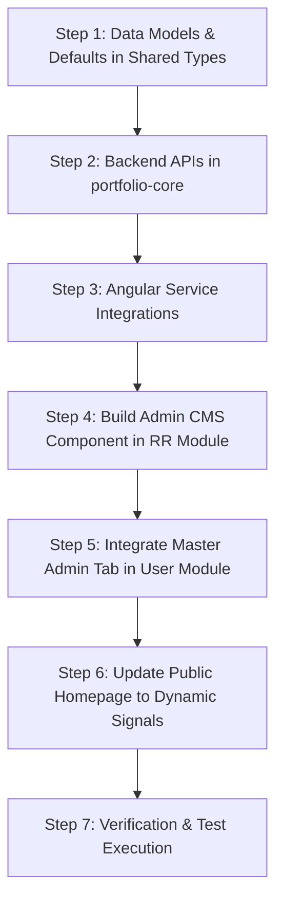

# Implementation Plan: RR Dynamic Homepage Content & Banner Management

## 1. Overview & Objectives

Currently, the RoadReady (`RR`) public homepage (`/user/rr` or `/user/rr/home`) contains hardcoded marketing copy, service highlights, about-us statistics, contact details, and a static hero background banner image. 

This feature introduces a comprehensive dynamic Content Management System (CMS) for the RR homepage:
1. **Dynamic Content & Banner Management**:
   - Enables Administrators to dynamically update all home page content:
     - Hero banner images (supporting single or multi-banner carousel rotation, custom overlays, and CTA links).
     - Hero titles, taglines, subtitles, and call-to-action buttons.
     - Brand information, office locations, phone numbers, email desks, and social/web links.
     - Services list (titles, descriptions, icons, and hover descriptions).
     - About Us section (narratives and 4 key metric stats: years of experience, fleet size, happy bookings, safe rides).
     - Contact desk info and footer copyright.
2. **Default Content Fallback**:
   - Ships with an authoritative default content blueprint matching the current production homepage.
   - If the admin has not customized a field or chooses to reset it, the system automatically falls back to default values.
   - Provides a "Restore Factory Defaults" action with confirmation.
3. **Admin Page Inside RR Module & User Module Master Admin Integration**:
   - **Primary Page**: A dedicated CMS page inside the RR module (`/user/rr/home-content`) under the RR Admin Dashboard sidebar.
   - **User Module Master Integration**: As requested ("prefer user module master for Admin page"), integrate access within the Master Admin console (`/user/admin`) via a dedicated "RR Homepage CMS" tab or management bridge, adhering to the User Module Master styling and permission guards (`masterAdminGuard`).

---

## 2. Git Information

- **Branch Name**:
  `feat/rr-dynamic-homepage-content-and-banner-management`

- **Commit Message**:
  ```text
  feat(rr): dynamic homepage content and banner management with admin cms and default fallbacks

  - Create dynamic homepage content schema with hero banners, services, about, and contact sections
  - Implement public and authenticated admin APIs for fetching, updating, and restoring default homepage content
  - Build admin CMS page inside RR module with banner carousel manager and section-by-section live editors
  - Integrate management entry point within user module master admin console
  - Wire public RR homepage to dynamically render content with seamless default fallbacks
  - Add comprehensive unit and e2e test specifications
  ```

---

## 3. Data Architecture & Models

### 3.1 Shared Types (`libs/shared-types/src/lib/rr.ts`)

```typescript
export interface IRRHomeBanner {
  id: string;
  imageUrl: string;
  title?: string;
  subtitle?: string;
  altText?: string;
  badgeText?: string;
  ctaText?: string;
  ctaLink?: string;
  isActive: boolean;
  order: number;
}

export interface IRRHomeHeroContent {
  badge: string;
  title: string;
  subtitle: string;
  primaryCtaText: string;
  primaryCtaLink: string;
  secondaryCtaText: string;
  secondaryCtaLink: string;
  banners: IRRHomeBanner[];
  autoRotateBanners: boolean;
  bannerIntervalSeconds: number;
}

export interface IRRHomeServiceItem {
  id: string;
  title: string;
  description: string;
  icon: string; // Lucide icon identifier (e.g. 'lucideKey', 'lucideMap')
  hoverText?: string;
  isActive: boolean;
  order: number;
}

export interface IRRHomeServicesSection {
  tagline: string;
  title: string;
  description: string;
  items: IRRHomeServiceItem[];
}

export interface IRRHomeStatItem {
  id: string;
  value: string;
  label: string;
  order: number;
}

export interface IRRHomeAboutSection {
  tagline: string;
  title: string;
  paragraphs: string[];
  stats: IRRHomeStatItem[];
}

export interface IRRHomeFleetSection {
  tagline: string;
  title: string;
  description: string;
}

export interface IRRHomeContactItem {
  id: string;
  type: 'address' | 'phone' | 'email' | 'web';
  title: string;
  values: string[];
  icon: string;
  order: number;
}

export interface IRRHomeContactSection {
  tagline: string;
  title: string;
  description: string;
  items: IRRHomeContactItem[];
  primaryPhone: string;
  primaryPhoneRaw: string;
  secondaryPhone: string;
  secondaryPhoneRaw: string;
  whatsappNumberRaw: string;
}

export interface IRRHomeFooterContent {
  brandName: string;
  copyrightText: string;
}

export interface IRRHomePageContent {
  _id?: string;
  isCustomized: boolean;
  hero: IRRHomeHeroContent;
  services: IRRHomeServicesSection;
  fleet: IRRHomeFleetSection;
  about: IRRHomeAboutSection;
  contact: IRRHomeContactSection;
  footer: IRRHomeFooterContent;
  updatedAt?: string;
  updatedBy?: string;
}
```

### 3.2 Default Content Blueprint (`DEFAULT_RR_HOMEPAGE_CONTENT`)

```typescript
export const DEFAULT_RR_HOMEPAGE_CONTENT: IRRHomePageContent = {
  isCustomized: false,
  hero: {
    badge: 'PREMIUM CAR RENTALS & FLEET COMMAND',
    title: 'Uncompromising Comfort for Every Journey',
    subtitle:
      "Experience seamless travels with Kakinada's premier car rental fleet. Tailored corporate solutions, local sightseeing, and self-drive luxury with zero hidden charges.",
    primaryCtaText: 'Explore Fleet',
    primaryCtaLink: '#browse',
    secondaryCtaText: 'Book Consultation',
    secondaryCtaLink: '#contact',
    autoRotateBanners: true,
    bannerIntervalSeconds: 6,
    banners: [
      {
        id: 'default-hero-1',
        imageUrl:
          'https://pub-5892202ec1784725a7afbb07173ed9c1.r2.dev/public_assets/porsche.png',
        title: 'Uncompromising Comfort for Every Journey',
        subtitle: 'Experience seamless travels with luxury performance.',
        altText: 'RoadReady Rentals Luxury Fleet',
        isActive: true,
        order: 1,
      },
    ],
  },
  services: {
    tagline: 'Our Services',
    title: 'Tailored For Every Transit Requirement',
    description:
      'From solo highway cruises to corporate delegations, we provide flexible mobility solutions designed around your schedule.',
    items: [
      {
        id: 'srv-1',
        title: 'Self-Drive Rentals',
        description:
          'Freedom of independent travel with flexible hourly and daily rates.',
        icon: 'lucideKey',
        hoverText: 'Unlimited kms available on select premium models.',
        isActive: true,
        order: 1,
      },
      {
        id: 'srv-2',
        title: 'Local Sight Seeing',
        description:
          'Uncover local treasures with customizable day trips and travel assistance.',
        icon: 'lucideMap',
        hoverText: 'Explore city attractions with professional guides.',
        isActive: true,
        order: 2,
      },
      {
        id: 'srv-3',
        title: 'Outstations Pickups',
        description:
          'Reliable airport drops, terminal connections, and outstation travels.',
        icon: 'lucidePlane',
        hoverText: 'Safe and convenient one-way/roundout journeys.',
        isActive: true,
        order: 3,
      },
      {
        id: 'srv-4',
        title: 'Package Tours',
        description:
          'Enjoy unified hotel pairings, route guides, and custom family tour packages.',
        icon: 'lucideGift',
        hoverText: 'Bespoke travel packages for holidays and events.',
        isActive: true,
        order: 4,
      },
      {
        id: 'srv-5',
        title: 'Corporate Transits',
        description:
          'Elevated employee transit, client commute solutions, and executive leasing.',
        icon: 'lucideBuilding',
        hoverText: 'Long-term corporate contracts and executive transit.',
        isActive: true,
        order: 5,
      },
    ],
  },
  fleet: {
    tagline: 'Our Fleet',
    title: 'Browse by Category',
    description:
      'Select from our wide selection of fully inspected, cleaned, and road-ready vehicles.',
  },
  about: {
    tagline: 'Who We Are',
    title: 'Over a Decade of Travel Excellence',
    paragraphs: [
      "RoadReady Rentals has been Suryanarayana Puram's most trusted travel facilitator for over ten years. We bridge the gap between premium passenger fleet availability and pocket-friendly consumer bookings.",
      'Our commitment remains absolute: well-maintained models, verified professional drivers, punctual pickups, and complete billing transparency. From quick commutes to outstation holidays, we make every trip an experience in comfort.',
    ],
    stats: [
      { id: 'stat-1', value: '10+', label: 'Years Experience', order: 1 },
      { id: 'stat-2', value: '50+', label: 'Fleet Vehicles', order: 2 },
      { id: 'stat-3', value: '15k+', label: 'Happy Bookings', order: 3 },
      { id: 'stat-4', value: '100%', label: 'Safe Rides', order: 4 },
    ],
  },
  contact: {
    tagline: 'Get In Touch',
    title: 'Connect With Our Desk',
    description:
      'Our booking desk is open 24/7. Reach out to schedule a custom trip or lease a vehicle.',
    primaryPhone: '+91 9494873336',
    primaryPhoneRaw: '9494873336',
    secondaryPhone: '+91 9494893336',
    secondaryPhoneRaw: '9494893336',
    whatsappNumberRaw: '9494873336',
    items: [
      {
        id: 'contact-1',
        type: 'address',
        title: 'Office Address',
        values: [
          'RoadReady Rentals Automotives',
          'Cinema road, Suryanarayana puram, Kakinada, AP 533001',
        ],
        icon: 'lucideMapPin',
        order: 1,
      },
      {
        id: 'contact-2',
        type: 'phone',
        title: 'Phone Desk',
        values: ['+91 9494873336', '+91 9494893336'],
        icon: 'lucidePhone',
        order: 2,
      },
      {
        id: 'contact-3',
        type: 'email',
        title: 'Email Enquiries',
        values: ['support@roadready.com', 'info@rams-cars.com'],
        icon: 'lucideMail',
        order: 3,
      },
      {
        id: 'contact-4',
        type: 'web',
        title: 'Web Portal',
        values: ['roadreadyrentals.com'],
        icon: 'lucideGlobe',
        order: 4,
      },
    ],
  },
  footer: {
    brandName: 'RoadReady Rentals',
    copyrightText:
      '© 2026 RoadReady Rentals — Built for Ultimate Comfort and Speed',
  },
};
```

---

## 4. API Endpoints Specification

### 4.1 Public Endpoints (`apps/portfolio-core/src/app/rr/rr-public.routes.ts`)

| Method | Endpoint | Access | Description |
| :--- | :--- | :--- | :--- |
| `GET` | `/api/rr/public/home-content` | Public (Unauthenticated) | Returns current dynamic homepage content merged with defaults. If never customized, returns default content. |

### 4.2 Admin Endpoints (`apps/portfolio-core/src/app/rr/rr.routes.ts`)

| Method | Endpoint | Access | Description |
| :--- | :--- | :--- | :--- |
| `GET` | `/api/rr/home-content` | Authenticated (Admin/Master) | Fetches current CMS configuration from MongoDB `rr_settings` (`key: 'rr_home_content'`). |
| `PUT` | `/api/rr/home-content` | Authenticated (Admin/Master) | Updates dynamic home content, saves timestamp and author, validates structure. |
| `POST` | `/api/rr/home-content/reset` | Authenticated (Admin/Master) | Resets customized home content back to factory defaults. |

---

## 5. Frontend Architecture & UI/UX Design

### 5.1 Admin Page Component: `RRHomeContentAdminComponent`
- **Location**: `apps/portfolio/src/app/modules/rr/components/dashboard/components/home-content/`
- **Route**: `/user/rr/home-content`
- **Sidebar Integration**:
  - Add to RR Admin Dashboard sidebar under **Administrative** section:
    - Label: `Homepage CMS`
    - Icon: `lucideSliders` or `lucidePalette`
    - Tooltip: `Homepage Content & Banners`

### 5.2 Section-by-Section Editor Features
1. **Banner & Hero Editor**:
   - Multiple banner image management with URL input, thumbnail preview, order reordering, and active toggle.
   - Quick "Add Banner Image" and "Remove Banner".
   - Carousel settings (auto-rotation toggle, interval seconds).
   - Hero badge, main title, subtitle, and CTA buttons.
2. **Services Editor**:
   - Manage section heading, tagline, and descriptions.
   - Inline card editor for service items (title, description, icon selector, hover text).
3. **About Us & Metrics Editor**:
   - Tagline, title, and rich narrative paragraphs.
   - 4 metric counters with editable values (e.g. `10+`, `50+`, `15k+`, `100%`) and labels.
4. **Contact & Desk Information Editor**:
   - Office addresses, phone numbers, email addresses, web URL.
   - Desk raw numbers for direct click-to-call and WhatsApp reservations.
5. **Footer & Branding Editor**:
   - Brand name and copyright banner text.
6. **Live Controls & Actions**:
   - "Save Changes" with loading state and toast feedback.
   - "Preview Changes" toggle to preview desktop/mobile layout.
   - "Restore Defaults" button with confirmation dialog.
   - Indicator badge showing whether the site is currently running on `Custom Dynamic Content` or `Factory Default Content`.

### 5.3 User Module Master Integration (`/user/admin`)
- Update `apps/portfolio/src/app/modules/user/components/admin-panel/admin-panel.component.ts|html`:
  - Add a dedicated navigation tab / quick launcher `RR Homepage` in the Master Admin Console.
  - Allows Master Administrators to view CMS status, navigate directly to `/user/rr/home-content`, or edit configuration using shared Spartan Helm components.

### 5.4 Public Homepage Binding (`RRHomepageComponent`)
- Update `apps/portfolio/src/app/modules/rr/components/homepage/homepage.component.ts|html|scss`:
  - Fetch content from `rrPublicApi.getHomeContent()`.
  - Fall back to `DEFAULT_RR_HOMEPAGE_CONTENT` seamlessly.
  - Implement dynamic hero banner background and multi-banner carousel/rotator with smooth crossfade animations.
  - Bind services, about metrics, contact cards, and footer copy to dynamic signals.

---

## 6. Implementation Step-by-Step Plan



### Step 1: Shared Types & Default Content Definition
- Update `libs/shared-types/src/lib/rr.ts`:
  - Add interfaces `IRRHomeBanner`, `IRRHomeHeroContent`, `IRRHomeServiceItem`, `IRRHomeServicesSection`, `IRRHomeStatItem`, `IRRHomeAboutSection`, `IRRHomeContactItem`, `IRRHomeContactSection`, `IRRHomeFooterContent`, `IRRHomePageContent`.
  - Export `DEFAULT_RR_HOMEPAGE_CONTENT` blueprint.

### Step 2: Backend REST APIs (`apps/portfolio-core`)
- In `apps/portfolio-core/src/app/rr/rr-public.routes.ts`:
  - Implement `GET /api/rr/public/home-content`.
- In `apps/portfolio-core/src/app/rr/rr.routes.ts`:
  - Implement `GET /api/rr/home-content` (Admin).
  - Implement `PUT /api/rr/home-content` (Admin).
  - Implement `POST /api/rr/home-content/reset` (Admin).

### Step 3: Frontend API Services
- In `apps/portfolio/src/app/modules/rr/services/rr-public-api.service.ts`:
  - Add `getHomeContent(): Promise<IRRHomePageContent>`.
- In `apps/portfolio/src/app/modules/rr/services/rr-api.service.ts`:
  - Add `getHomeContent(): Promise<IRRHomePageContent>`.
  - Add `updateHomeContent(content: Partial<IRRHomePageContent>): Promise<IRRHomePageContent>`.
  - Add `resetHomeContent(): Promise<IRRHomePageContent>`.

### Step 4: Admin CMS Page inside RR Module
- Create `apps/portfolio/src/app/modules/rr/components/dashboard/components/home-content/`:
  - `home-content.component.ts`
  - `home-content.component.html`
  - `home-content.component.scss`
  - `home-content.component.spec.ts`
- Register route `/user/rr/home-content` in `rr-routing.module.ts`.
- Add sidebar menu item in `dashboard.component.html` and `dashboard.component.ts`.

### Step 5: User Module Master Admin Integration
- In `apps/portfolio/src/app/modules/user/components/admin-panel/`:
  - Add tab/entry point for RR Homepage CMS.
  - Enable direct configuration and status inspection for Master Admins.

### Step 6: Public Homepage Dynamic Rendering
- Update `apps/portfolio/src/app/modules/rr/components/homepage/homepage.component.ts`:
  - Add `homeContent = signal<IRRHomePageContent>(DEFAULT_RR_HOMEPAGE_CONTENT)`.
  - Implement banner rotation timer for multi-banner support.
- Update `apps/portfolio/src/app/modules/rr/components/homepage/homepage.component.html`:
  - Bind dynamic hero banners, title, subtitle, badges, CTA links.
  - Bind services, about paragraphs, statistics, contact desk, and footer.
- Update `apps/portfolio/src/app/modules/rr/components/homepage/homepage.component.scss`:
  - Support dynamic hero background / banner carousel crossfade.

### Step 7: Testing & Verification
- Unit tests for `home-content.component.spec.ts` and `homepage.component.spec.ts`.
- Verify public fallback when no database custom content is present.
- Verify admin updates persist to MongoDB and reflect immediately on the public homepage.
- Verify "Reset to Default" restores original production copy and banners.
- Run linting and build checks: `nx run-many -t lint,test`.

---

## 7. Verification Checklist

- [ ] Public endpoint `/api/rr/public/home-content` responds with default content when unconfigured.
- [ ] Admin can log in, navigate to `/user/rr/home-content`, and view pre-populated current/default fields.
- [ ] Admin can upload or enter new banner image URLs and toggle active banner slides.
- [ ] Admin can modify hero text, services, about stats, and contact desk details.
- [ ] Saving updates correctly changes public homepage hero, banner, and text content.
- [ ] "Restore Defaults" button resets all content back to factory default blueprint.
- [ ] User Module Master Admin console (`/user/admin`) provides seamless access to the CMS.
- [ ] Unit tests pass and no regression in existing RR dashboard or user modules.
