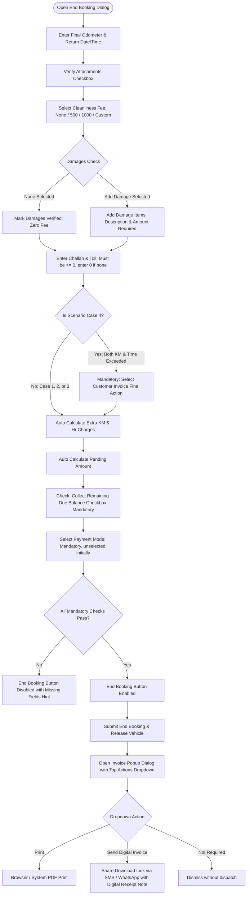

# Implementation Plan: End Booking UI Mandatory Validations, Case 4 Refinements & Digital Invoice Popup

## 1. Overview & Objective

This feature refines the **End Booking** workflow in the RoadReady (`rr`) rental module to enforce strict operational validations, introduce dual-choice damage verification, mandate settlement acknowledgment even for zero-balance bookings, and introduce an enhanced **Digital Invoice Popup** with integrated delivery options (Print, Send Digital Invoice via SMS/WhatsApp, Not Required) and a digitally generated receipt note in the customer signature block. These invoice options are also unified with the **Historical Logs** invoice viewer.

---

## 2. Git Information

- **Branch Name**: `feat/rr-end-booking-validation-and-digital-invoice-popup`
- **Primary / Merge Commit Message**:
  ```text
  feat(rr): enforce mandatory end booking validations, case 4 rules, and digital invoice actions

  - Make final odometer, return date/time, and attachments verification strictly mandatory
  - Require explicit selection for cleanliness charges and numeric entry (>= 0) for challan/toll
  - Introduce Add Damage vs None dual buttons for damage verification
  - Enforce mandatory customer invoice fine selection when Case 4 is active
  - Add mandatory remaining balance verification checkbox and unselected initial payment mode
  - Add top dropdown in invoice popup with Print, Send Digital Invoice (SMS/WhatsApp), and Not Required
  - Add digital receipt note and "Not required" in customer signature field for digital invoices
  - Ensure identical invoice popup options in Historical Logs
  ```

### Task-Level Commit Messages:
- **Task 1**: `feat(rr): enforce mandatory end booking odometer, return date, and initial input states`
- **Task 2**: `feat(rr): add dual-action damage buttons and mandatory case 4 fine selection`
- **Task 3**: `feat(rr): require balance verification checkbox and empty initial payment mode`
- **Task 4**: `feat(rr): add send invoice dropdown with digital receipt signature note in invoice popup`

---

## 3. Architecture & Workflow Diagram



---

## 4. Detailed Task Breakdown

### Task 1: Mandatory Return Details, Initial States & Cleanliness Validation
**Files touched:**
- `apps/portfolio/src/app/modules/rr/shared/dialogs/end-booking-dialog/end-booking-dialog.component.ts`
- `apps/portfolio/src/app/modules/rr/shared/dialogs/end-booking-dialog/end-booking-dialog.component.html`

**Implementation details:**
1. **Final Odometer Reading**:
   - Initial value: `''` (empty string).
   - Validation: Must be non-empty, a valid number, and $\ge$ `vehicleOdometerStart`.
   - UI: Clear error banner if empty or less than pickup odometer.
2. **Return Date and Time**:
   - Initial value: `''` (empty string).
   - Validation: Must be non-empty, valid ISO/date string, and $\ge$ `pickupDateTime`.
   - UI: Helper message if empty or prior to pickup.
3. **Attachments Verified Checkbox**:
   - Initial state: `false`.
   - Mandatory: Must be checked by staff after reviewing vehicle documents and photos.
4. **Cleanliness Fee / Charges**:
   - Initial state: `''` (no option pre-selected).
   - Mandatory: User must explicitly choose one: `none` (₹0), `500`, `1000`, or `custom`.
   - If `custom` selected, the custom input must be non-negative and non-empty.
5. **Challan & Toll**:
   - Initial state: `''` (empty string) for both Challan and Toll.
   - Mandatory: User must enter a numeric value ($\ge 0$). If no amount was incurred, staff must explicitly enter `0` to continue.
   - Validation helper: Flag empty state as incomplete until `0` or an actual positive number is typed.

---

### Task 2: Dual-Action Damage Verification Flow & Case 4 Fine Selection
**Files touched:**
- `apps/portfolio/src/app/modules/rr/shared/dialogs/end-booking-dialog/end-booking-dialog.component.ts`
- `apps/portfolio/src/app/modules/rr/shared/dialogs/end-booking-dialog/end-booking-dialog.component.html`

**Implementation details:**
1. **Damages Dual-Action Buttons (`Add Damage` & `None`)**:
   - Add state: `damageSelectionStatus: 'none' | 'damage' | null` (initially `null`).
   - UI Buttons:
     - **None**: Marks damages verification as completed with ₹0 fee. Clears any draft damages.
     - **Add Damage**: Sets status to `'damage'` and adds an initial damage item row.
   - Mandatory requirement:
     - If neither button has been selected, damage verification is incomplete (`isFormValid()` returns `false`).
     - If `Add Damage` is selected: Every damage item in the list must have a non-empty `description` and a valid numeric `amount` ($\ge 0$). If list is empty, user must either add a valid damage or click `None`.
2. **Extra KM & Extra Hr Automatic Calculations**:
   - Case 1: Both in limit $\rightarrow$ Extra KM = 0, Extra Hr = 0.
   - Case 2: KM exceeded, Hr within limit $\rightarrow$ Extra KM auto-calculated, Extra Hr = 0.
   - Case 3: Hr exceeded, KM within limit $\rightarrow$ Extra Hr auto-calculated, Extra KM = 0.
   - Case 4: Both exceeded $\rightarrow$ Automatic slab recalculation adds extra KM allowance and recalculates slab rental price; excess time absorbed into rent.
3. **Apply Late / Non-Intimation Fine (Case 4 Mandatory Selection)**:
   - Displayed strictly only when Case 4 is active (`activeScenario() === 'case4'`).
   - Mandatory decision: When displayed, the staff must explicitly select whether to apply the fine or waive/omit it for the customer invoice (`fineDecision: 'apply' | 'waive' | null`, initially `null`).
   - If 'apply' is selected, fine amount must be a valid non-negative number (default ₹1,000).

---

### Task 3: Due Balance Settlement & End Booking Action Gate
**Files touched:**
- `apps/portfolio/src/app/modules/rr/shared/dialogs/end-booking-dialog/end-booking-dialog.component.ts`
- `apps/portfolio/src/app/modules/rr/shared/dialogs/end-booking-dialog/end-booking-dialog.component.html`

**Implementation details:**
1. **Collect Remaining Due Balance Checkbox**:
   - Initial state: `false` (unchecked).
   - Mandatory: Checkbox must be checked to confirm verification of pending balance before completing booking.
   - Dynamic behavior:
     - If `balancePending > 0`: Checking indicates the balance amount is collected now and settled to 0 upon completion.
     - If `balancePending === 0`: Checkbox is still mandatory to verify and confirm zero dues before closing.
2. **Payment Mode Dropdown**:
   - Initial state: `''` (empty string, displays placeholder "Select Payment Mode").
   - Mandatory: Staff must select one payment mode from: `Cash`, `UPI`, `Card`, `Net Banking`.
   - Cannot remain unselected/empty.
3. **End Booking Button Gating**:
   - The "End Booking & Generate Invoice" button is strictly disabled until:
     - Final Odometer is entered and $\ge$ pickup odometer
     - Return Date/Time is entered and $\ge$ pickup date/time
     - Attachments verified checkbox is checked
     - Cleanliness charge is explicitly selected (and custom amount entered if custom)
     - Damage choice is made (either "None" or all added damage items completed)
     - Challan is entered ($\ge 0$, user can enter 0)
     - Toll is entered ($\ge 0$, user can enter 0)
     - If Case 4: Fine customer invoice selection is decided
     - Collect Remaining Due Balance checkbox is checked
     - Payment mode is selected
   - Dynamic missing fields hint in the dialog footer displays the specific remaining requirement.

---

### Task 4: Digital Invoice Popup Actions & Historical Logs Parity
**Files touched:**
- `apps/portfolio/src/app/modules/rr/shared/dialogs/pdf-viewer-dialog/rr-pdf-viewer-dialog.component.ts`
- `apps/portfolio/src/app/modules/rr/services/rr-invoice-pdf.service.ts`
- `apps/portfolio/src/app/modules/rr/components/dashboard/components/history/history.component.ts`
- `apps/portfolio/src/app/modules/rr/components/dashboard/components/history/history.component.html`

**Implementation details:**
1. **Top Actions Dropdown in Invoice Popup (`RRPdfViewerDialogComponent`)**:
   - Add a top header dropdown menu: **"Send Invoice Options"** / **"Invoice Actions"**.
   - Dropdown items:
     - **Print**: Triggers document printing via iframe / browser print API.
     - **Send Digital Invoice**: Dispatches/shares public invoice download link to the customer's phone number as SMS or WhatsApp (via existing `RRWhatsAppService` / `rrApi.sendWhatsAppNotification` integration).
     - **Not required**: Closes menu / dismisses delivery action without sending.
2. **Digital Invoice Receipt Signature Section**:
   - Update `RRInvoicePdfService.generateInvoicePdfDoc()`:
   - In the Customer Signature section of the PDF:
     - Customer Signature text: `Not required`
     - Explanatory note: `(This is a Digitally generated receipt, if required customer signed visit Branch)`
3. **Parity in Historical Logs**:
   - When viewing invoices in **Historical Logs** (`history.component.html` $\rightarrow$ `viewInvoice(booking)`), the invoice popup opens with the identical top dropdown options (`Print`, `Send Digital Invoice`, `Not required`) and the same digital receipt signature note.

---

## 5. Verification & Testing Plan

1. **Unit & Spec Tests**:
   - Run `npx nx test portfolio --testFile=end-booking-dialog.component.spec.ts` (or update/add tests for new mandatory form states).
   - Validate that `isFormValid()` returns `false` when any mandatory item is in its initial unselected state.
   - Validate that `isFormValid()` turns `true` only when all fields are completed.
2. **End-to-End & Manual Testing Checklist**:
   - **Case 1 (Within limit)**: Verify Challan = 0, Toll = 0, Cleanliness = None, Damages = None enables End Booking only after Collect Balance is checked and Payment Mode selected.
   - **Case 4 (Exceeded)**: Verify Case 4 slab calculations trigger, fine selection checkbox appears and is mandatory.
   - **Invoice Popup**:
     - Verify top dropdown displays `Print`, `Send Digital Invoice`, `Not required`.
     - Click `Print` to confirm print dialog.
     - Click `Send Digital Invoice` to confirm SMS/WhatsApp link dispatch to customer number.
     - Check PDF preview signature section for: `Not required` and `(This is a Digitally generated receipt, if required customer signed visit Branch)`.
   - **Historical Logs**:
     - Open Historical Logs tab, click "Invoice" for a past completed booking.
     - Confirm identical top dropdown and digital invoice signature note are present.
