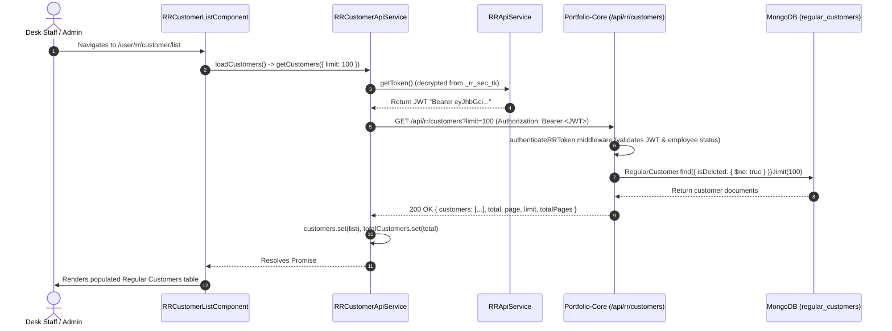
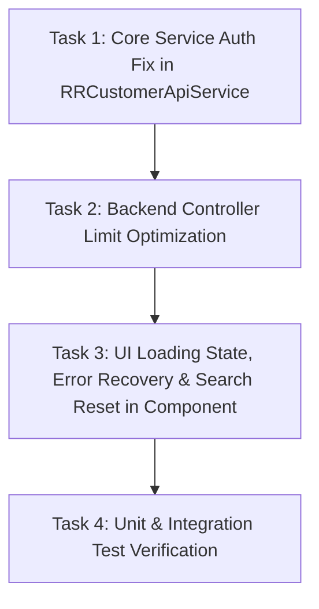

# Implementation Plan: Fix RR Module Regular Customer List Not Loading

## 1. Executive Summary & Root Cause Analysis

### Problem Statement
In the RoadReady Rentals (`rr`) portal, navigating to **Regular Customers** (`/user/rr/customer/list`) results in the customer directory failing to load. Users see an empty table with `"No regular customers found."`, and in production environments or live sessions, a toast notification `"Failed to load customer memberships"` is triggered. Furthermore, the Regular Customer autocomplete and discount calculation inside the **New Booking** and **Advance Booking** dialogs also fail to populate.

### Root Cause Analysis
1. **Primary Root Cause - Auth Token Desynchronization & 401 Unauthorized**:
   - `RRCustomerApiService` constructs request headers using:
     ```typescript
     private getHeaders(): HttpHeaders {
       let headers = new HttpHeaders({ 'Content-Type': 'application/json' });
       if (typeof window !== 'undefined' && window.sessionStorage) {
         const token = sessionStorage.getItem('rr_token');
         if (token) {
           headers = headers.set('Authorization', `Bearer ${token}`);
         }
       }
       return headers;
     }
     ```
   - However, `RRApiService` does **not** store the active session JWT under plaintext `'rr_token'`. When staff login, `RRApiService.login()` uses `this.setEncryptedItem(sessionStorage, this.STORAGE_KEY_TOKEN, token)` where `STORAGE_KEY_TOKEN = '_rr_sec_tk'`, encrypting the token via AES-256 with an envelope format. Additionally, `RRApiService` purges legacy `'rr_token'` entries.
   - As a result, `sessionStorage.getItem('rr_token')` evaluates to `null`.
   - All outgoing requests to `/api/rr/customers` lack an `Authorization` header.
   - Backend middleware `customerRouter.use(authenticateRRToken)` inspects `req.headers['authorization']` and rejects unauthenticated requests with `401 Unauthorized` (`"Authorization header is required."`).
   - `RRCustomerListComponent.loadCustomers()` catches the error, displays `toast.error('Failed to load customer memberships')`, and `customerApi.customers()` remains an empty array `[]`.

2. **Secondary Issue - Missing UI Loading Indicator & Empty State Flash**:
   - `customer-list.component.html` does not check `customerApi.isLoading()`.
   - While the request is in flight (or when it fails), the table immediately displays the `@empty` block (`"No regular customers found."`), offering no visual feedback that data is loading and no retry mechanism if the network call fails.

3. **Tertiary Issue - Search Query Pagination Boundary Trap**:
   - When users type into the search filter input, `currentPage` is not reset to `0`.
   - If a user was on page 2 and types a query yielding fewer than 10 matches, `pagedCustomers()` returns empty slice `[]`, masking matching customers.

4. **Quaternary Issue - Backend Query Limit Cap Mismatch**:
   - `RRCustomerListComponent.loadCustomers()` requests `{ limit: 100 }`.
   - `CustomerController.getCustomers` clamps limit via `Math.min(50, Math.max(1, Number(req.query['limit']) || 10))`, capping the response at 50 records instead of 100.

---

## 2. Git Information

- **Branch Name**: `fix/rr-regular-customer-list-loading`
- **Commit Messages**:

### Per-Task Commits:
1. `fix(rr): authenticate customer api requests using encrypted rr-api session token`
2. `fix(rr-core): allow customer list page limit up to 100 in controller`
3. `fix(rr): add loading spinner, retry action, and search pagination reset in customer list`
4. `test(rr): add customer api service tests and verify customer list loading`

### Combined Squash Commit Option:
```text
fix(rr): resolve regular customer list not loading due to auth token desynchronization

- Inject RRApiService into RRCustomerApiService to retrieve encrypted auth token for Authorization headers
- Add fallback token retrieval for backward compatibility and test environments
- Introduce explicit loading spinner, error state with retry action, and search page reset in customer list component
- Increase max pagination limit from 50 to 100 in portfolio-core customer controller
- Add unit tests verifying token header injection and test customer list loading behavior
```

---

## 3. Architecture & Data Flow



---

## 4. Breakdown of Tasks



### Task 1: Core Service Auth Fix (`RRCustomerApiService`)
- **File**: `apps/portfolio/src/app/modules/rr/services/rr-customer-api.service.ts`
- **Objective**: Ensure all HTTP calls from `RRCustomerApiService` carry a valid Authorization Bearer header obtained from `RRApiService`.
- **Implementation Steps**:
  1. Inject `RRApiService`: `private rrApi = inject(RRApiService);`
  2. Update `getHeaders()`:
     ```typescript
     private getHeaders(): HttpHeaders {
       let headers = new HttpHeaders({ 'Content-Type': 'application/json' });
       const token =
         this.rrApi.getToken() ||
         (typeof window !== 'undefined' && window.sessionStorage
           ? sessionStorage.getItem('rr_token')
           : null);
       if (token) {
         headers = headers.set('Authorization', `Bearer ${token}`);
       }
       return headers;
     }
     ```
  3. Validate that all service methods (`getCustomers`, `getCustomerById`, `getAutocomplete`, `createCustomer`, `updateCustomer`, `deleteCustomer`, `checkMembershipDiscount`) automatically use this corrected header.

### Task 2: Backend Controller Limit Optimization (`customer.controller.ts`)
- **File**: `apps/portfolio-core/src/controllers/customer.controller.ts`
- **Objective**: Allow fetching up to 100 customers per request as expected by `customer-list.component.ts`.
- **Implementation Steps**:
  1. In `CustomerController.getCustomers`:
     ```typescript
     // Change from Math.min(50, ...) to Math.min(100, ...)
     const limit = Math.min(100, Math.max(1, Number(req.query['limit']) || 10));
     ```
  2. Verify that queries with `limit=100` return up to 100 records and correct pagination metadata.

### Task 3: UI Loading State, Error Recovery & Search Pagination Reset (`customer-list.component`)
- **Files**:
  - `apps/portfolio/src/app/modules/rr/components/dashboard/components/customer-list/customer-list.component.ts`
  - `apps/portfolio/src/app/modules/rr/components/dashboard/components/customer-list/customer-list.component.html`
- **Objective**: Improve user experience with clear loading feedback, error recovery button, and accurate search pagination.
- **Implementation Steps**:
  1. In `customer-list.component.ts`:
     - Add `hasLoadError = signal<boolean>(false);`
     - Provide `lucideLoader2` and `lucideRefreshCw` in `provideIcons(...)`.
     - Update `loadCustomers()`:
       ```typescript
       async loadCustomers(): Promise<void> {
         this.hasLoadError.set(false);
         try {
           await this.customerApi.getCustomers({ limit: 100 });
         } catch (err: unknown) {
           this.hasLoadError.set(true);
           toast.error('Failed to load customer memberships');
         }
       }
       ```
     - Add `onSearchChange(query: string)`:
       ```typescript
       onSearchChange(query: string): void {
         this.searchQuery.set(query);
         this.currentPage.set(0);
       }
       ```
  2. In `customer-list.component.html`:
     - Update search input to `(ngModelChange)="onSearchChange($event)"`.
     - In `<tbody>`:
       - `@if (customerApi.isLoading())`: Render spinner row:
         ```html
         <tr hlmTr>
           <td hlmTd colspan="9" class="text-center text-muted-foreground py-14">
             <ng-icon name="lucideLoader2" class="size-8 animate-spin mx-auto block mb-2 text-primary"></ng-icon>
             <div class="font-semibold text-sm">Loading regular customer directory...</div>
             <div class="text-xs text-muted-foreground mt-1">Fetching verified KYC records and loyalty tiers</div>
           </td>
         </tr>
         ```
       - `@else if (hasLoadError())`: Render error row with retry button:
         ```html
         <tr hlmTr>
           <td hlmTd colspan="9" class="text-center py-12">
             <ng-icon name="lucideAlertCircle" class="size-8 mx-auto block mb-2 text-destructive"></ng-icon>
             <div class="font-semibold text-sm text-destructive">Failed to load customer directory</div>
             <div class="text-xs text-muted-foreground mt-1 mb-4">Please verify your connection and permissions.</div>
             <button hlmBtn variant="outline" size="sm" (click)="loadCustomers()" class="gap-1.5 h-8">
               <ng-icon name="lucideRefreshCw" class="size-3.5"></ng-icon>
               <span>Retry</span>
             </button>
           </td>
         </tr>
         ```
       - `@else`: Render `@for (c of pagedCustomers())` with `@empty` block.

### Task 4: Unit & Integration Test Verification
- **Files**:
  - `apps/portfolio/src/app/modules/rr/services/rr-customer-api.service.spec.ts` (New unit test)
  - `apps/portfolio/src/app/modules/rr/components/dashboard/components/customer-list/customer-list.component.spec.ts` (Playwright E2E)
- **Objective**: Ensure the fix is thoroughly tested and regressions are prevented.
- **Implementation Steps**:
  1. Create `rr-customer-api.service.spec.ts` using `HttpClientTestingModule`:
     - Test that `getHeaders()` calls `rrApi.getToken()` and attaches `Authorization: Bearer <token>`.
     - Test that `getCustomers()` sets `customers` and `totalCustomers` signals.
     - Test fallback when `sessionStorage` has `rr_token`.
  2. Verify Playwright test suite in `customer-list.component.spec.ts` runs cleanly.

---

## 5. File Change Summary

| File Path | Nature of Change | Summary |
|-----------|------------------|---------|
| `apps/portfolio/src/app/modules/rr/services/rr-customer-api.service.ts` | Bug Fix | Inject `RRApiService` and retrieve decrypted JWT in `getHeaders()` |
| `apps/portfolio-core/src/controllers/customer.controller.ts` | Optimization | Increase page limit cap from 50 to 100 in `getCustomers` |
| `apps/portfolio/src/app/modules/rr/components/dashboard/components/customer-list/customer-list.component.ts` | Enhancement | Add `hasLoadError`, `onSearchChange` (page reset), and icon imports |
| `apps/portfolio/src/app/modules/rr/components/dashboard/components/customer-list/customer-list.component.html` | UI Enhancement | Add loading spinner state and retry button row |
| `apps/portfolio/src/app/modules/rr/services/rr-customer-api.service.spec.ts` | Test | Unit tests for auth token propagation in `RRCustomerApiService` |

---

## 6. Verification Checklist

1. [ ] **Authentication Verification**:
   - Log in as admin or employee on RR portal.
   - Open Network tab and verify `GET /api/rr/customers?limit=100` includes `Authorization: Bearer <valid_jwt>`.
   - Verify server returns `200 OK` with customer list instead of `401 Unauthorized`.
2. [ ] **Table Rendering**:
   - Customer records render with membership ID, customer name, contact details, KYC masked badges, and tier badges.
   - Active/disabled statuses and action buttons render correctly based on role.
3. [ ] **Search & Pagination**:
   - Searching by customer name, phone, or membership ID immediately updates results and resets view to page 1.
   - Paging through multiple pages functions smoothly.
4. [ ] **Booking Dialog Interoperability**:
   - In New Booking Dialog and Advance Booking Dialog, toggle "Existing Regular Member?".
   - Verify autocomplete dropdown queries `/api/rr/customers/autocomplete` with auth headers and populates member choices.
5. [ ] **Automated Tests**:
   - Run unit tests: `npx nx test portfolio --testFile=rr-customer-api.service.spec.ts`
   - Run e2e tests: `npx playwright test customer-list.component.spec.ts`

