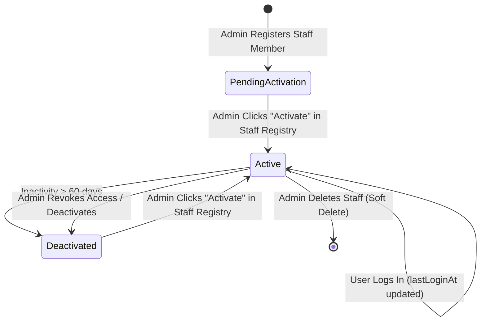
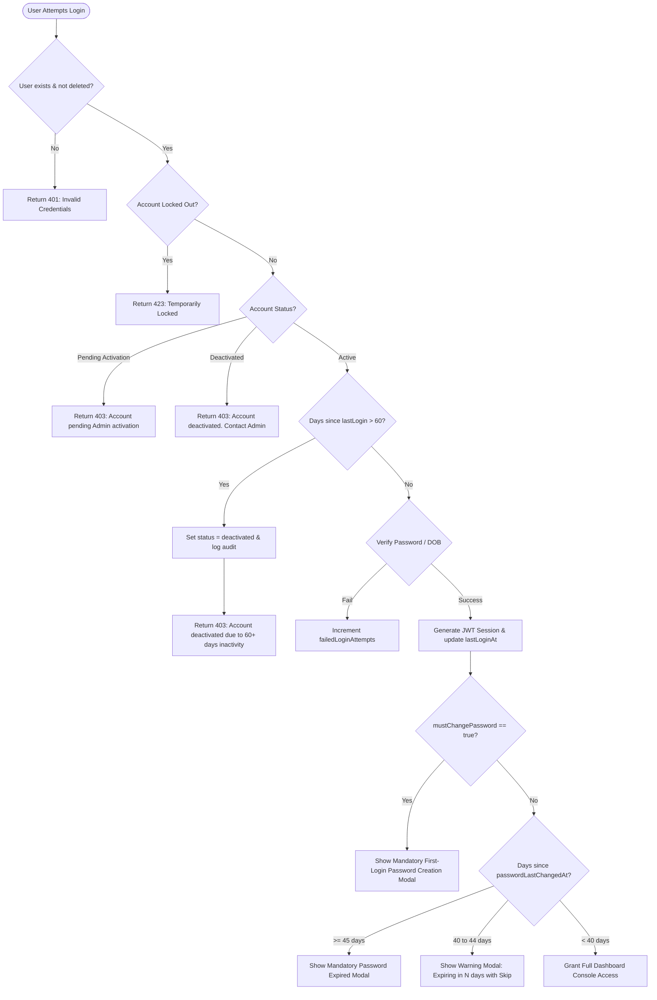
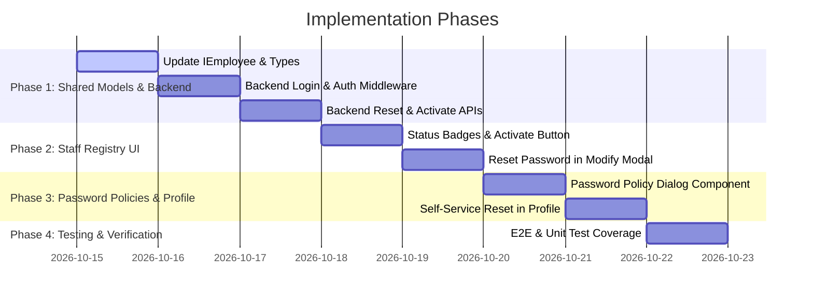

# Implementation Plan: User Activation Lifecycle, Password Expiration, and Password Reset Policy

## 1. Overview & Objectives

This feature introduces a comprehensive identity lifecycle, password rotation policy, and administrative access control across the RoadReady (`rr`) fleet management platform for all staff and admin accounts.

### Key Objectives:
1. **User Activation Lifecycle**:
   - **New Users**: When an administrator registers a new user (employee or admin), the user account is created in a `pending_activation` state. Only after an administrator clicks **Activate** can the user perform their first login.
   - **Deactivated Users**: If a user account is deactivated (manually or automatically via inactivity), it is clearly flagged in the Staff Registry with an **Activate** button to restore portal access.
   - **Automatic Inactivity Deactivation**: If an active user has not logged in for **more than 60 days**, the account is automatically deactivated upon subsequent login evaluation or backend sweep.

2. **First Login & Mandatory Password Creation**:
   - Irrespective of assigned role (`employee` or `admin`), all accounts must be prompted to set a personal password upon their first successful login.
   - Initial credentials: We support either **DOB** (Date of Birth) or an **Admin-generated Temporary Password** (configurable/selectable during registration).
   - Once authenticated with initial credentials, the user is immediately required to define a permanent password before dashboard access is granted.

3. **Password Life & Rotation Policy (45-Day Expiry)**:
   - User passwords have a maximum lifespan of **45 days** from `passwordLastChangedAt`.
   - **Buffer Period (Days 40 to 44)**: When logging in, the user receives an alert/dialog notifying them that their password will expire in $N$ days, with an option to **Update Now** or **Remind Me Later (Skip)**.
   - **Expiry (Day 45 onwards)**: Password recreation becomes **mandatory**. The user cannot bypass the dialog or access dashboard functionality until a new password is set.

4. **Password Reset Workflows**:
   - **Admin Reset (Staff Registry)**: In the Staff Registry "Modify Staff Record" popup, an administrative **Reset Password** button is available at all times. Triggering a reset issues a new temporary password (or resets to DOB) and flags the user account with `mustChangePassword = true`.
   - **Self-Service Reset (User Profile)**: Logged-in users can update their password at any time from the **View Profile** dialog in the dashboard header by verifying their current password and supplying a new one.

5. **Staff Registry UI Enhancements**:
   - Add an **Active / Deactivated / Pending Activation** status badge in the Staff Registry table.
   - Provide an **Activate** button enabled for new users and deactivated users.
   - Provide a persistent **Reset Password** button within the Modify Staff Record popup.

---

## 2. Git Information

- **Suggested Branch Name**: `feat/rr-staff-activation-password-lifecycle`
- **Commit Message**:
  ```text
  feat(rr): implement user activation, password lifecycle, and self-service reset

  - Add user lifecycle statuses: pending_activation, active, and deactivated
  - Require admin activation for newly registered users before initial login
  - Enforce automatic account deactivation after 60+ days of login inactivity
  - Require mandatory password creation on first login for all user roles
  - Enforce 45-day password expiration with skippable buffer period (days 40-44)
  - Add admin password reset button in Staff Registry modify user modal
  - Add self-service change password section in Desk Agent user profile modal
  - Display activation status badges and dynamic Activate button in Staff Registry
  ```

---

## 3. Credential Architecture & First Login Decision

### Decision Matrix: DOB vs Temporary Password for First Login

| Attribute | Option A: Date of Birth (DOB) | Option B: Admin-Generated Temporary Password | Recommended Hybrid Approach |
| :--- | :--- | :--- | :--- |
| **User Experience** | Frictionless; user already knows their DOB; no credentials to lose. | Standard enterprise pattern; prevents credential guessing if DOB is known. | **Support Both with Admin Choice**: Default to DOB with an option for Admin to generate a one-time random temporary password if desired. |
| **First Login Auth** | User inputs Employee ID + DOB (`YYYY-MM-DD` or `DD-MM-YYYY`). | User inputs Employee ID + Temporary Password. | Both authenticate against the same backend route (`/auth/login`). |
| **Post-Login Action** | `mustChangePassword: true` forces password creation immediately. | `mustChangePassword: true` forces password creation immediately. | Unified first-login dialog triggers immediately upon token issuance. |

---

## 4. Architecture & Workflow Diagrams

### 4.1 User Lifecycle State Machine



### 4.2 Login Authentication & Password Policy Flow



---

## 5. Detailed Component & Backend Schema Modifications

### 5.1 Shared Types & Database Schema (`libs/shared-types/src/lib/rr.ts`)

Update `IEmployee` and related auth interfaces:

```typescript
export type RRUserStatus = 'pending_activation' | 'active' | 'deactivated';

export interface IEmployee {
  _id?: ObjectId | string;
  id: string; // Unique ID (e.g. 'RRA001')
  firstName: string;
  lastName: string;
  dob: string; // YYYY-MM-DD
  phone: string;
  altPhone?: string;
  email: string;
  aadhar: string;
  dl: string;
  address: string;
  allowLogin: boolean;
  role: RRRole;
  status: RRUserStatus; // 'pending_activation' | 'active' | 'deactivated'
  isFirstLogin?: boolean; // True until first password creation
  mustChangePassword?: boolean; // Set on creation or admin reset
  passwordLastChangedAt?: string | null; // ISO Date of last password update
  lastLoginAt?: string | null; // ISO Date of last successful login
  passwordHash?: string; // Bcrypt hashed password
  createdAt: string;
  isDeleted?: boolean;
  deletedAt?: string | null;
  deletedBy?: string | null;
  failedLoginAttempts?: number;
  lockoutUntil?: Date | string | null;
}

export interface IRRLoginResponse {
  access_token: string;
  user: IRRUser;
  status: RRUserStatus;
  mustChangePassword: boolean;
  passwordAgeDays: number;
  passwordExpiresInDays: number;
  isBufferPeriod: boolean;
  isExpired: boolean;
}

export interface IRRChangePasswordRequest {
  currentPassword?: string; // Required for self-service, omitted if mustChangePassword
  newPassword: string;
}
```

### 5.2 Backend API Routes (`apps/portfolio-core/src/app/rr/rr.routes.ts`)

1. **`POST /api/rr/auth/login`**:
   - Verify account status:
     - If `status === 'pending_activation'`: Return 403 `Account pending activation by Administrator.`
     - If `status === 'deactivated'`: Return 403 `Account deactivated. Please contact an Administrator.`
   - Check 60-day inactivity threshold:
     - If `lastLoginAt` exists and `(now - lastLoginAt) > 60 * 24 * 60 * 60 * 1000`:
       - Automatically update `status: 'deactivated'`, `allowLogin: false`.
       - Log audit event: `User deactivated due to 60+ days of inactivity`.
       - Return 403 `Account has been deactivated due to more than 60 days of inactivity. Please contact an Administrator to reactivate.`
   - Verify credentials (supports Password or DOB).
   - Calculate password age:
     - `daysSinceChange = Math.floor((now - passwordLastChangedAt) / (1000 * 60 * 60 * 24))`
     - `isBufferPeriod = daysSinceChange >= 40 && daysSinceChange < 45`
     - `isExpired = daysSinceChange >= 45`
   - Update `lastLoginAt = new Date().toISOString()`.
   - Return token and password policy metadata.

2. **`POST /api/rr/auth/change-password`** (Authenticated):
   - For users with `mustChangePassword === true`: Allows setting `newPassword` without `currentPassword`.
   - For regular self-service password changes: Requires `currentPassword` verification against `passwordHash`.
   - Validates password complexity: minimum 8 characters, at least 1 uppercase, 1 lowercase, 1 number, 1 special character.
   - Cannot reuse previous password.
   - Hashes new password with `bcrypt.hash(..., 10)`.
   - Updates `passwordHash`, `mustChangePassword: false`, `isFirstLogin: false`, `passwordLastChangedAt: new Date().toISOString()`.
   - Emits audit log entry.

3. **`PUT /api/rr/employees/:id/activate`** (Admin Only):
   - Updates employee `status = 'active'`, `allowLogin = true`.
   - Updates `lastLoginAt = new Date().toISOString()` (resets inactivity timer).
   - Emits audit log entry: `Administrator activated account for {firstName} {lastName} ({id})`.

4. **`POST /api/rr/employees/:id/reset-password`** (Admin Only):
   - Resets user credential to DOB or a generated temporary password.
   - Sets `mustChangePassword = true`.
   - Emits audit log entry: `Administrator reset credentials for {firstName} {lastName} ({id})`.

5. **`POST /api/rr/employees`** (Admin Only - User Creation):
   - Default new employee fields:
     - `status: 'pending_activation'`
     - `allowLogin: false`
     - `mustChangePassword: true`
     - `isFirstLogin: true`
     - `passwordLastChangedAt: null`
     - `lastLoginAt: null`

### 5.3 Angular Frontend - Service Layer (`apps/portfolio/src/app/modules/rr/services/rr-api.service.ts`)

- Add `activateEmployee(id: string): Promise<IEmployee>`
- Add `resetEmployeePassword(id: string, options?: { useDob?: boolean }): Promise<{ message: string; tempPass?: string }>`
- Add `changePassword(payload: IRRChangePasswordRequest): Promise<{ success: boolean; message: string }>`
- Add reactive state signal `passwordPolicyAlert = signal<{ isRequired: boolean; isBuffer: boolean; daysRemaining: number } | null>(null)`

### 5.4 UI Changes - Staff Registry (`apps/portfolio/src/app/modules/rr/components/dashboard/components/employee-list/`)

1. **Staff Registry Table (`employee-list.component.html`)**:
   - Update **Portal Access** column:
     - `Active` badge: Green (`bg-emerald-500/10 text-emerald-600 border-emerald-200`)
     - `Pending Activation` badge: Amber (`bg-amber-500/10 text-amber-600 border-amber-200`)
     - `Deactivated` badge: Red (`bg-destructive/10 text-destructive border-destructive/20`)
   - Add **Activate Button** in Actions column:
     - Displayed with `lucideUserCheck` or `lucideShieldCheck` icon.
     - Visible / enabled when `e.status === 'pending_activation' || e.status === 'deactivated'`.
     - Tooltip: `"Activate User Portal Access"`.
     - Clicking triggers confirmation and calls `activateEmployee(e.id)`.

2. **Modify User Modal (`employeeFormDialog`)**:
   - Add a dedicated **Security & Credentials** section in the modal.
   - Provide a persistent **Reset Password** button (always enabled in edit mode):
     - Displays confirmation modal/dialog.
     - Resets user password, flags `mustChangePassword: true`, and notifies the admin with a toast.

### 5.5 UI Changes - User Profile Dialog (`dashboard.component.html`)

1. **View Profile Dialog (`#profileInfoDialog`)**:
   - Below current read-only identity fields, add a collapsible or distinct section:
     - **Change Account Password** button / inline form.
     - Fields:
       - Current Password (with eye toggle)
       - New Password (with eye toggle & strength meter/rules)
       - Confirm New Password
     - Submit button: `"Update Password"`.

### 5.6 UI Changes - Password Expiry & First Login Modal (`apps/portfolio/src/app/modules/rr/shared/dialogs/`)

Create a reusable dialog: `rr-password-policy-dialog`:
1. **Mandatory First Login State**:
   - Title: `"Welcome to RoadReady - Set Your Password"`
   - Subtitle: `"This is your first login. You must configure a secure personal password to continue."`
   - Non-dismissible (backdrop click disabled, escape key disabled, cancel button hidden).
2. **Buffer Expiry Warning State (Days 40 - 44)**:
   - Title: `"Password Expiration Reminder"`
   - Subtitle: `"Your password will expire in X days. Please update it now to prevent uninterrupted access."`
   - Action buttons: `"Change Now"` and `"Remind Me Later (Skip)"`.
3. **Mandatory Expired State (Day 45+)**:
   - Title: `"Password Expired"`
   - Subtitle: `"Your password was set more than 45 days ago and has expired. You must set a new password to proceed."`
   - Non-dismissible.

---

## 6. Implementation Step-by-Step Plan



### Phase 1: Shared Models & Backend API
- [ ] Edit `libs/shared-types/src/lib/rr.ts`: Add `RRUserStatus`, update `IEmployee` with `status`, `isFirstLogin`, `mustChangePassword`, `passwordLastChangedAt`, `lastLoginAt`.
- [ ] Edit `apps/portfolio-core/src/app/rr/rr.routes.ts`:
  - [ ] Update `POST /auth/login` to validate `status`, enforce 60-day inactivity deactivation, and return password age metadata.
  - [ ] Implement `POST /auth/change-password` endpoint.
  - [ ] Implement `PUT /employees/:id/activate` endpoint.
  - [ ] Implement `POST /employees/:id/reset-password` endpoint.
  - [ ] Update `POST /employees` to initialize users with `status: 'pending_activation'`, `allowLogin: false`, and `mustChangePassword: true`.
  - [ ] Update `RRService.seedInitialData()` to ensure existing admin/employee seed records have valid status and timestamps.

### Phase 2: Staff Registry Frontend Updates
- [ ] Edit `apps/portfolio/src/app/modules/rr/services/rr-api.service.ts`:
  - [ ] Add `activateEmployee()`, `resetEmployeePassword()`, `changePassword()` methods.
- [ ] Edit `apps/portfolio/src/app/modules/rr/components/dashboard/components/employee-list/employee-list.component.html`:
  - [ ] Display `Active`, `Deactivated`, and `Pending Activation` badges.
  - [ ] Add `Activate` button enabled for pending and deactivated users.
  - [ ] Add `Reset Password` button in the Modify Staff Record popup.
- [ ] Edit `apps/portfolio/src/app/modules/rr/components/dashboard/components/employee-list/employee-list.component.ts`:
  - [ ] Add handler `activateEmployee(e: IEmployee)`.
  - [ ] Add handler `resetPassword(e: IEmployee)`.

### Phase 3: Password Policy & Profile Management
- [ ] Create `apps/portfolio/src/app/modules/rr/shared/dialogs/password-policy-dialog/`:
  - [ ] Handle mandatory first login password setup.
  - [ ] Handle buffer period warning (days 40-44) with skip option.
  - [ ] Handle mandatory 45-day expired password update.
- [ ] Integrate password policy check in `dashboard.component.ts` on route load.
- [ ] Edit `apps/portfolio/src/app/modules/rr/components/dashboard/dashboard.component.html`:
  - [ ] Add Change Password form in `#profileInfoDialog`.
- [ ] Edit `apps/portfolio/src/app/modules/rr/components/dashboard/dashboard.component.ts`:
  - [ ] Add self-service password reset submission logic.

### Phase 4: Testing & Verification
- [ ] Unit tests for backend activation, deactivation, and login routes.
- [ ] E2E tests for:
  - [ ] New user registration -> verification that login is blocked before activation.
  - [ ] Admin activation -> user first login -> mandatory password change prompt.
  - [ ] Inactivity check (>60 days) -> automatic deactivation and error message.
  - [ ] Buffer period (day 42) -> warning displayed with functional skip option.
  - [ ] Expiry (day 46) -> mandatory lock requiring password change.
  - [ ] Admin reset in Staff Registry popup -> next login forces password reset.
  - [ ] Self-service reset in User Profile.

---

## 7. Edge Cases & Security Considerations

1. **Self-Deactivation Prevention**:
   - An administrator cannot deactivate their own active administrative account.
2. **Brute Force Protection**:
   - Keep existing 5-attempt rate limiter / 15-minute temporary lockout intact while evaluating credentials.
3. **Password Re-use Prevention**:
   - Prevent the user from setting their new password to their immediate previous password or default DOB.
4. **Session Invalidation on Password Reset / Deactivation**:
   - When an account is deactivated by an administrator, any active refresh/token verification checks (`/auth/permissions`) reject the session on the next cycle (every 10 minutes or immediate token revocation).
5. **Backwards Compatibility**:
   - For existing database employee records that lack `status`, safely fallback to checking `allowLogin ? 'active' : 'deactivated'`, and seed `passwordLastChangedAt` to `createdAt` or current date to avoid immediate accidental lockout of existing admins.
