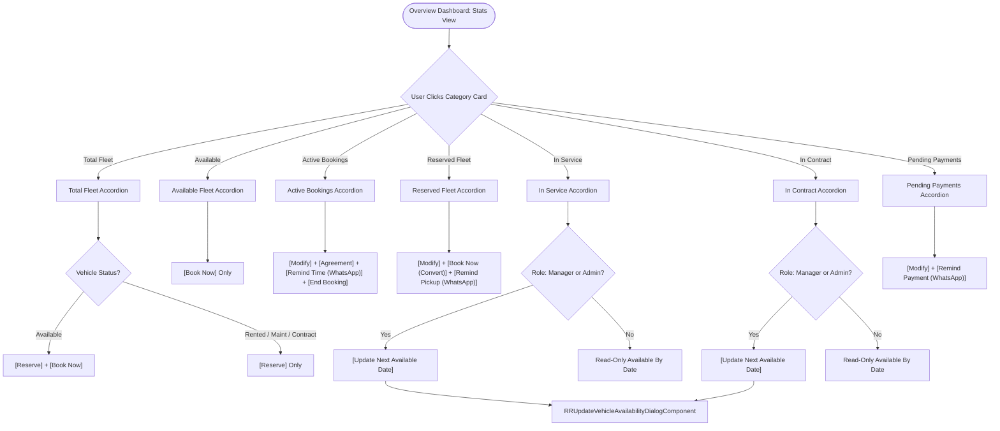

# Implementation Plan: Category-Specific Fleet Actions and Vehicle Availability Management

## 1. Executive Summary & Objective

In the RoadReady Rentals (`rr`) operations console, the **Overview Dashboard (`app-rr-stats-view`)** provides real-time accordion-expanded telemetry for 7 core fleet and booking categories. Each category represents a distinct operational lifecycle state for vehicles or rental contracts.

This plan details the exact specifications and code changes required to align all actions, buttons, dialog interactions, and role permissions with the operational requirements defined for each category:

1. **Total Fleet**:
   - `Available Status`: **Reserve**, **Book Now**
   - `Remaining Status` (rented, in service, contract): **Reserve**
2. **Available**:
   - **Book Now**
3. **Active Booking**:
   - **Modify**, **Agreement**, **End Booking**, and **btn for Remind Customer about remaining time in current booking** (Return Time WhatsApp Reminder)
4. **Reserved Fleet**:
   - **Modify**, **Book Now** (convert advance reservation to active booking), and **btn for Remind Customer about coming reservation/booking** (Pickup Intimation WhatsApp Reminder)
5. **In Service**:
   - **Update** (ability to update next available date) — *Restricted to Managers and Admin only*
6. **In Contract**:
   - **Update** (ability to update next available date) — *Restricted to Managers and Admin only*
7. **Pending Payment**:
   - **Modify**, and **btn for Remind Customer about pending payment** (Outstanding Balance WhatsApp Reminder)

---

## 2. Git Information

- **Branch Name**: `feat/rr-fleet-category-actions-availability`
- **Commit Message**:
  ```text
  feat(rr): implement category-specific fleet actions and manager availability updates

  - Total Fleet: configure Reserve & Book Now for available vehicles, Reserve for remaining statuses
  - Available: display Book Now action
  - Active Booking: wire Modify, Agreement, End Booking, and Remind Customer (remaining time)
  - Reserved Fleet: wire Modify, Book Now, and Remind Customer (upcoming reservation)
  - In Service & In Contract: add Update next available date dialog restricted to Managers and Admin
  - Pending Payment: restrict actions to Modify and Remind Customer (pending balance)
  - Support 'manager' role in RR types, permissions, and staff management
  ```
- **Note**: The markdown plan file will NOT be committed to git.

---

## 3. Architecture & Functional Specification

### 3.1 Category Action Matrix

| Category Key | Category Title | Item Type | Displayed Actions / Buttons | Target Dialog / Service Method | Role Restriction |
| :--- | :--- | :--- | :--- | :--- | :--- |
| `fleet` | **Total Fleet** | `IVehicle` | • Status == `available`: **Reserve**, **Book Now**<br>• Remaining Statuses: **Reserve** | • `bookVehicle(v)` (`RRNewBookingDialogComponent`)<br>• `reserveVehicle(v)` (`RRReserveBookingDialogComponent`) | All staff |
| `available` | **Available** | `IVehicle` | • **Book Now** | • `bookVehicle(v)` (`RRNewBookingDialogComponent`) | All staff |
| `bookings` | **Active Booking** | `IBooking` | • **Modify**<br>• **Agreement**<br>• **Remind Time** (Remind Customer)<br>• **End Booking** | • `modifyBooking(b)` (`RRModifyBookingDialogComponent`)<br>• `viewAgreement(b)` (`RRInvoicePdfService`)<br>• `openWhatsAppModal(b, 'active_reminder')`<br>• `endBooking(b)` (`RREndBookingDialogComponent`) | All staff |
| `reserved` | **Reserved Fleet** | `{ vehicle, reservation }` | • **Modify**<br>• **Book Now**<br>• **Remind Pickup** (Remind Customer) | • `modifyReservation(resv)` (`RRReserveBookingDialogComponent`)<br>• `bookVehicleFromReservation(resv)` (`RRNewBookingDialogComponent`)<br>• `openWhatsAppModal(resv, 'reserve_intimation')` | All staff |
| `maintenance` | **In Service** | `IVehicle` | • **Update Date** (Next Available Date) | • `openUpdateAvailabilityModal(v)` (`RRUpdateVehicleAvailabilityDialogComponent`) | **Managers & Admin ONLY** |
| `contract` | **In Contract** | `IVehicle` | • **Update Date** (Next Available Date) | • `openUpdateAvailabilityModal(v)` (`RRUpdateVehicleAvailabilityDialogComponent`) | **Managers & Admin ONLY** |
| `payments` | **Pending Payment** | `IBooking` | • **Modify**<br>• **Remind Payment** (Remind Customer) | • `modifyBooking(b)` (`RRModifyBookingDialogComponent`)<br>• `openWhatsAppModal(b, 'pending_payment')` | All staff |

---

### 3.2 System Interaction Flowchart



---

## 4. Step-by-Step Implementation Details

### Step 1: Update Roles & Permission Types
- **File**: `libs/shared-types/src/lib/rr.ts`
  - Update `RRRole`:
    ```typescript
    export type RRRole = 'admin' | 'manager' | 'employee';
    ```
- **File**: `apps/portfolio/src/app/modules/rr/services/rr-api.service.ts`
  - Add computed helpers for permission checks:
    ```typescript
    isManager = computed(() => this.currentUser()?.role === 'manager');
    isManagerOrAdmin = computed(() => {
      const role = this.currentUser()?.role;
      return role === 'admin' || role === 'manager';
    });
    ```
- **Files**: `apps/portfolio/src/app/modules/rr/components/dashboard/components/employee-list/`
  - In `employee-list.component.html`: add `<option value="manager">Operations Manager</option>`.
  - In `employee-list.component.ts`: handle `'manager'` role badge and password assignment defaults.

---

### Step 2: Build `RRUpdateVehicleAvailabilityDialogComponent`
- **Location**: `apps/portfolio/src/app/modules/rr/shared/dialogs/update-availability-dialog/`
- **Component**: Standalone Angular component with Spartan UI (`BrnDialogRef`, `injectBrnDialogContext`, `HlmDatePickerImports`, `HlmButtonImports`, `HlmInputImports`, `HlmLabelImports`, `HlmBadgeImports`).
- **Context**:
  ```typescript
  export interface UpdateVehicleAvailabilityDialogContext {
    vehicle: IVehicle;
  }
  ```
- **Functionality**:
  - Displays Vehicle information: Registration Number, Manufacturer, Model, Status badge (`In Service` or `In Contract`).
  - Current Next Available Date (if previously set) via `IndianDatePipe`.
  - Date Picker (`hlm-date-picker`) with calendar UI for selecting the new `availableBy` / `nextAvailableDate`.
  - Validation: Date must be valid and cannot be in the past.
  - Optional service notes or reason for extension/maintenance.
  - Submission: Calls `rrApi.updateVehicle(vehicle.regNo, { availableBy: isoDate, nextAvailableDate: isoDate })`.
  - Audit: Automatic system audit log created through backend or logged activity.
  - Toast: `toast.success('Next available date updated successfully')`.
  - Emits result to trigger immediate reload of dashboard vehicles and telemetry.
- **Export**: Export in `apps/portfolio/src/app/modules/rr/shared/dialogs/index.ts` and `apps/portfolio/src/app/modules/rr/shared/index.ts`.

---

### Step 3: Enhance `RRVehicleCardComponent` (`vehicle-card.component.ts` & `.html`)
- **Action Control Inputs & Signals**:
  - Add `@Input() canUpdateAvailability = false` (passed when user is Manager or Admin).
  - Add `@Output() updateAvailabilityClick = new EventEmitter<IVehicle>()`.
- **Card UI Upgrades**:
  - **In Service & In Contract**:
    - When `canUpdateAvailability` is true, render an `Update Date` action button directly in the `Available By:` badge/banner as well as inside the desktop hover overlay and touch dropdown.
  - **Total Fleet vs Available Category Distinction**:
    - When `activeCategory === 'fleet'`:
      - `showBookNowOverlay`: true only when `vehicle.status === 'available'`.
      - `showReserveBtn`: true for ALL vehicles (both available and remaining statuses).
    - When `activeCategory === 'available'`:
      - `showBookNowOverlay`: true.
      - `showReserveBtn`: false (no reserve button).
  - Ensure touch fallback buttons (`.touch-action-trigger`) exactly mirror the hover overlay actions for both mobile and touch devices.

---

### Step 4: Configure `RRStatsViewComponent` (`stats-view.component.ts`)
- **Injected Services & Computeds**:
  - Add `isManagerOrAdmin = computed(() => { const role = this.rrApi.currentUser()?.role; return role === 'admin' || role === 'manager'; });`
- **Reserve Action Upgrade**:
  - Update `reserveVehicle(vehicle: IVehicle, event?: any)` to directly open `RRReserveBookingDialogComponent` modal in-place (keeping the user on the Overview Dashboard console without an unnecessary page route redirection).
- **Update Availability Modal Integration**:
  - Implement `openUpdateAvailabilityModal(vehicle: IVehicle, event?: Event)`:
    ```typescript
    openUpdateAvailabilityModal(vehicle: IVehicle, event?: Event) {
      event?.stopPropagation();
      if (!this.isManagerOrAdmin()) {
        toast.error('Only Managers and Admin can update vehicle availability dates');
        return;
      }
      const ref = this.dialog.open(RRUpdateVehicleAvailabilityDialogComponent, {
        context: { vehicle },
        contentClass: 'max-w-lg w-full p-6 max-h-[90vh] flex flex-col overflow-hidden',
      });
      ref.closed$.subscribe((updated) => {
        if (updated) {
          this.loadVehicles();
          this.loadStats();
        }
      });
    }
    ```
- **Ensure Direct Book Now from Reservation**:
  - Verify `bookVehicleFromReservation(item.reservation, $event)` correctly passes reservation context to `RRNewBookingDialogComponent`.

---

### Step 5: Update `stats-view.component.html` Template
1. **Total Fleet & Vehicle Categories Section (`isVehicleCategory`)**:
   - For `activeCategory() === 'fleet'`:
     - Available vehicles: Show `Reserve` and `Book Now`.
     - Remaining vehicles: Show `Reserve` only.
   - For `activeCategory() === 'available'`:
     - Show `Book Now` only.
   - For `activeCategory() === 'maintenance'` and `'contract'`:
     - Pass `[canUpdateAvailability]="isManagerOrAdmin()"`.
     - Wire `(updateAvailabilityClick)="openUpdateAvailabilityModal(v, $event)"`.
     - Render an immediate action button under the card for Managers & Admins:
       ```html
       @if ((activeCategory() === 'maintenance' || activeCategory() === 'contract') && isManagerOrAdmin()) {
         <div class="mt-2 px-1">
           <button
             hlmBtn
             size="sm"
             variant="outline"
             class="w-full text-xs h-7.5 gap-1.5 font-bold border-border/80 hover:bg-muted"
             (click)="openUpdateAvailabilityModal(v, $event)"
           >
             <ng-icon name="lucideCalendar" class="text-xs text-primary"></ng-icon>
             <span>Update Available Date</span>
           </button>
         </div>
       }
       ```

2. **Reserved Fleet Section (`isReservedCategory`)**:
   - For all three views (`All`, `5 Seater`, `7 Seater`), render the three requested action buttons below each reserved vehicle card:
     ```html
     <div class="mt-2.5 flex items-center gap-1.5 px-0.5">
       <!-- 1. Modify -->
       <button
         hlmBtn
         size="sm"
         variant="outline"
         class="text-xs h-7.5 px-2 flex-1 gap-1 border-cyan-500/30 text-cyan-600 dark:text-cyan-400 hover:bg-cyan-500/10 font-semibold"
         (click)="modifyReservation(item.reservation, $event)"
         hlmTooltip="Modify reservation details"
       >
         <ng-icon name="lucidePencil" class="text-xs"></ng-icon>
         <span>Modify</span>
       </button>

       <!-- 2. Book Now -->
       <button
         hlmBtn
         size="sm"
         class="text-xs h-7.5 px-2 flex-1 gap-1 bg-gradient-to-r from-cyan-500 to-blue-600 hover:from-cyan-400 hover:to-blue-500 text-white font-bold shadow-xs"
         (click)="bookVehicleFromReservation(item.reservation, $event)"
         hlmTooltip="Convert reservation to active booking"
       >
         <ng-icon name="lucideKey" class="text-xs"></ng-icon>
         <span>Book Now</span>
       </button>

       <!-- 3. Remind Customer (Pickup Intimation) -->
       <button
         hlmBtn
         size="sm"
         variant="outline"
         class="text-xs h-7.5 px-2.5 gap-1 border-emerald-500/30 text-emerald-600 dark:text-emerald-400 hover:bg-emerald-500/10 font-semibold"
         (click)="openWhatsAppModal(item.reservation, 'reserve_intimation', $event)"
         hlmTooltip="Remind Customer about upcoming reservation/booking"
       >
         <ng-icon name="lucideMessageSquare" class="text-xs text-emerald-500"></ng-icon>
         <span>Remind</span>
       </button>
     </div>
     ```

3. **Active Booking vs Pending Payment in Reusable Booking Card Template (`#bookingCardTpl`)**:
   - Split the actions conditionally based on `activeCategory()`:
   - **For `activeCategory() === 'bookings'` (Active Bookings)**:
     - 1. **Modify**: `modifyBooking(b, $event)`
     - 2. **Agreement**: `viewAgreement(b, $event)`
     - 3. **Remind Customer**: `openWhatsAppModal(b, 'active_reminder', $event)` with label `Remind Time` and tooltip `Remind Customer about remaining time in current booking`.
     - 4. **End Booking**: `endBooking(b, $event)`
   - **For `activeCategory() === 'payments'` (Pending Payment)**:
     - 1. **Modify**: `modifyBooking(b, $event)`
     - 2. **Remind Customer**: `openWhatsAppModal(b, 'pending_payment', $event)` with label `Remind Payment` and tooltip `Remind Customer about pending payment`.
     - *(Agreement and End Booking buttons omitted in Pending Payment mode)*.
   - Update both the desktop hover overlay and the touch 3-dots dropdown menu (`bookingActionMenu`) to reflect this clean separation.

---

## 5. Verification & Testing Plan

1. **Total Fleet Verification**:
   - Expand `Total Fleet`:
     - For vehicle with status `available`: Verify both **Reserve** and **Book Now** buttons are displayed and functional.
     - For vehicle with remaining status (`in_booking`, `maintenance`, `contract`): Verify only **Reserve** button is displayed.
2. **Available Fleet Verification**:
   - Expand `Available`: Verify only **Book Now** button is shown and opens `RRNewBookingDialogComponent`.
3. **Active Bookings Verification**:
   - Expand `Active Bookings`: Verify all 4 actions are present (**Modify**, **Agreement**, **Remind Time**, **End Booking**).
   - Test clicking "Remind Time": Verify WhatsApp preview dialog opens with `active_reminder` template and customer rental time.
4. **Reserved Fleet Verification**:
   - Expand `Reserved Fleet`: Verify all 3 actions are present on each card in `All`, `5 Seater`, and `7 Seater` tabs (**Modify**, **Book Now**, **Remind Pickup**).
   - Test clicking "Book Now": Verify it opens `RRNewBookingDialogComponent` prefilled with customer and vehicle details from the reservation.
   - Test clicking "Remind Pickup": Verify it opens WhatsApp preview dialog with `reserve_intimation` template.
5. **In Service & In Contract Verification**:
   - Log in as Admin or Manager: Verify **Update Available Date** button appears.
   - Click "Update": Verify modal opens, pick a future date, submit, and verify date updates and UI refreshes.
   - Log in as Employee: Verify "Update Available Date" button is NOT rendered.
6. **Pending Payment Verification**:
   - Expand `Pending Payments`: Verify only **Modify** and **Remind Payment** buttons appear.
   - Test clicking "Remind Payment": Verify WhatsApp preview modal opens with `pending_payment` template showing pending balance.

